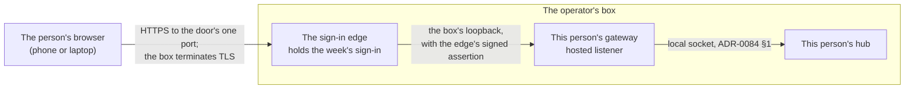

# 327. A hosted browser reaches its gateway through the sign-in edge, which signs every request it forwards, and that hop is the fifth egress boundary

- Status: Proposed
- Date: 2026-10-18
- Scope: a gateway serving the owner of a hub hosted on a box the operator runs, reached over HTTPS the box terminates itself, through our own sign-in service. Tracker: [#3138](https://github.com/leonapivato/ai-assistant/issues/3138), acceptance [#3133](https://github.com/leonapivato/ai-assistant/issues/3133), implementation [#3139](https://github.com/leonapivato/ai-assistant/issues/3139), containers [#3142](https://github.com/leonapivato/ai-assistant/issues/3142).
- Dependency: ADR-0004, ADR-0168, ADR-0172, ADR-0174, ADR-0177, ADR-0182, ADR-0296 and ADR-0298, as their status lines leave them.
- Authorization: the owner accepted the web-door proposal ([#3132](https://github.com/leonapivato/ai-assistant/pull/3132)) with three changes in the ruling of 2026-10-18 on #879 ([the ruling](https://github.com/leonapivato/ai-assistant/issues/879#issuecomment-6252766646)): the token's issuer is our own sign-in service; the privacy property the boundary then gave up, behind a third party's tunnel, is named; and the page's bootstrap form becomes an automatic exchange. A second ruling the same day ([on #3138](https://github.com/leonapivato/ai-assistant/issues/3138#issuecomment-6254607509)) put no third party's network in the path: the door is our own HTTPS, terminated on the box, with one port open for it. So §4 states the property as kept, and names exactly where it differs. The dispatcher assigned 0327 for Hosted setup B1. This decision is that proposal, converted and revised by the second ruling.
- **Not a contract-surface decision.** It changes no `core/protocols.py` or `core/types.py` surface and no wire member. It adds `Settings` fields (§5, §6), a listener and its admission rule, and supersedes clauses of six ADRs in part (§15).

## Context

### The question

How does a person whose hub is hosted on the operator's box open their hub's page, from any
browser, signed in, with nothing to install?

The #879 ruling of 2026-10-18 lets hubs be hosted for other people, one hub per person, on a
box the owner operates. Each person reaches their hub through one shared Telegram bot and the
web, and "the web is signed in through our own sign-in service, with Google or an emailed
code, and a sign-in lasts a week. The operator holds no access to anyone else's account."
Telegram gives a person a line but no page. The page is where a person sees what their
assistant believes and corrects it, which is the thesis the hosted setup exists to test.

### Why today's doors do not serve a hosted person

A gateway has two browser listeners today. The loopback listener (ADR-0168 §2:1) serves
browsers on the gateway's own machine. The remote browser listener (ADR-0174) serves a
browser on another device of the owner's overlay: the device's overlay identity, the owner
listing it at the gateway, and a web session minted by exchanging a bootstrap value the owner
mints at the gateway's machine (ADR-0182 §1:1). A session ends after an idle hour, after twelve
hours, or when the gateway restarts (ADR-0168 §4).

Neither serves a hosted person. They are not on the box, and they are not on the operator's
overlay. Installing Tailscale and joining it is the friction the hosted setup is meant to
remove, and a bootstrap value is minted at the box, where only the operator stands. So each
person would ask the operator for a code most days, and the operator would hold a door into
their hub.

### The path a request takes

The owner's rulings put two things in front of the gateway, both on the box. **The door** is
our own HTTPS: the box terminates TLS for the door's public hostname, it opens one port to the
internet for the door, and its firewall closes every other. The hostname's DNS is held at any
registrar. **The sign-in edge**, behind the door, is our own sign-in service, a separate program
kept in a private repository. It holds the person's sign-in for a week, with Google or an
emailed code through a vendor. It routes each signed-in account to that person's gateway, and
on every request it forwards it attaches a short-lived assertion it signs. The gateway verifies the assertion with
the edge's public key, configured at setup. What terminates TLS in front of the edge, and how
it obtains its certificate, are the edge's business.

So the browser never holds the assertion: it holds the edge's sign-in, and the edge adds the
assertion on the box. The gateway fetches no key and takes no one's word. It checks every
request itself, because any process on the box can reach a loopback port and set a header,
and none can forge the edge's signature without the edge's private key.

### What the corpus says that this has to move

- **ADR-0174 §1:1** enumerates where user data may leave a device: `models/`, the `tools/`
  seam, the hub's remote transport, and the gateway's remote browser transport over the
  owner's overlay. "Every other egress is a bug." A page served across the public network to a
  browser, through the edge, is none of the four.
- **ADR-0168 §2:2** and **ADR-0174 §2:6.** Reaching a gateway's listener from another device
  "by an operator-configured proxy, a port forward, a tunnel, or any other means" is
  authorised by no clause, and a tunnel in front of the loopback listener is not the fourth
  boundary. The edge, forwarding from the public network, is exactly such a proxy. It needs a
  boundary of its own, in front of a listener of its own.
- **ADR-0124 §2:1**, which ADR-0174 §2:1 adopts whole for the fourth boundary: the payload is
  "encrypted end to end between the two participating devices, such that no third party —
  including the overlay's operator and any relay it routes through — holds a key that
  decrypts it". Only the box terminates the door's TLS, so no third party holds such a key.
  But the two ends are the browser's device and the box, with the edge and the gateway both on
  the box, and the box's key is vouched for by the public certificate system rather than by an
  overlay the owner administers. §4 states the property in that form.
- **ADR-0168 §5:3** and **ADR-0182 §1.** A session is minted only by exchanging a bootstrap
  value, minted at the gateway's machine. On the hosted listener the assertion takes the
  value's place.
- **ADR-0168 §4:6** and **ADR-0182 §4:2.** A mint at `gateway_max_sessions` is refused, and
  "nothing is evicted". Behind an automatic exchange, every new browser and every gateway
  restart mints. A person with a few browsers would be locked out of their own page.
- **ADR-0296 §1:1** and **§1:7.** A browser device is a machine, "admitted by a gateway by
  the overlay identity it obtains". The hosted listener has no machine identity to obtain,
  only an account.
- **ADR-0172 §1:1.** The web-session credential class is "exactly three kinds of value, and
  it is closed". Its exemptions rest on replacement (d) of ADR-0172 §2:4: every value in it
  is "minted by this system" and "ceases to admit anything no later than the end of the
  gateway process". The edge's assertion is minted by the edge, and a valid one outlives a
  gateway restart, so it cannot join the class without breaking the condition the class's
  exemptions rest on (§9).
- **ADR-0177 §3:4.** Credential entry is refused off a loopback origin. That stays (§12).
- **ADR-0323 §2:6.** "The line shares no transcript with the hub chat." That stays (§13).

### Containers are coming

#3142 puts each person's hub and gateway in one container, its port published only to the
host's loopback. A port published that way is forwarded to an address of the container's own
network interface, not to the container's loopback, so a listener the container binds on its
own loopback is not reached by it. A rule that the hosted listener binds loopback, as the
proposal had it, holds on the box and fails in the container. §5 states the rule as what may
reach the listener rather than as an address family. How the container is built is #3142's.

### Options considered

- **Cloudflare Tunnel as the transport.** The converted draft's. The box would open no port,
  and Cloudflare's network would absorb floods and hide the box's address. But Cloudflare
  terminates TLS for the hostname, so it would hold a key that decrypts every page, every
  message and both halves of every web session crossing the door, and could act as a person for
  as long as a sign-in lasts. The draft named that cost. Rejected by the owner's ruling of
  2026-10-18 on #3138, for that cost.
- **Cloudflare Access as the issuer.** The proposal's design, ruled for the pilot on
  2026-10-17 and replaced on 2026-10-18. It bought the sign-in rather than building it, and
  it put the gateway on Cloudflare's rotating, published keys. Our own edge keeps the gateway's
  check the same while the sign-in becomes the launch's own, and its key is configured rather
  than fetched (§6).
- **Tailscale for each person.** No new boundary. But each person installs an app and joins
  a network, and the bootstrap value would still be minted at the box. Rejected on friction,
  and because the operator would hold every person's door.
- **The edge checks the sign-in, and the gateway trusts a header.** Simpler in the gateway,
  and any process on the box could set that header on the loopback port. Rejected.
- **The gateway fetches the edge's keys.** A key endpoint the gateway calls would be a
  connection off the gateway that ADR-0168 §10:2's "fetches nothing at runtime" and ADR-0191's
  injected capability would both have to answer. A key configured at setup needs neither.
  Rotation is an operator act at the gateway, which is cheap behind the automatic exchange (§11).
- **One browser device per browser profile, through a long-lived cookie.** Closer to
  ADR-0296 §1:7, but every new browser would cost a setup act by the operator. Later, if the
  pilot shows it matters.
- **The assertion as a fourth member of ADR-0172's class.** Rejected, because it fails the
  condition that class's exemptions rest on (§9).

## Decision

We will give a gateway a third browser listener, the **hosted listener**. The sign-in edge
reaches it from the box's own loopback. It admits a request on two facts: the edge's signed
assertion that this hub's owner is signed in, and a live web session. It mints that session from
the assertion with nothing typed. All of the owner's browsers are one browser device. The hop is
the fifth egress boundary. It keeps end-to-end encryption between the browser's device and the
box, which alone terminates TLS, and §4 names where that differs from the fourth boundary's.

### 1. Status and delivery

> **Normative.** This document remains `Proposed` until the reviews `CONTRIBUTING.md` →
> "Finishing an ADR PR" requires have returned green on one tree and the owner's authorization
> to ratify stands. An assigned number or a green review alone does not change its status.

> **Normative.** The gateway's hosted listener, its assertion check, its exchange, the hosted
> browser device and the page's automatic exchange are built by their own lane after this
> decision merges `Accepted`, as #3139 tracks, and by no lane before.

### 2. Terms

> **Normative.** The **edge** is the sign-in service that holds a person's sign-in, routes each
> signed-in account to that person's gateway, and signs the assertion §6 rules. It is a program
> outside this repository. This decision binds what a gateway accepts from it, and what the
> boundary requires of the traffic it carries (§4:1, §4:5, §4:7, §4:8), never how it is built.

> **Normative.** The **door** is the edge's public HTTPS endpoint: the hostname a hosted
> owner's browser opens, the one port the box exposes to the public network for it, and the TLS
> the box terminates there. Nothing in this decision is conditioned on the program that
> terminates TLS, on the certificate authority or on the registrar: changing any of them
> reopens no clause, provided §4's statements stay true of the door.

> **Normative.** A **hosted listener** is the gateway listener §5 binds, which the edge alone
> forwards requests to. A **hosted owner** is the owner of a hub whose gateway runs one.

> **Normative.** An **assertion** is a value the edge signs and attaches to one request it
> forwards, stating which account is signed in and for which hub (§6).

### 3. The fifth egress boundary

ADR-0174 §1:1's enumeration gains one member. Its text, with the addition, reads:

> **Normative.** User data may leave the device only from `models/`, from the designated
> integration seam inside `tools/`, across the hub's **remote transport** between the hub and a
> device the owner has enrolled under ADR-0124 §6, across the gateway's **remote browser
> transport** between a gateway and a browser on another device of the owner's overlay — its
> two halves being the gateway's remote browser listener and the front-end bundle this
> repository serves to that browser — or across the gateway's **hosted browser transport**
> between a gateway's hosted listener and its hosted owner's browser, carried through the door
> by the edge — its two halves being the hosted listener and the front-end bundle this
> repository serves to that browser; every other egress is a bug.

> **Normative.** The four boundaries ADR-0174 §1:1 named are unchanged by this decision, and
> no lane may cite it toward designating anything, registering an integration, or any clause
> of ADR-0155, ADR-0124 §2 or ADR-0174 §2.

> **Normative.** ADR-0174 §2:6 stands and is reinforced: a proxy, port forward, tunnel or
> "serve" feature in front of the **loopback** listener, or in front of the remote browser
> listener, is not this boundary. The edge alone reaches the hosted listener, and nothing the
> door exposes reaches any other listener of this system.

> **Normative.** The gateway opens no connection for the hosted browser transport. It fetches
> no key, no configuration and no asset, and the edge's keys reach it only as configuration
> (§6). The transport is therefore outside ADR-0191's injected capability, for the structural
> reason ADR-0191 §5:3 gives for the third and fourth boundaries: its listener half accepts
> connections and its bundle half opens none from the gateway.

> **Normative.** The gateway never dials a browser or the edge on this boundary. ADR-0174 §10:1
> binds the hosted listener as it binds the remote one.

### 4. The door keeps the property, between the browser's device and the box

> **Normative.** The hosted browser transport has ADR-0124 §2:1's second property, which
> ADR-0174 §2:1 adopts for the fourth boundary, in this form: what crosses the public network is
> encrypted under TLS between the hosted owner's browser and the box, and only the box
> terminates it. The door's TLS private key is held on the box alone. No registrar, certificate
> authority, network or relay between the browser and the box holds a key that decrypts it.

> **Normative.** The property differs from ADR-0124 §2:1's in two respects, and no lane may cite
> this boundary for more than the clause above states. Its ends are the browser's device and the
> box, not the browser and the gateway: TLS ends at the edge, and a request crosses the box in
> the clear to the hosted listener, where whoever holds the box can read it, as they can read the
> hub's store. And the box's key is vouched for to the browser by the public certificate system,
> not by an overlay the owner administers: whoever can have a publicly trusted certificate issued
> for the door's hostname, by controlling its DNS or through an authority that misissues one,
> can stand between the browser and the box.

> **Normative.** The hosted browser transport does not have ADR-0124 §2:1's third property: the
> edge's accounts are administered by the operator, at the person's request (#879's terms), and
> not by the hosted owner.

> **Normative.** The gateway checks each request's assertion itself before serving anything
> (§7), so that ADR-0124 §2:1's first property is kept in the gateway's own form: no request is
> served that the edge has not authenticated.

> **Normative.** Nothing of a hosted hub crosses the public network on this boundary except
> inside the door's TLS: no page, no request, no response and no value of ADR-0172 §1:1's class.

> **Normative.** For the door, the box exposes one port to the public network, the HTTPS port
> 443, and the box's firewall closes every other port to the public network. No gateway's or
> hub's listener is reachable from it. How the edge obtains its certificate is the edge's
> business, within that posture.

> **Normative.** The edge alters no response body the gateway serves, the front-end bundle
> included, so that ADR-0174 §1:1's "the front-end bundle this repository serves" stays true at
> the browser.

> **Normative.** The edge caches no response the gateway serves on the hosted listener, so that
> every request reaches the gateway and is admitted there (§7).

> **Normative.** The gateway serves every response on the hosted listener with
> `Cache-Control: no-store, no-transform`, as the standard's own request against caching and
> transformation. This is a request to the edge and to the browser, not the guarantee; §4:7 and
> §4:8 are the guarantee.

The door's costs are the box's exposure, and they are concrete. The box takes connections from
the internet directly, so the edge, and whatever terminates TLS in front of it, can be reached by
anyone, and a flaw in either is a flaw at every hosted door. An edge taken over signs assertions
for every hub (§6). Hardening it is the edge's, outside this repository (§14:3). The gateway's own
check refuses everything the edge did not sign (§6, §7). Nothing shields the door from a flood: one
aimed at it can take every hosted door down, and with them the box's other work. The gateway's
own figures bound what reaches a gateway (§5:8), and no clause here bounds the edge. And the box's
address is public, named by the door's DNS record, so whatever the box exposes is found. That is
why the box's posture is a clause (§4:6), and the other two costs are stated here and not ruled.
They fit the pilot's terms: storage on the box is plain, the operator reads diagnostics, and trust
is by relationship (#879). Against them, no third party's network holds a key to what a hosted
owner sees and types.

### 5. The hosted listener binds where only the box reaches it

> **Normative.** The hosted listener is **off unless it is configured on**, by
> `gateway_hosted_address`. Unset, which is the default, means off, so the field is nullable
> because it is the switch, for the reason ADR-0174 §8:12 gives of `gateway_remote_address`. A
> gateway with it off is exactly the gateway ADR-0168 and ADR-0174 describe.

> **Normative.** The hosted listener may be reached from the box's own loopback and from
> nothing else: no other machine, no overlay and no public network reaches it by any route.

> **Normative.** `gateway_hosted_address` is refused at settings load unless it is a literal
> loopback address or a literal private-use address (IPv4 RFC 1918, IPv6 unique-local). A
> wildcard, a multicast address, a link-local address, an address in the shared space
> `100.64.0.0/10` that overlays use, and any globally reachable address are refused.

> **Normative.** On a gateway that shares the box's network namespace, the hosted address is a
> loopback address. A private-use address is configured only for a gateway running in a network
> namespace of its own, a container among them, whose hosted port is published to the host's
> loopback address and to nothing else. Setting up that publication is the setup's obligation,
> and #3142's lane holds it.

> **Normative.** The hosted listener binds `gateway_hosted_port`, a valid non-privileged TCP
> port whose default is 8423. It is refused at settings load when the hosted listener is on and
> the port equals `gateway_port`: the loopback listener and a loopback hosted listener share an
> address, so one figure cannot serve both.

> **Normative.** The hosted listener speaks plain HTTP to the edge, on the box. This decision
> authorises no certificate and no key material for it, and ADR-0202 is untouched.

> **Normative.** A gateway with the hosted listener on still binds ADR-0168 §2's loopback
> listener, under every clause of ADR-0168 §2 this decision does not supersede, and binds the
> remote browser listener exactly when ADR-0174 configures it on.

> **Normative.** Every figure ADR-0174 §8:1 names is the gateway's total across all its
> listeners. A connection on the hosted listener counts against the same figure, and a session
> minted through it counts against the same ceiling. ADR-0168 §8's figures bind a connection and
> a request on the hosted listener as they bind one on the loopback listener.

> **Normative.** A stream on the hosted listener carries a keep-alive more often than the idle
> timeout of every hop between the gateway and the browser, the edge's among them. The
> implementing lane states the cadence it relies on and the edge's timeout it assumes.

### 6. What the gateway accepts as the edge's assertion

> **Normative.** The assertion is a JSON Web Token in compact JWS form, carried in exactly one
> `Edge-Assertion` request header. A request carrying none, or more than one, carries no
> assertion.

> **Normative.** The gateway verifies the signature as Ed25519 (`alg` `EdDSA`) and as nothing
> else. A token naming any other algorithm, `none` included, is refused, and the gateway never
> takes the algorithm to apply from the token.

> **Normative.** The gateway verifies the signature only against the public keys configured in
> `gateway_edge_public_keys`, and the assertion verifies when one of them verifies it. The
> gateway never takes a key, or where to find one, from the token: a `jwk`, `jku`, `x5u`, `x5c`
> or `kid` member decides nothing.

> **Normative.** `gateway_edge_public_keys` is a set of Ed25519 public keys written at the
> gateway by the operator at setup. A public key is Tier 2 configuration. The edge's private key
> is the edge's and never reaches a gateway.

> **Normative.** Rotating the edge's key is an act at the gateway: the operator adds the new
> public key, restarts the gateway, and removes the old key once the edge no longer signs with
> it. No request on any listener may add to, remove from or replace the set.

> **Normative.** The assertion is accepted only when its `iss` claim equals
> `gateway_edge_issuer`, compared literally.

> **Normative.** The assertion is accepted only when its `aud` claim is a single string equal to
> `gateway_edge_audience`, compared literally. An `aud` that is a list is refused, so one
> assertion never admits to two hubs.

> **Normative.** The assertion is accepted only when its `sub` claim equals
> `gateway_edge_subject`, compared literally. That setting holds one account and never a list.

> **Normative.** `gateway_edge_subject` is the edge's opaque, stable identifier for the hosted
> owner's account, not an email address or any other contact detail.

> **Normative.** The assertion is accepted only when it carries `iat` and `exp`, `iat` is not
> after the gateway's present time, `exp` is after it, any `nbf` it carries is not after it, and
> `exp` is no more than `gateway_edge_assertion_max_age` after `iat`. No leeway is applied: the
> edge and the gateway read one clock, on one box.

> **Normative.** `gateway_edge_assertion_max_age` is refused at settings load unless it is
> strictly positive and no greater than five minutes. Its default is sixty seconds.

> **Normative.** A configuration with the hosted listener on is refused at settings load while
> any of `gateway_edge_issuer`, `gateway_edge_audience`, `gateway_edge_subject`,
> `gateway_hosted_host_name` and `gateway_hosted_device` is unset, or while
> `gateway_edge_public_keys` is empty.

> **Normative.** A configuration with the hosted listener off is refused at settings load while
> any of those five is set, or while `gateway_edge_public_keys` is non-empty. Each is something
> the operator wrote about a listener, so a configuration carrying one while the listener is off
> is one no reading makes true, and none is ignored silently (ADR-0174 §8:6's reason).

> **Normative.** A gateway that cannot verify an assertion, for any reason, refuses the request.
> No failure of the check admits anything.

An assertion is replayable for its lifetime by whoever sees it. On this path that is the edge
and any process on the box that can read loopback traffic, which is the operator, who can read
the hub's store in any case. §6's short lifetime bounds it, and binding an assertion to one
request is the edge's to add later without any change here.

### 7. Admission on two facts

> **Normative.** On the hosted listener the gateway checks the assertion (§6) first, before
> ADR-0168 §7's `Host` and `Origin` checks and before any session is read. A request failing it
> is refused without the session being consulted, and its refusal discloses nothing about
> whether a session exists.

> **Normative.** On the hosted listener the gateway refuses any request whose `Host` header is
> not `gateway_hosted_host_name`, compared literally. The gateway resolves nothing: the name is
> admitted as a `Host` value and never used as a destination.

> **Normative.** On the hosted listener the gateway refuses any request carrying an `Origin`
> that is not `https://` followed by `gateway_hosted_host_name`, and sends no cross-origin
> resource sharing header and honours no preflight, exactly as ADR-0168 §7:2 requires.

> **Normative.** On the hosted listener exactly two kinds of request are served without a live
> session, once the checks above pass: the front end's own static assets, and the exchange of §8.
> They are ADR-0168 §3:1's two pre-session exceptions, the exchange standing in the bootstrap
> exchange's place, and they gain no third.

> **Normative.** On the hosted listener every other request is admitted only when both facts
> hold: it carries a valid assertion, and it carries a live web session under ADR-0168 §4 and
> §6. Neither fact admits a request on its own.

> **Normative.** A request refused on the hosted listener on its assertion (§6), its `Host`
> (§7:2) or its `Origin` (§7:3) is refused with one refusal, the same whichever of those checks
> it failed. It carries no assistant content, no fact about the hub's state, no fact about
> whether the hub is reachable, nothing about whether a session exists, and nothing about which
> of those checks failed.

> **Normative.** A request that passes those checks and is refused on its session is refused
> exactly as ADR-0168 §3:2 and §6:4 rule, and this decision supersedes neither: a request with
> no live session is refused as an absent session, and one whose header half verifies against a
> live session while its cookie half does not, or that carries more than one cookie of the
> gateway's own name, is refused with ADR-0168 §6:4's distinct fault. Neither is §7:6's refusal,
> so the page tells the three apart (§11:2, §11:5, §11:6).

> **Normative.** The gateway records a refusal on any of §6's conditions as an admission
> decision, under ADR-0168 §6's record clause, beside the conditions of ADR-0168 §3 to §7 it
> already records. The condition names which check failed: no assertion, a malformed one, its
> signature, its issuer, its audience, its subject, or its times.

> **Normative.** Every record about the hosted listener carries only the Tier 2 facts
> ADR-0168 §6:11 enumerates, and nothing ADR-0168 §6:12 excludes. In particular no record
> carries an assertion, any part or claim of one, or the subject.

> **Normative.** ADR-0168 §6:10's four request classes bind the hosted listener, with the
> exchange in the bootstrap exchange's class. They gain no fifth.

### 8. The exchange takes the bootstrap value's place

> **Normative.** On the hosted listener a session is minted by the **exchange**: a `POST` to the
> exchange path carrying a valid assertion, an `Origin` that §7 admits, and nothing else.
> A request to it with a body, or with no `Origin`, is refused.

> **Normative.** The exchange is the only request by which a session is minted on the hosted
> listener. It returns nothing but the two session values ADR-0168 §6 requires, and a failed
> exchange discloses only that it failed, exactly as ADR-0168 §5:3 requires of the bootstrap
> exchange.

> **Normative.** The hosted listener serves no bootstrap exchange. A bootstrap value is
> exchangeable on the loopback listener and on the remote browser listener, under ADR-0168 §5,
> ADR-0174 and ADR-0182, and on no other.

> **Normative.** ADR-0182 §1:10 binds the hosted listener: no request on it mints a bootstrap
> value.

> **Normative.** On the hosted listener the cookie half is set with the `Secure` attribute, and
> its name carries the `__Host-` prefix, besides every attribute ADR-0168 §6:2 requires.

> **Normative.** An exchange on the hosted listener that would take the live session count past
> `gateway_max_sessions` ends the oldest live session minted through the hosted listener, then
> mints. Where no live session was minted through it, the exchange is refused as ADR-0182 §4:2
> rules. No session minted through another listener is ever ended by it.

> **Normative.** The mint record of an exchange that ended a session says so in its outcome.
> That outcome is a value of the outcome fact ADR-0168 §6:11 already enumerates, and no new
> kind of fact is added.

Sessions on the hosted listener stay as ADR-0168 §4 rules them: process memory, the same
lifetimes, gone when the gateway restarts. Behind the exchange that stops mattering to the
person. When a session ends, the page exchanges again (§11), and nobody types anything. A
person signs in again when their sign-in at the edge ends, not when the gateway restarts.

### 9. The assertion is Tier 0, outside the web-session class, with its own exemption

> **Normative.** An assertion is a bearer credential and Tier 0 under ADR-0004 §1, as the
> session halves and the bootstrap value are (ADR-0168 §6:7).

> **Normative.** The gateway holds an assertion only while it checks the request that carried
> it. It writes none to any database this system opens, to any file, to any log record, to any
> audit record, or into any error or diagnostic. It places none in a response, passes none to
> the promoted engine surface, and sends none in any frame to the hub.

> **Normative.** An assertion is **not** in ADR-0172 §1:1's web-session credential class, and
> no lane may cite ADR-0172 toward it. It is minted by the edge, not by this system, and a valid
> one admits after a gateway restart, so it fails ADR-0172 §2:4's replacement (d). The class
> stays closed at three kinds.

> **Normative.** ADR-0004 §3's keyring clause has no subject here and is not superseded: this
> system stores no assertion anywhere, and the browser never holds one. Nothing in this
> decision authorises storing one anywhere.

> **Normative.** ADR-0004 §6's purge clause has no subject here and is not superseded: there is
> no assertion at rest on this system's side to purge.

> **Normative.** ADR-0004 §7's gating clause is superseded **only** as it reaches a gateway's
> verification of an assertion on the hosted listener's admission path, and for nothing else.
> `permissions/` sits behind the hub connection that the admission decides, so it cannot gate
> this read.

> **Normative.** Three replacements stand in that exemption's place, and an implementation that
> omits any of them does not have it. The assertion is read for admission alone, on one path
> (§9:2). Its custody is the operating system's: the box's loopback between the edge and the
> gateway, and the gateway's process memory for the length of one check. And the admission is
> recorded: every mint and every refusal, an assertion's refusal included (§7).

> **Normative.** No record is written for an assertion that verified. The exemption's third
> replacement reaches an admission and not a use, and its emission and not its retention, as
> ADR-0172 §3:4 and §3:5 state of that exemption's own.

> **Normative.** The session halves minted on the hosted listener are members of ADR-0172 §1:1's
> class, unchanged, and keep its exemptions only on ADR-0172 §6:1's conditions, which this
> decision keeps. ADR-0168 §4's storage clauses bind them untouched. ADR-0168 §6's record clause
> binds them with nothing taken away: every mint and every refusal it names is still recorded,
> each record carries only the Tier 2 facts ADR-0168 §6:11 enumerates, and §7 adds refusals to
> what is recorded and no fact to what a record may carry.

### 10. One browser device per hosted owner

> **Normative.** Every browser a gateway's hosted listener admits is one **hosted browser
> device**, named by `gateway_hosted_device`. A hosted browser device is the hosted owner's
> browsers through the door, and not a machine.

> **Normative.** The gateway names the hosted browser device in ADR-0298 §1:1's `acting_for` on
> every request it relays from the hosted listener. It relays no request from the hosted
> listener without it, so no such request acts with the gateway's own device's roles
> (ADR-0298 §8:1).

> **Normative.** `gateway_hosted_device` is held to ADR-0298 §1:3's invariant, checked as
> ADR-0174 §8:7 splits the check for an overlay identity. It is never `hub` and never the hub's
> own overlay identity (ADR-0298 §3:3).

> **Normative.** The name the setup configures in `gateway_hosted_device` is held by no other
> device the hub knows. The setup lists the hub's devices with `ai-assistant-device` before
> choosing it, so that the hosted owner's browsers never take on another device's roles.

> **Normative.** The hosted browser device registers at the hub by ADR-0298 §4:2, on the first
> request that names it, and its id is that name.

> **Normative.** The hosted browser device's roles are given at the hub with
> `ai-assistant-device` (ADR-0298 §4:14), as a setup act performed only at the person's
> request. Until then it can do nothing (ADR-0296 §2:6).

The cost: the hub cannot tell the person's phone from their laptop, so a conversation's devices
name "the web" rather than a machine. That is acceptable for the pilot.

### 11. The page exchanges by itself

> **Normative.** On the hosted listener the page shows no bootstrap entry. It mints its session
> by §8's exchange, with nothing typed.

> **Normative.** The page makes the exchange of its own motion on two events only: when it loads
> holding no header half, and when the gateway refuses the header half it holds as no live
> session. It makes at most one exchange for each such event.

> **Normative.** After a failed exchange the page makes no further one until the owner acts, a
> reload included. A page may not turn the exchange into a retry loop.

> **Normative.** The page re-issues no request a refusal interrupted. ADR-0182 §7:5's rule that
> each operation is re-issued only on an act by the owner binds the hosted page.

> **Normative.** On the hosted listener a refusal that ADR-0168 §6:4 reports as its own fault is
> shown as that fault, and the page makes no exchange for it.

> **Normative.** On the hosted listener a refusal of §7:6 is shown as the door refusing the
> request, with the statement that signing in again happens at the sign-in page, and the page
> makes no exchange for it. An exchange is checked first by the same checks (§7:1), so the next
> attempt is the owner's to make.

> **Normative.** The hosted page states, without requiring an interaction to reveal it, that it
> stays signed in for as long as the person's sign-in lasts, and that signing in again happens
> at the sign-in page.

> **Normative.** The page on the loopback listener and on the remote browser listener keeps the
> bootstrap entry exactly as ADR-0182 §6 rules.

### 12. What stays refused

> **Normative.** On the hosted listener `connect_account` and `reprovision_account` are not
> admitted. A request for either is refused on a condition of its own, naming that credential
> entry is available on a loopback origin only, and the refusal is decided from the listener
> the request arrived on, as ADR-0177 §3:4 and §3:5 rule for the remote browser listener.

> **Normative.** On the hosted listener `disconnect_account`, `connected_accounts` and
> `recent_connection_acts` are admitted as they are on the remote browser listener
> (ADR-0177 §3:4).

> **Normative.** This decision authorises no browser capability on the hosted page that the
> page does not use on the loopback listener. A lane that wants a secure-context capability
> there, microphone capture among them, stops and owes a ratified decision, as ADR-0174 §7:2
> has a lane do for the remote listener. Whatever such a capability carries is user data of a
> kind this boundary has not been weighed for.

> **Normative.** This decision authorises no durable session and no durable credential of this
> system's. ADR-0182 §5:5 binds the hosted listener unchanged. The week-long sign-in is the
> edge's, outside this system, and no lane moves it into the gateway.

ADR-0177's refusal rested on the remote listener's page not being a potentially trustworthy
origin. The hosted page is HTTPS and is one. The refusal stays for a different reason: a
credential typed there would leave the person's own device for the box and pass the edge in the
clear on the box, and ADR-0177 rules a credential's entry from a loopback origin only. Lifting it
on the hosted listener is a decision of its own, for when a hosted person connects an account that
takes a credential.

### 13. Who the door admits

> **Normative.** A hub hosted for a person configures that person's account at the edge as its
> `gateway_edge_subject`, and no other account. The operator's account is the subject of the
> operator's own hub alone.

> **Normative.** The operator's own hub may run a hosted listener, so that the operator signs in
> through the door as every hosted owner does. That changes nothing about its remote browser
> listener, the hub's remote listener, or the operator's devices on the overlay.

The door gives the operator nothing in anyone else's hub. It is not a mechanism that keeps the
operator out. The operator holds the box, so a hub's local socket and its gateway's loopback
listener stay within the operator's reach, as the store does. What keeps the operator from acting
as a person there is #879's terms: "The operator never performs an act that carries the person's
authority". #3133's scenario "The operator cannot open anyone else's page or act as them" is met
for the door by §6 and §13, and for the box by those terms.

The page shows the hub's own conversations, and not the Telegram chat. ADR-0323 §2:6 stands. The
assistant's memory connects the two: what someone tells it on Telegram shows up in what it
believes on the web. The note to each person explains that in a sentence.

### 14. What this decides no part of

> **Normative.** This decision decides no `core/protocols.py` and no `core/types.py` surface. A
> lane implementing it that finds it needs either stops and owes its own contract ADR, merged
> first (golden rule 5, ADR-0015 §5).

> **Normative.** It changes no member of the connect exchange, no frame's encoding and no
> method's arguments or results, so no lane implementing it changes `PROTOCOL_VERSION` for it
> (ADR-0124 §9).

> **Normative.** It decides nothing about the edge's internals: its sign-in vendor, how it
> holds a sign-in, how it routes, whether each person has a hostname of their own, how it
> obtains its certificate, or how it keeps the private key it signs assertions with. A lane that
> finds a clause here needs one of those to be a particular way stops and raises it on #3138.

> **Normative.** It decides nothing about how #3142's container is built beyond §5's rule on
> what may reach the hosted listener.

### 15. Relationship to earlier decisions

ADR-0082 §1 has this text apply ADR-0070 §1's test: would a reader holding only the earlier
text now act differently? Where they would, the clause is superseded in part and recorded on that
ADR's status line and in a dated header note, atomically with this decision. Each replacement
takes effect when this decision is ratified.

> **Normative.** This decision supersedes, in part and only in the scopes listed below, clauses
> of ADR-0004, ADR-0168, ADR-0174, ADR-0182, ADR-0296 and ADR-0298, and no clause of any other
> ADR.

**Superseded in part, each only as it reaches the hosted listener, its hosted browser device,
or the page it serves:**

- **ADR-0004 §7's gating clause**, only for a gateway's verification of an assertion (§9).
- **ADR-0168 §2:1**, the loopback-only bind, as it reaches a hosted address that is private-use
  (§5). **§2:2**, the one-device clause, as it reaches the hosted listener (§3). **§3:1**, the
  pre-session exceptions: the exchange takes the bootstrap exchange's place, and both are served
  only on an assertion (§7). **§4:1**'s sole-admitter clause: the assertion is the second fact
  (§7). **§4:6**'s refusal rather than eviction (§8). **§5:3**'s only-mint clause (§8).
  **§6:9**'s list of the sections a recorded refusal is decided on, which gains §6's conditions
  (§7). **§7:1**'s loopback-name `Host` check (§7).
- **ADR-0174 §1:1**, the enumeration, which gains the fifth boundary (§3). **§2:3**'s "binds
  only ADR-0168 §2's loopback listener", as it reaches a gateway with the hosted listener on
  (§5).
- **ADR-0182 §4:1** and **§4:2**, the refusal at the ceiling with nothing evicted (§8). **§6:3**,
  the page's three stated conditions, and **§6:4**, the bootstrap entry shown as re-entry, as
  they reach the hosted page (§11). **§7:5**'s first sentence, that the page re-issues no other
  request of its own motion, only as it reaches §11's exchange. The rest of §7:5 binds (§11).
- **ADR-0296 §1:1**, a browser device admitted by its overlay identity. **§1:3**, registration
  by listing a machine. **§1:7**, a device is the machine. **§5:4**, admission by the overlay
  identity or loopback (§10, §7). ADR-0298 records §1:3 as the owner's ruling. The owner's
  acceptance of one browser device per hosted owner, in the review of the proposal this decision
  converts, is the authority for superseding it here, and only here.
- **ADR-0298 §2:9**'s list of the ids a peer writing a message names, which gains the hosted
  browser device's configured name (§10).

**Engaged, examined, and not superseded:**

- **ADR-0124 §2:1** and **ADR-0174 §2:1** govern the hub's remote listener and the remote
  browser listener, and both stay true of them. §4 states the form in which the fifth boundary
  has their second property and that it does not have their third, and supersedes neither.
- **ADR-0174 §2:6** and **ADR-0168 §2:2**'s prohibition on a tunnel in front of the loopback
  listener stand (§3:3).
- **ADR-0174 §5:2** reaches the fourth boundary only. On the fifth, the session halves cross the
  public network only inside the door's TLS (§4:5), and are in the clear only on the box, between
  the edge and the gateway (§4:2).
- **ADR-0172.** Its class stays closed at three (§9:3), its exemptions keep their condition for
  the session halves (§9:9), and the assertion's exemption is this decision's own, argued here,
  as ADR-0172 §3:8 requires of a further Tier 0 access `permissions/` cannot gate.
- **ADR-0182 §1:10** binds the hosted listener whole (§8:4, §7:4, §7:10). **§5:5** binds unchanged
  (§12:4).
- **ADR-0168 §6:13**'s rule that a mint record is not rate-bounded binds the hosted listener. Only
  a request the edge signed for the owner can drive a mint, and §11:2–§11:3 bound how often the
  page makes one.
- **ADR-0168 §10:2**, the gateway fetches nothing at runtime: kept by §3:4.
- **ADR-0177 §3** is applied to the hosted listener by §12, unchanged.
- **ADR-0298 §1:5**, **§4:2** and **§8:1** are used as given (§10).
- **ADR-0323 §2:6** stands (§13).
- **ADR-0094 §9.** The gateway gains no edge state. It holds the same session table, and which
  listener minted a session is one more bounded fact about each row. The week's sign-in is the
  edge's state, held outside this system.

## Consequences

- **A hosted person opens their page from any browser, signed in, with nothing to install.** A
  gateway restart, an expired session or a new browser costs them nothing. They sign in again
  when the edge's week runs out.
- **The part the gateway builds is the part the launch keeps.** At launch the edge changes;
  the gateway's check (§6) does not.
- **No third party reads the web door.** Only the box terminates its TLS (§4:1). What the
  property is not is stated as well (§4:2): its ends are the browser's device and the box, and
  the box can read what crosses it, as it can read the store. The note to each person says so.
- **The box is exposed.** It takes connections from the internet on the door's one port, has
  no shield against a flood, and its address is public (§4). The box's posture is a clause
  (§4:6); the edge's hardening is the edge's.
- **The edge's signing key is now the door to every hosted hub.** One key signs for all of them,
  and the audience separates them. A leaked key admits to any hub until the operator rotates it
  at each gateway (§6:5). Its custody is the edge's, outside this decision, and the edge now
  faces the internet directly (§4).
- **The operator's reach is unchanged, and the door adds none.** The operator holds the box, so
  #879's terms, and not a mechanism, keep the operator from acting as a person there (§13).
- **The hub cannot tell a person's browsers apart** (§10). A conversation's devices name the web.
- **An open stream outlives a sign-out** until it ends: the assertion is checked when the request
  arrives. Every later request is refused once the edge stops signing.
- **Follow-on work.** #3139 builds §§5–12 in `interfaces/gateway/` and `core/config.py`. #3142
  holds §5:4 for the container. The edge holds §4:1's key custody, §4:5 and §4:7–§4:8. The
  operator's setup holds §4:6, §10:4 and §13:1. A wiki
  section on how a browser is admitted to a gateway is a later edit.
- **Revisit** if a hosted person connects an account that takes a credential (§12), if the pilot
  shows one device per person costs too much (§10), or if the box's exposure costs more than the
  pilot can carry (§4). Each is a new ADR, not an edit of this one.
