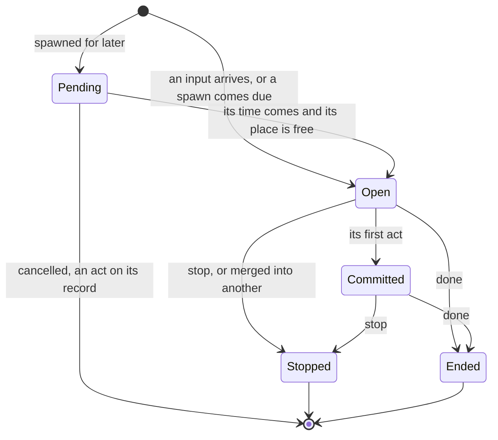

# Three operations between activations: spawn, stop and share

**The question.** Activations run side by side. What can one of them do to another, and is
there a small set of operations that covers every case, so that joining, takeover,
reminders, background work and whatever comes next are built from the same few pieces
instead of each being a mechanism of its own?

This is a proposal for the owner's design walk. It starts from the owner's direction of
2026-10-21:

> *"What if there was some basic operations that can be done in parallel activations, such
> as merging, because merging is essentially what takeover and joining is, except one goes
> into the newer, one goes into older activation. So there's merging. There's potentially
> forking … And then maybe a split … Or do these operations merge, fork, split, cover,
> essentially anything that could happen?"*

The conversation that followed agreed the shape below. Merge is a share and a stop done as
one step, joining and takeover are just merges, start is a normal activation, and the
primitives are **spawn, stop and share**. This file writes that down, tests it against every
situation we could find, and names what it would change. An independent read of an earlier
draft tried to break it; what it found about the operations themselves is folded in.

**What it assumes.** Outside content, disclosure (who may see what) and authority
(approvals) are other designs, and this proposal assumes they work, as the owner directed
on 2026-10-21. It says only that whatever crosses between activations carries its author,
its authority and its outside-content marks with it. What those mean is decided there.

**It is the simple version.** The owner, the same day: *"For now, do a simple design that
works. Don't worry much about who and what and privacy. That stuff will be addressed
later."* So who may use these operations on whose activations, by person or by device, is
left for later. For now the operations reach only what is already wired: what ADR-0332 §4
shows understanding, and the places ADR-0340 already speaks into.

## Baseline

**Wiki, read at revision `84f20c8`** (direction where not ratified):
[Concurrent activations](https://github.com/leonapivato/ai-assistant/wiki/Concurrent-activations),
[Controller](https://github.com/leonapivato/ai-assistant/wiki/Controller),
[Activations](https://github.com/leonapivato/ai-assistant/wiki/Activations),
[Internal sensors](https://github.com/leonapivato/ai-assistant/wiki/Internal-sensors).
The Concurrent activations page already says *"taking over and merging are one
mechanism: the older activation is stopped, and the newer sees its progress."* This
proposal takes that sentence as its seed.

**ADRs it reads, as they stand on `main`:**

- ADR-0280 §3 (the controller's working set; rules never read text).
- ADR-0292 §5 (an input's author and authority), §7 (output, and proactivity needing
  nothing of its own), §11 (activations side by side; merging and taking over as one
  mechanism), §12:5–§12:6 (a command is a structured act; the same operation asked for in
  words is input like any other).
- ADR-0295 (a stop: a command naming one activation, and what it guarantees) and ADR-0297
  (the stop mark).
- ADR-0306 §5 (acting's claims and records) and ADR-0321 §4 (an approval is used only by
  the activation the yes was given in).
- ADR-0332 §2–§4 (one at a time within a place, joining until the first act, the
  cross-place takeover), §8 (the line's `/stop`) and §9, which leaves open *"whether a typed
  'scratch that' can halt an activation that has committed"* (#2515) and background work.
- ADR-0343 (a join is taken pending its readers' marking).

**And one draft:** ADR-0340 (#3271, Proposed, held for the owner's question 2), which makes a
reminder a record in the plan store that the clock turns into an ordinary activation when
it comes due, and a finished background task's report the same kind of record.

## The idea in brief

Three operations act between activations:

- **Spawn.** An activation sets up a new one, to start now or later, carrying part of its
  work. The spawn is a record, written as the spawning activation's effect.
- **Stop.** An activation stops: it takes no further step, writes nothing new into its
  place, and keeps what it already finished. This is ADR-0295's stop, unchanged.
- **Share.** A copy of what one running activation has reaches another, as input that
  informs and never authorizes. The one it came from carries on untouched.

One composition gets a name of its own, because it must be done as one step:

- **Merge** is a share and a stop together. The giver's input is copied into the receiver
  and the giver is stopped, with nothing able to happen in between. Joining (newer into
  older) and takeover (older into newer) are both merges and need no other names.

Everything after an activation has acted goes through **records**, not through an
operation. The next activation reads what the last one did: its episode, its stories, its
effects and any pending spawns. That is how a correction after a reply works today, and it
stays that way.

Start is not an operation. An input arriving, whether a message, a clock push or a task's
next turn, begins an activation the same way every time.

## Where an activation can be, and what applies there

The line that shapes every rule is **the first act**: ADR-0332 §3's *committed*. Before it,
an activation's work is only thinking, and it can be thrown away or redone. After it, the
activation has done something in the world or in the hub's records that cannot be copied,
combined or taken back.

| Operation on activation A | Pending (spawned, not started) | Open (running, not yet acted) | Committed (running, has acted) | Ended or stopped |
| --- | --- | --- | --- | --- |
| **Stop A** | Not a stop: cancelling is an act on its record | Yes | Yes; what is in flight finishes and is recorded | Nothing changes (ADR-0295 §1:6) |
| **Share from A** | Nothing to share | Yes | Yes | Not a share: the next activation reads A's records |
| **Merge A with another** | No | Yes, where the other has not acted either | No, because A has acted | No |
| **A spawns** | — | Yes, and spawning is itself A's first act | Yes | — |

## 1. Stop

**The meaning stays ADR-0295's.** A stop is graceful. Nothing new starts, an effect already
sent finishes and its outcome is recorded, nothing acquired is orphaned, nothing new is
written into the place, and the place's current state shows what finished. A stop abandons
no goal and undoes nothing (ADR-0295 §2–§4), so "go on" after a stop is how the person takes
it back.

**What causes a stop.** There are three routes. Two are built, and one is new:

1. **The command** (built). The stop control beside *working…*, the line's `/stop`, and
   the command line. It is set by code at once, works in the middle of acting, needs no
   model call to be obeyed, and nothing read or written can fake it (ADR-0295 §1,
   ADR-0332 §8).
2. **A merge** (built). The giver of a merge is stopped (ADR-0295 §5, ADR-0332 §4).
3. **A cancel across places** (new). The person on Telegram says "never mind the booking"
   while the activation the web started has already acted. Today the takeover is *not
   taken* and *"nothing is stopped"* (ADR-0332 §4:8), so the older one goes on. With this
   route, the web one is stopped under every guarantee above, and the person hears what
   finished and what didn't. This is the case ADR-0332 §9 left to #2515. The owner,
   2026-10-21: *"Yes, you should be able to cancel across devices. Maybe this has some sort
   of permission depending on devices. For now, we can disregard it."*

**How the cancel across places is decided.** It is a takeover's sibling, and decided the
same way. ADR-0292 §11:2 already has the shape: *"Understanding judges how a new activation
relates to one running, and a rule acts on the judgment."*

- Understanding is already shown the person's running work on their other places, under
  ADR-0332 §4's limits. Its reply may name one shown activation that this input
  **cancels**, in a closed field beside `continues`.
- A rule then stops it, in one step, after checking that it is still running. The controller
  reads no text (ADR-0280 §3:4): the judgment is understanding's and the act is a rule's.
- Its targets are activations started by the person's own requests. A task is stopped
  through its record (§4). A reminder that is being said is stopped by the stop control, so
  a misread "never mind" can't end it for good (ADR-0340 §3:6).
- Where "never mind" could mean either of two running activations, understanding names
  neither, and the reply asks which.

**What it costs.** A stop is the conservative direction: a misread one can never cause an
act. It can still leave multi-step work half done, such as half the invitations sent. That
is already true of the stop control. The place's current state shows what finished, and
durability across a stop during an act is #2584's.

**Where it does not reach.** On the same place, a typed "never mind" after the running
activation has acted still waits behind it, because a place runs one activation at a time
(ADR-0332 §2:3). The control is the way there, which is why it exists (ADR-0295 §1:5's
note). Before the running activation has acted, a typed "wait, not that" joins it, and
understanding reads it (ADR-0332 §3).

**Stopping what has not started.** A pending spawn is a record waiting for its time, so
"cancel the bins reminder" is an act on that record (ADR-0340 §4's cancel), not a stop.

## 2. Share

**What it is.** A copy of what activation A has so far reaches activation B as input that
informs. A is not touched, slowed or told.

**The case it serves.** The person asks on the web for flights to Denver. That activation
is searching and has already acted. The person then asks on Telegram, "what's the cheapest
so far?" Today the Telegram activation is shown only the web activation's input and that it
has committed (ADR-0332 §4), so it can only say the search is still running. With a share,
it answers from what the search has found, and the search carries on.

**How it would work, as the pick:**

- **Pull only, to start.** B's understanding is shown A's running work under ADR-0332 §4. It
  may name A as one it draws on, in a closed field beside `continues` and `cancels`. A rule
  then copies A's findings into B's working set, and B's planning is shown them labelled as
  A's.
- **What is copied:** what A has found so far, in the form A's planning was shown it. Drafts
  and approvals are never copied.
- **What it carries:** no authority, because a copy informs. Each piece keeps its marks, so
  outside content stays outside content in B.
- **Who it reaches:** whatever understanding is already shown under ADR-0332 §4. Who may
  share with whom is decided later.
- **The record:** B's episode records the share, naming A and the moment it was taken, so
  the viewer and the observer can see why B knew what it knew.

**Why pull and not push.** For A to push to B, A would have to judge, while busy with its
own work, that B would benefit, and no case has needed that yet. A pull lands before B
acts, because B's understanding runs before B acts. So the question of a share arriving
after B's first act does not come up yet.

## 3. Merge

**A merge is a share and a stop done as one step.** The giver's input is copied into the
receiver, and the giver is stopped. The receiver re-reads everything from understanding,
with the authority each input carries.

**Why it isn't a fourth primitive.** It can look as if a merge *moves* an input with its
authority, while a share copies without authority, so merge would be "move and stop". But a
move is exactly a copy and the original's removal. Stopping the giver
in the same step is the removal: once it is stopped, the copy is the only live one, so it
can keep the authority. A share on its own can't, because the original is still live and
one yes would count twice. The atomic stop is what turns a share into a move.

**It must be one step.** If it were a share and then a stop, the giver could act in
between, and the same message would be acted on twice. ADR-0332 §4 already does the check,
the stop mark and the copy *"in one step with no await between"*.

**When it is allowed:** neither side has acted, neither is stopped, both inputs have the same
author, authority and origin, no earlier input on the place is waiting, and the join limit
is not reached (ADR-0332 §3:3, §4:6, §6:5). Who decides depends on the case:

- **Joining** is a merge decided by code when the input arrives: a new input on a place
  whose running activation has not acted. The newer input never starts an activation of
  its own, so "stopping" it means it never starts. Its record names the place it came from
  (ADR-0332 §3).
- **Takeover** is a merge decided by understanding's `continues`, across places: the older
  activation is stopped, and its input moves into the newer one. Its record names the
  activation it came from (ADR-0332 §3–§4).

Nothing in how either behaves changes. This proposal only names them.

**Not the stories' merge.** A story merge (ADR-0289) joins two stored matters. An
activation merge joins two running pieces of work. They share a word and nothing else.

## 4. Spawn

**What it is.** Activation A sets up a new activation, to start now or later, carrying part
of its work. The spawn is written as a record in the plan store and claimed as A's effect
in one step, as ADR-0340 §4:3 does for a reminder. Because it is a record, it survives a
restart, can be listed, and can be changed or cancelled by the person.

**What a spawn holds:**

| Part | What it is |
| --- | --- |
| **For whom** | The person A is for (ADR-0338 §2:2). |
| **Where** | The place it will speak into: the place it was set from, the line where the person named it, or, for a background task, a place of its own on an internal channel. |
| **When** | Now; an instant; or a rule such as every weekday at 8. A condition, such as "when I get home", is a watch and comes later (#2585). |
| **What it carries** | A reminder's text; or a task's statement, its stories, its budget and what counts as done. |
| **Its state** | For a reminder, each occurrence's state (ADR-0340 §4:2). For a task: running, paused until a time, stopped, or ended, plus each slice's state. |
| **Author and marks** | Its author is whoever set it, written when they set it (ADR-0292 §5's table). A report's author is the assistant (ADR-0340 §10:3). It carries its setter's outside-content mark (ADR-0340 §2:6). |
| **Authority** | None, and no approval the setter held carries over (ADR-0321 §4:1). ADR-0292 §5:6 says this of reminders; this proposal extends it to every spawn. |

**How it starts.** When it comes due, a sensor in the hub pushes it, and that starts an
ordinary activation. For time, that sensor is ADR-0340 §6's clock. A spawn speaking into a
person's place counts as that place's activation, so it waits while another runs there and
reads its record again before it starts (ADR-0340 §3:4–§3:5).

**Spawning is an act, so it commits the spawner.** Writing the record is a write to the
hub's own records, which ADR-0332 §3 counts as a first act. So "remind me at 8" followed a
moment later by "make it 9" is one input if the second arrives during the short wait. If it
arrives after the reminder is set, it waits, and the next activation changes the record.

**A background task is one record, worked in slices.** The earlier draft had each slice
spawn the next. The independent read showed three ways that breaks, none of them about
anything outside these operations:

- a slice stopped before it spawned its successor would end the task silently, with no
  report;
- a restart after a slice spawned its successor, but before the slice ended, would rerun
  the slice and fork the chain in two;
- "pause until tomorrow" would have no record to move.

So a task is one spawn record, the way a recurring reminder is, and its slices are its
occurrences:

- The sensor pushes the next slice from the task record, numbered in sequence. It marks the
  slice *pushed*, naming its activation, as ADR-0340 §6:5 does an occurrence. At start it
  settles every pushed slice from its effect records, and never pushes a number twice.
- A slice spawns nothing. It appends what it found to the task's story and records whether
  the task is done, needs the person, or should go on.
- Each slice reads the task record when it starts, so "actually, up to $2.5k" said after
  the task started is an act on the record, and the next slice works from it.
- Stop, pause and resume are each one atomic write to the task record, and a stop also
  stops the slice running, if any. A cancel can't race a slice's spawn, because no slice
  spawns.
- The report is set by rule when the task leaves *running*, however it leaves, which
  ADR-0340 §10:2 already asks for. A slice that was stopped can claim nothing, so the
  report can't be the last slice's job, as ADR-0340 §10:1 has it. This includes a stop by
  the person: the stopping reply confirms the stop, and the report says what was found.
  That is one rule with no exception.

**Who may spawn what.** The rule that keeps spawns from multiplying:

| Activation | May spawn |
| --- | --- |
| One whose input carries the person's authority | A reminder; a background task |
| A slice of a background task | Nothing. Its task record is what the sensor pushes from |
| One a reminder or a report started | Nothing (ADR-0340 §4:4) |
| An event's (ADR-0313 §4:3) | Nothing, until proactivity decides what an event may start |

**Its instances.** Spawn covers more than splitting off the research:

| Case | As a spawn |
| --- | --- |
| "Remind me at 8" | Later, into this place (ADR-0340, drafted) |
| "Remind me every weekday at 8" | A rule; each occurrence starts one activation (ADR-0340 §9) |
| "I'll look into apartments and get back to you" | A task record, now, on the task's own place; its slices are its occurrences |
| A finished task reporting back | One report, due at once, into the place that started the task (ADR-0340 §10) |

So reminders, background work and report-back are one primitive with a "when" attached,
rather than three mechanisms.

## 5. Continuing through records

After an activation has acted, nothing merges into it, and what comes next is a new
activation that reads the records. This is not a fourth operation. It is how the system
already works, and it is what keeps the three operations small:

- "Actually Sunday" after it booked Saturday: the next activation sees the booking.
  Changing it is a new request (ADR-0295 §4:2).
- "How's the search going?": recall finds the task's story, which every slice appends to,
  and the task record says whether it is running.
- Cancelling or changing a pending reminder or task: an act on its record through the plan
  store's own members, which is how every activation changes shared state (ADR-0332 §2:6).

## 6. The rules every operation keeps

1. **The first act is the line.** A merge needs both sides not to have acted. A stop applies
   on both sides of the line, and what is in flight finishes. A share copies only what has
   finished.
2. **Effects never move.** An effect belongs to the activation that claimed it. It is never
   copied, moved or merged. A merge copies inputs, not effects.
3. **Only a merged input carries authority**, because its giver is stopped in the same step.
   A share and a spawn carry none, and an approval is used only by the activation its yes
   was given in (ADR-0321 §4:1).
4. **Marks travel.** Whatever crosses between activations carries its author, its
   authority and its outside-content marks. What they mean is the other designs'.
5. **Who comes later.** For now the operations reach only what ADR-0332 §4 already shows
   understanding, and a spawn speaks only into the place it was set from or the line
   (ADR-0340 §3:1). Who may do what to whose activations, by person or by device, is
   decided later.
6. **Each operation has one trigger.**
   - A stop: a command, a merge, or understanding's `cancels`, applied by a rule.
   - A share and a merge: code when the input arrives, or understanding's closed fields,
     applied by a rule.
   - A spawn, a cancel, or a change to a pending record: a capability planning calls, which
     authorizing checks like any call.

   The controller never reads text (ADR-0280 §3:4).
7. **Every operation is recorded where it happened.**
   - A merged input names where it came from: the place for a join, the activation for a
     takeover.
   - A share names its source.
   - A spawn is its setter's effect.
   - A stop is its activation's end entry.

   The viewer and the observer can always explain why something happened.
8. **Everything is bounded.**
   - Merges, by the join limit.
   - Shares, by a limit per activation.
   - Spawns, by who may spawn what, and by a task's budget.
   - Every activation, by its deadline, its round limit and the spend ceiling.
9. **Nothing runs unseen.** A person can see their running activations in each place's
   current state, and their pending reminders and tasks by listing them.
10. **Each operation is one atomic step.**
    - A merge's check, stop and copy happen with no await between (ADR-0332 §4).
    - A spawn writes its record and claims its effect together (ADR-0340 §4:3).
    - A stop and a claim race in the store, and whichever lands first wins (ADR-0295 §2:2).

## 7. The situations

Status:
- **built** is on `main` and live;
- **drafted** is in ADR-0340, not yet ratified;
- **new** is what this proposal adds;
- **elsewhere** is another decision's.

**One person, one place**

| Situation | What happens | Status |
| --- | --- | --- |
| A burst of three messages before any reply | Merge (joining): one activation, one reply to all three | Built |
| "Actually Sunday" a second after "book Saturday", before it acts | Merge: understanding reads both, and Saturday is never booked | Built |
| "Actually Sunday" after it booked Saturday | Waits; the next activation sees the booking, and changing it is a new request | Built |
| A typed "never mind" after it has acted | Waits behind the work; the stop control or `/stop` is the way | Built |
| The stop control mid-booking | Stop: the booking in flight finishes and is recorded; nothing new is written; the state shows what finished | Built |
| "Go on" right after a stop | A new activation; the goal stood (ADR-0295 §4:1), so it picks up from the records | Built |
| An unrelated question while a long answer is still being thought out | Merge if it hasn't acted, so one reply answers both, as a person would; otherwise it waits | Built |
| "Answer the next question off the top of your head" | Not an operation: a pending mode is a record the next activation reads when it starts (the modes decision) | Elsewhere |

**One person, several places**

| Situation | What happens | Status |
| --- | --- | --- |
| Start a thought on Telegram, finish it on the web, before any reply | Merge (takeover): the Telegram activation is stopped, and its input moves to the web one | Built, not yet seen live |
| The same, but Telegram already replied | No merge; the web activation sees how far Telegram's got | Built |
| "What's the cheapest so far?" on Telegram while the web activation is mid-search | Share: Telegram answers from what the search has found, and the search goes on | New |
| "Never mind the booking" on Telegram after the web activation has acted | Cancel across places: understanding names it, and a rule stops it; the reply says what finished | New |
| "Never mind" while two activations run on other places | Understanding names neither, and the reply asks which | New |
| A misread "never mind" stopped the wrong work | "Go on" picks it up again: a stop abandons no goal | New, by ADR-0295 §4:1 |
| "Book the table" sent from two devices | Merge where neither has acted; otherwise the second sees the first's effect, and a true race is the lock and recheck's (#2586) | Built, with #2586 open |

**Background work and time**

| Situation | What happens | Status |
| --- | --- | --- |
| "What's the weather, and find me apartments under $2k" | One reply gives the weather and says it will look; the apartments are a task record | New, built by the background-work decision |
| Each step of the long task | The sensor pushes the task's slices one at a time on its own place, so the person's place is free | New, as above |
| "Actually, up to $2.5k" just after the task started | Waits, then an act on the task record; the next slice reads the new statement | New, as above |
| The task finishes, gives up, needs a yes or runs out of budget | A rule sets its one report into the place that started it, when it leaves *running* | Drafted (ADR-0340 §10), changed here |
| The task's next step needs a yes | Its report asks, and the person's yes starts an activation that makes the call itself, reading the task's story | Open (see below) |
| "How's the search going?" | Records: the task's story and its state | New, as above |
| "Stop the research" or "pause it until tomorrow" | One write to the task record, which also stops the slice running | New, as above |
| The hub restarts mid-slice | The slice closes as `hub_stopped`; at start the sensor settles each pushed slice from its effects and never pushes a number twice | New, as above |
| "Remind me at 8" | Spawn later into this place | Drafted |
| The reminder comes due while the person is mid-conversation there | It waits for the place, reads its record again, then speaks. It never merges in, because it carries no authority and a merge needs the same authority | Drafted (ADR-0340 §3:4–§3:5); see the busy-place item below |
| "Cancel the bins reminder" or "make it 9" | An act on the pending spawn's record | Drafted |
| The hub restarts mid-reminder | At start the clock settles each pushed occurrence from its effects and pushes again only what was not said, or is due a second try | Drafted (ADR-0340 §6:6, §7) |
| The hub was down at 8 | The reminder is said once, marked late | Drafted (ADR-0340 §8) |
| The person deletes the conversation | Its pending reminders are cancelled with it | Drafted (ADR-0340 §4:10); tasks are open below |
| "Remind me when I get home" | A spawn on a condition, which is a watch | Elsewhere (#2585) |

**Several people**

| Situation | What happens | Status |
| --- | --- | --- |
| Two people in one shared place | One activation at a time; only the same author's input joins | The rule is decided (ADR-0332 §2:5); shared places themselves wait for the household design |
| Your partner's activation could use what yours is finding ("are we having pasta?" while yours plans dinner) | No share across people yet; who may share with whom comes later | Later |
| A forwarded message or an email, whose author is only claimed | Never merges with the person's own activation, because its authority differs | Built |

**Races and bounds**

| Situation | What happens | Status |
| --- | --- | --- |
| Two activations try to merge with each other at once | The atomic step decides: the first wins, and the second finds its target stopped and takes nothing | Built (ADR-0332 §4) |
| A chain of merges | Bounded by the join limit | Built |
| A cancel and a takeover aimed at the same activation at once | Both set the same stop mark in one step; whichever lands second finds it stopped | New |
| A task that never finishes | Its budget, and only its record's sensor pushes slices | New |
| A yes given in one activation used by a spawned or shared one | Impossible: an approval is used only by its yes's activation | Built (ADR-0321 §4:1) |

## 8. Operations considered and not added

| Operation | Why it isn't a primitive |
| --- | --- |
| **Fork**, a running copy | It doubles the model calls, and the copy could act, so it would send two emails or make two bookings. Barred from acting, it is no longer a copy but a snapshot, which is a share. Trying two approaches and keeping the better one belongs inside a phase (two drafts and a critique), not between activations. |
| **Split** into equal parts | A person answers a two-part message in one reply and hands off only the long part. That is a spawn. Splitting into peers would give two replies to one message. |
| **Move** | A copy and the original's removal: a share and a stop in one step, which is a merge (§3). |
| **Suspend and resume** | A paused activation doesn't survive a restart and holds its place while paused. Ending, then being continued by a spawn or by the next activation, does the same job safely. |
| **Pause** | A write to the task record; the running slice is stopped. |
| **Wait for another activation** | The awaited work reports back with a spawn, and the waiting is done by records. |
| **Cancel and change** | Acts on a pending spawn's record, through the plan store's members, as every activation changes shared state. |
| **Undo** | A new request (ADR-0295 §4:2). |
| **Redirect** ("send that to my phone") | Planning chooses an output's place (ADR-0292 §7:2). It is delivery, not an operation between activations. |
| **Priority and preemption** | A long task runs in short slices on its own place, so nothing needs to be preempted. |
| **Supersede** ("never mind, do X instead") | A merge before the first act; a cancel across places after it. |

**The words** are spawn, stop and share, agreed with the owner on 2026-10-21. The owner first
suggested "kill", and took "stop" instead. "Kill" means abrupt and without cleanup, and taken
at its word it would drop the record of an act in flight, which is the unknown-outcome
problem (#2584). "Stop" also already names the mechanism: ADR-0295, ADR-0297, `/stop`, the
stop control and the record's *stopped*.

## 9. What it would change

| Part | What changes | Amends |
| --- | --- | --- |
| **The words** | Spawn, stop, share and merge become the names later decisions use; joining and takeover are restated as merges | Nothing: no behaviour changes |
| **The rules of §6** | Gathered in one place as the floors every operation keeps | Nothing new, except where the rows below name it |
| **Cancel across places** | Understanding may name a shown activation the input cancels, and a rule stops it even after it has acted | ADR-0332 §4:8 (*"nothing is stopped"* where it has committed), and ADR-0332 §4:4, which names only `continues`; ADR-0295 §1:1 and §1:4 (a stop is a command, accepted only as a device's structured act) and §1:5 (typed words are never a stop), for this route alone; it answers the item ADR-0332 §9 left to #2515, and ADR-0292 §11:2's end state |
| **Share by pull** | Understanding may name a running activation it draws on, and a rule copies what it has found | ADR-0332 §2:1 (no activation reads another's state except as §3 and §4 state) and §4:1 (what understanding is shown); ADR-0280 §3:5 (the working set gains the copy). How a copy's outside-content marks count is the outside-content design's |
| **Spawn** | Every spawn carries no authority; a task is one record whose slices are its occurrences | ADR-0292 §5:6, widened from reminders to every spawn; for ADR-0340, still a draft: §10:1, so that a rule sets the report when a task leaves *running* rather than its last slice |

**How it might convert.** My pick is one ADR that:
- names the three operations and merge;
- states the rules of §6;
- restates joining and takeover as merges;
- decides the cancel across places and the share by pull, each built later by its own lane.

ADR-0340 takes one change in its rebased round (§10:1, above). Otherwise its text need not
change: the new ADR names its reminder and report as spawn's first instances.

The alternative is a words-only ADR now, with the cancel and the share each their own
decision when a lane needs them. That is cheaper to ratify, but leaves the two behaviours
without a home for longer.

## What it leaves open

- **A reminder in a busy place, for ADR-0340.** The clock admits only when the place is
  idle (ADR-0340 §3:4), and it wakes on its own interval. Messages that waited are taken in
  the moment an activation ends (ADR-0332 §2:4), so in a busy chat a medicine reminder can
  keep losing that race. The simple rule, taken here, is that a due spawn takes its turn in
  the place's arrival order, admitted as an input of its own and never folded into the
  person's messages. ADR-0340's rebased round carries it.
- **How a task asks for a yes,** and how the yes reaches the call it proposed, is the
  background-work decision's, with the authority design.
- **Exactly what a share copies.**
- **Push shares,** where an activation offers what it found to another, wait for a case.
- **Who may do what.** Shares, merges and cancels between household members, and any
  permission by device, come later.
- **A background task's authority.** Whether a task's first yes can cover a stated set of
  later calls is the owner's authority design (the controller walk's answer 10, on #3257).
- **Spawns on a condition** (#2585), and what an event's activation may spawn, wait for
  proactivity.
- **A task whose starting conversation is deleted.** Its reminders are cancelled
  (ADR-0340 §4:10). Whether its task is cancelled too belongs to the background-work
  decision.
- **Who hears where the matter went** after a takeover or a cancel across places (#2588).
- **The numbers:** the share limit per activation, and a task's default budget (#2589).

## Where the walk stands (2026-10-21)

| Question | Answer |
| --- | --- |
| The words | Spawn, stop and share, with merge as share plus stop (the owner). |
| Cancel across places | Yes; permission by device comes later (the owner). Decided by understanding and applied by a rule, as takeover is. |
| Share | The simple version: pull only, reaching what understanding is already shown (the owner's *"simple design that works"*). |
| A background task | One record whose slices are its occurrences, with one report however it ends, a stop by the person included. It is the simple rule that removes the wrong-moment failures. |
| A reminder in a busy place | It takes its turn in the place's arrival order. That is the simple rule. Weaving it into a running reply would make whether it was said depend on how that reply was worded. |
| Conversion | One ADR, as §9's pick, unless the owner says otherwise. |

**Still open:** the ADR's number, which is assigned at conversion, and anything the owner
finds missing or wrong in the situations above.
