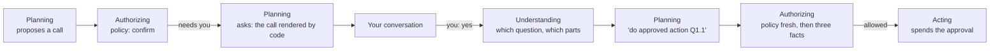

# Authority: your yes, for the cutover

**The question.** When authorizing says a call needs you, how does the assistant ask, how does
your answer become permission, and how is the call checked and run? What is the smallest version
of this the cutover can wait for, and where does authority go after it?

## The baseline

The wiki at [84f20c8](https://github.com/leonapivato/ai-assistant/wiki) has the direction for this
milestone on
[Authorizing](https://github.com/leonapivato/ai-assistant/wiki/Authorizing) (owner, 2026-09-27 and
2026-10-05). Related pages are
[Permission and approval](https://github.com/leonapivato/ai-assistant/wiki/Permission-and-approval),
[Permission decision](https://github.com/leonapivato/ai-assistant/wiki/Permission-decision),
[Confirmation](https://github.com/leonapivato/ai-assistant/wiki/Confirmation),
[Outside-content lineage](https://github.com/leonapivato/ai-assistant/wiki/Outside-content-lineage),
[Planning](https://github.com/leonapivato/ai-assistant/wiki/Planning) and
[Stories](https://github.com/leonapivato/ai-assistant/wiki/Stories).

**Built at `12d492a3`.** The phases' thin path is built behind its test-hub opt-in: ADR-0306 to
ADR-0309, as ADR-0312 corrects them.
- **Authorizing checks every call by rule** (ADR-0306 §4): the policy, then the outside-content
  stand-in, then, for the message, its place.
- **"Confirm" means *needs you*.** It parks nothing, and planning answers it plainly: it cannot be
  done yet (ADR-0307 §9).
- **The old answer path retires at the cutover** (ADR-0309 §5): parks and `resume`, goal
  authorizations, quotes, stated bounds, charges, the deferred memory questions, and the
  `authorizations` and `revoke-authorization` commands with their gateway panels.
- **The cutover deploy waits for this milestone** (ADR-0309 §6).

**What this design reuses:**
- the policy, `ThresholdActionPolicy`;
- the recorded, read-back decision (ADR-0021, ADR-0037 §2–§3);
- the exact-call match, `PermissionDecision.authorises`;
- what an egress question must show (ADR-0148 §8), and the binder's `rebind`;
- the rule that an authorisation is spent by its act (ADR-0192);
- acting's effect records and duplicate backstop (ADR-0306 §5);
- `MemoryPolicy` with its `UserConfirmation`, which loses its producer when ADR-0078's questions
  retire.

Every ruling below is the owner's, from the walk of 2026-10-12.

## 0. The frame

**Think like a human assistant.** A human assistant has three sources of permission:
1. what the boss asked for, including a yes to something the assistant proposed;
2. a standing mandate that grows with trust;
3. nothing else. Other people never give permission.

Every detail that matters is either **settled** by the boss (said now, "the usual", the boss's own
past choices and preferences) or **left open** by the boss within bounds ("somewhere nice", "under
$100"). Anything else, the assistant asks about.

**Where the assistant differs from a human:** where a human relies on an instinct the AI lacks, the
AI gets a rule instead.
- Text it reads can steer it, so outside content never grants permission, and that is a rule, not
  judgment.
- It can confidently invent a detail, so a detail counts as yours only where it can be traced to
  you.
- It cannot recognize you, so only the channel's proof of who you are counts.
- It never promotes itself. A one-time yes never becomes a habit.
- It works at machine speed, so one approval allows one act.

Where it can do better than a human is a perfect record and predictable rules.

**Permission is not care.** Authority answers *am I allowed to do this?*. Whether the assistant got
it right ("fifty, right?", "Luigi's okay?") is care, and care is planning's judgment. Planning may
always check with you before it acts, even when it is allowed to act. This is the wiki's existing
rule that judgment can take authority away but never add it.

## 1. Staging

| | At the cutover | After the cutover |
| --- | --- | --- |
| **How you authorize** | A yes to a question that showed the exact calls | Also a direct instruction, with details settled or left open by you (§9) |
| **What is matched** | The call against the call the question showed, value for value | The call against your words, your past choices and your preferences, each value traced to you |
| **Standing mandates** | None, beyond the search and forecast providers you configured | Given explicitly, never grown by the assistant |

The cutover needs only the first column. A yes needs no translation from words to values. The
question is rendered from the call's own values, you see them, and the yes approves exactly that
call. The cost is that, until §9 lands, every action the policy wants confirmed asks once, even when
you named every detail. At the cutover the only capabilities that act in the world are the simulated
booking on the test hub and sending email, if it is carried onto the new path, so the cost is small.

## 2. Asking

1. **When it asks.** When authorizing returns *needs you*, planning's next round asks. This replaces
   "it cannot be done yet".
2. **What it shows.** Code renders each action from the call's actual values, and planning writes
   the message around that. The rendered part is what you approve.
   - The question shows **every value the call carries**, except the values the hub fills in
     itself. Those are also left out of the comparison in §4.
   - For a call that leaves the hub, this includes at least what ADR-0148 §8 requires: the
     account's identity, the destinations in both forms, and the payload.
   - A booking shows the place, time, party size and price. A remember shows the statement.
3. **Several at once.** One question may show several actions, numbered, so "just the first" is easy
   to read.
4. **What is kept.** The round records the exact calls its question asks about, bindings included,
   beside its message. ADR-0307's round has no place for this, so this design adds one.
5. **No buttons.** Questions are ordinary messages (ADR-0307 §3). By voice, the same text is read
   aloud.

## 3. The answer

1. **An answer is an activation like any other.** There is no special answer command. Understanding
   reads whether the input answers a question, which question, and which parts.
2. **Who can answer.** Only input that carries your authority (ADR-0292 §5): at the cutover, a
   message you sent through the hub chat. An email that says "yes, go ahead" approves nothing,
   however it is read.
3. **Which question.** Understanding is shown your unanswered questions, from this conversation and
   from the stories it links to. The story bounds what it looks at, not a clock.
   - A reply to the question's message is a strong hint.
   - When it is unclear which question a yes answers, the assistant asks "yes to which?" and never
     guesses.
   - Whether a question was changed, superseded, has gone stale, or was already dealt with is
     understanding's reading of the story.
4. **What a reply can be.**
   - **Yes** approves every part shown. **A partial yes** approves only those parts.
   - **No** approves nothing. A later "actually, yes" still works. Planning does not ask again about
     something you refused in the same task; that is its own care.
   - **A change** ("make it 8", "only up to $100") approves nothing. Planning asks again with the new
     values.
   - **Unclear** approves nothing, and the assistant asks again.
   - **A yes with a condition** ("if it's still sunny Saturday") counts as a change at the cutover,
     because there are no timers to act later and no checking of conditions yet.
5. **A mixed message** ("yes, and also email Bob") has its yes recorded, and the rest is handled as a
   normal request.
6. **What understanding records** is a pointer: *yes to question Q, parts N*. It cannot create an
   approval for anything you were not shown. The worst a misreading can do is approve the wrong one
   of the questions you were actually shown, and that is why an unclear answer gets "which?".

## 4. After a yes: how the call is checked and run

1. **Your yes's activation runs it.** Planning is shown each approved action under a label and
   proposes "do approved action Q1.1". Code fills in the exact values and reuses the original
   binding (ADR-0307 §5's labels). Planning cannot make a copying mistake, and the binding is not
   worked out again.
2. **Step 1: the policy, fresh.**
   - A deny refuses, and nothing overrides it, not even your yes or the spend ceiling (ADR-0194).
   - An allow runs.
   - A confirm goes to step 2.
3. **Step 2: three facts, checked by rule against the story's records.**

   | Fact | Read from | What it stops |
   | --- | --- | --- |
   | **Shown to you.** The question's message reached one of your conversations, as its effect record shows (ADR-0306 §5). | The message's effect record | Understanding pointing at something you never saw |
   | **Exactly the call shown.** The same tool, every value the same apart from those the hub fills in, and the same binding. | The call against the call recorded with the question | Anything changing the call after you saw it |
   | **Not already run.** That part of that question has not been spent. | The record of what has run | One yes running twice, including two quick yeses |

   Whether you meant it, whether the question still applies, and what has happened since are
   readings, and they belong to understanding (§3). What actually ran is a fact. A model reading
   the story could be wrong about it, or be misled: an email saying "your booking didn't go through"
   could make it book twice. The record cannot be misled.
4. **The outcome.**
   - **All three hold:** the call is allowed. It is recorded as allowed by your yes to Q at its time,
     and read back before anything runs (ADR-0037 §2–§3).
   - **Any fact fails:** the call needs you again, and planning asks a fresh question.
   - **A deny stays not done**, and nothing is asked.
5. **Spending is tied to the question's part,** not to the activation or the decision. Two yeses to
   the same part cannot both run.
6. **A yes overrides every confirm, never a deny.** That includes the outside-content stand-in's
   confirm, because the values were shown to you.
7. **If the world changed** (the slot is gone, the price differs), the call runs as approved, and a
   failure or a different charge is reported. Anything else becomes a new question. Nothing is
   substituted.
8. **"Why did you do that?"** is answered from the decision: your words, the question, and when.

## 5. Memory asks

1. **A remember that `MemoryPolicy` asks about needs you.** Planning asks with the exact statement:
   "Should I remember: 'Your dentist is Dr. Lee on 5th St'?"
2. **Your yes writes exactly that statement as something you stated,** citing the question and your
   yes. This is the owner's 2026-09-01 rule: you assent to text you were shown, never to an
   interpretation. The yes also becomes `UserConfirmation`'s producer again.
3. **Other answers.** No means it is not remembered. A change brings a new question with the
   corrected statement. If you never answer, the question stays answerable.
   - That unanswered question *is* the hold the learning design wanted: nothing is written before
     your yes, and nothing is lost while you have not answered.
   - This resolves the three-way difference between the learning pass, ADR-0306 §4:3 and the built
     code.
4. **A conflict found only at write time**
   ([#2845](https://github.com/leonapivato/ai-assistant/issues/2845)) becomes *needs you*, not
   *not done*. The question shows both statements: "Remember 'Your dentist is Dr. Li', replacing
   'Dr. Lee'?" A yes writes the new statement and retires the old one.
5. **What is asked about** stays the built `MemoryPolicy` until learning revisits it. Learning
   decides what to ask; authority decides how. Every remember after the activation has read outside
   content asks, because the built policy says so.

## 6. Retrying after an unknown outcome

A retry is an action like any other
([#2839](https://github.com/leonapivato/ai-assistant/issues/2839)). A deliberate repeat that
matches an effect whose outcome is unknown, or not yet written, needs you instead of being refused.
A yes to an ordinary question showing the call lets it run. Saying "this might book twice" is
planning's care, not an authority rule. Nothing is ever retried without your yes.

## 7. What retires and what stays

- **Whose input counts:** only input the channel establishes as yours, sent as an instruction
  (ADR-0292 §5). At the cutover that is the hub chat.
  - An author who is only claimed never authorizes, nor does a voice that is not established
    ([#2819](https://github.com/leonapivato/ai-assistant/issues/2819),
    [#2582](https://github.com/leonapivato/ai-assistant/issues/2582)).
  - The decision records the channel that established you
    ([#113](https://github.com/leonapivato/ai-assistant/issues/113)).
- **Standing grants:** none at the cutover beyond the configured search and forecast providers
  (ADR-0247, ADR-0260).
  - **Recipient grants retire** (ADR-0193, ADR-0235). After the cutover nothing creates one, and none
    can cover a phases call, because every phases binding is model-covered.
  - **Destination trust retires** (ADR-0238, ADR-0242). Its only reader is the old search
    composer, and ADR-0309 §5 does not list it.
- **Seeing what is waiting on you:** your unanswered questions, seen where they were asked.
  "What are you waiting on me for?" works because planning is given them too. No new screen; the
  retired commands and panels stay retired.
- **Tasks started by a timer or an event** cannot write a message yet (ADR-0307 §3), so a call that
  needs you there does not run, and stays in the episode. This lasts until planning can write to a
  place other than the input's, which is planned. The same question path then applies.

## 8. Changes to ratified decisions

| Decision | Change |
| --- | --- |
| ADR-0306 §4 | *Needs you* gets an answer. A yes to a question showing the call overrides any confirm, the stand-in's included, never a deny. "Nothing resumes it" stands: the answer is a new activation. |
| ADR-0306 §4:3 | Memory that `MemoryPolicy` asks about is written on your yes, as something you stated. |
| ADR-0306 §5 | A deliberate repeat that matches an unknown or unwritten effect needs you, instead of never passing. "An unknown outcome is never retried" applies to retrying on the assistant's own initiative. |
| ADR-0307 §2 | The round records the exact calls its question asks about. |
| ADR-0307 §5, §6 | Approved actions are shown to planning under labels. Planning is given your unanswered questions. |
| ADR-0307 §9 | A call that needs you is asked about, not answered "cannot be done yet". Planning's instruction gains the care line. |
| ADR-0276 | Understanding records the answer pointer. The record still grants nothing by itself. Authorizing reads the pointer only as a pointer and checks it by rule. |
| ADR-0192 | An approval from a yes is spent per question part. |
| ADR-0148 §8 | The CONFIRM's park is replaced by the question. A yes is an ordinary message, not an interface answer. What is shown stays, and is extended to every value the call carries. |
| ADR-0193, ADR-0235, ADR-0238, ADR-0242 | Retire at the cutover. |
| ADR-0309 §5 | Adds destination trust to what retires, and turns the recipient grant's rework into retirement. |

## 9. After the cutover: the instruction path

This is direction, recorded so that the cutover build does not close it off. It is not proposed for
the cutover.

- **A direct instruction approves the action it names.** Every detail that matters is settled by
  you or left open by you within bounds. Anything else is shown to you first. Capabilities declare
  which of their arguments matter: what, where, to whom, how much, when.
- **A detail is yours when it traces back to you:** your words now, a choice you made before (an
  earlier instruction or yes), or something about you that comes from you. A detail is never yours
  when it traces to outside content or to the assistant's guess. Understanding records each
  detail's source, and authorizing checks the source by rule.
- **Exact values.** A concrete value counts as yours only when that exact value traces to you. A new
  value, such as a restaurant found in a search, is shown to you once. After that it is your past
  choice, and "the usual" works. Resolving names without asking (contacts, judging which "Luigi's"
  you meant) waits until this friction shows.
- **Per-value tracing then replaces the coarse stand-in.** Outside content cannot choose who, what
  or where, because every value that matters must trace to you. The sticky marks
  ([#2798](https://github.com/leonapivato/ai-assistant/issues/2798)) and
  [#2846](https://github.com/leonapivato/ai-assistant/issues/2846) are settled there.
- **Mandates** are given by you explicitly, may let outside content choose the recipient where the
  mandate says so, and are never grown by the assistant.
- **Conditions** are checked when the action runs, by rule for values or by a cited model judgment
  that authorizing confirms. They arrive with timers.
- **Approvals used later** ("book it Friday") are found through the story. They last until spent,
  withdrawn or narrowed, never widened, and at least until a time they name.

## Options considered

- **Reading money back when you have stated it.** Rejected: money should not be an exception.
- **A stakes dial,** where high-stakes actions are always read back. Rejected: it mixes permission
  with care. Double-checking is planning's judgment.
- **Only a yes ever approves.** Kept for the cutover, but not as the destination.
- **A model judging whether "Sam" matches a number.** Rejected: it is not a rule, and it is how a
  "Sam's new number" email would get through.
- **The controller running approved actions directly, skipping planning.** Rejected: it would be a
  second path, and planning is still needed for a mixed message and for the report.
- **One unanswered question per conversation,** where a new question closes the old one. Rejected:
  it silently drops questions you had not got to.
- **Questions that open and close, with a one-day expiry.** Rejected: "answered" is covered by
  spending, and "replaced" and "stale" are readings of the story, not rules.
- **A special question for retrying after an unknown outcome.** Rejected: a retry is an ordinary
  action.
- **Keeping approvals beyond the answering activation at the cutover.** Not needed. Spending
  per part and the story carry the facts that matter, and approvals used later arrive with timers.

## What it leaves open

- **A price that comes back as a result** is not checked against what was shown. At the cutover only
  the simulated booking charges, so reporting it afterwards is enough. A real paid capability will
  need the shown price to bind the call, as a maximum argument or a fresh quote checked before
  acting, which is ADR-0267's shape.
- **The recheck after the lock** belongs to the concurrency milestone
  ([#2586](https://github.com/leonapivato/ai-assistant/issues/2586)).
- **Unattended limits** ([#2583](https://github.com/leonapivato/ai-assistant/issues/2583)) and
  volume caps arrive with timers.
- **Other channels and voice identity**
  ([#2819](https://github.com/leonapivato/ai-assistant/issues/2819)).
- **Coverage for arguments mapped from labels**
  ([#2847](https://github.com/leonapivato/ai-assistant/issues/2847)), beyond reusing an approved
  call's binding.
- **The numbers** ([#2589](https://github.com/leonapivato/ai-assistant/issues/2589)). The yes path
  as proposed needs none.

## Delivery, roughly

One ADR converts this proposal. The lanes after it are a sketch for the dispatcher:
1. **The types:**
   - the round's asked-about calls;
   - understanding's answer pointer;
   - the label kind for approved actions;
   - a `PROTOCOL_VERSION` bump.
2. **Authorizing:**
   - the three facts;
   - spending per part;
   - reusing the binding;
   - the backstop change.
3. **Planning:**
   - asking in place of "cannot be done yet";
   - being given unanswered questions and approved actions;
   - the care line.
4. **Understanding:** reading answers.
5. **Memory:**
   - the yes writing what you stated;
   - #2845.

The retirements in §7 ride the cutover's deletion lanes.
