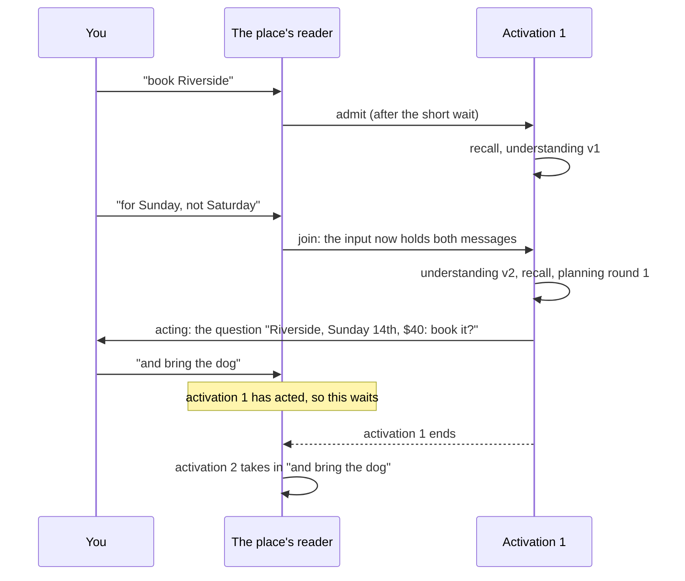

# The controller's next shape: activations side by side, joining one in flight, the short wait, modes, and background work

**The question.** How should the hub take in several inputs at once? That covers one
person on two platforms, two people, a burst of messages, a correction a second later, and
research that runs for days. And how should the work each activation does fit what it
needs, from a reflex to a long investigation?

This is a proposal for the owner's design walk. **Every pick below is the coordinator's,
unruled.** Each comes with the alternatives it beat and why. The questions for the walk
are at the end.

The owner's direction it starts from (2026-10-21, direction rather than rulings):

- *"I can text it on one platform, finish my thought on another, and have someone else
  talking to it all at the same time. While it's doing research for me."*
- Activations that connect with others already in flight: for example, reacting when the
  user is typing on Telegram.
- *"If you do a hard task it sets it to a controller that emphasises understanding and
  high effort vs something that wants a quick response."* Widened the same day: *"its not
  just effort level, but it also controls the phases, maybe there can be more or
  different phases that a dynamic controller can pass it through. So if I say something
  like, answer the next question with the first thing that comes to mind. A human sets
  the mental processing to just blert, essentially something like this for more
  scenarios."*

## The test: what a trusted human assistant would do

On 2026-10-21 the owner adopted *what a trusted human assistant or companion would do* as
the test for how Aether behaves (`VISION.md` Principle 3, in #3256, still open there and
written for how it handles people). This proposal uses the same test for the controller.

A good assistant:

- answers a quick question quickly;
- thinks hard about a hard one;
- blurts when asked to;
- double-checks before sending money or messaging someone;
- folds in "oh, and also…" without starting over;
- keeps working on the long errand while you talk about something else.

Each pick below is meant to feel like that. Where the analogy breaks, the design does
something else instead:

| A person… | The design, where it cannot do the same |
| --- | --- |
| sees you typing and waits | The hub chat's page says you are typing, and the hub waits (pick 3). A Telegram bot is told nothing, so the line waits a fixed moment and then folds in what arrives (picks 2 and 3) |
| folds in "oh, and also…" even halfway through doing it | Folding in happens only until the first act. After that the next activation picks it up and sees what was done, the way a person says "I'd already sent it, so I'll send a follow-up" (pick 2) |
| knows at a glance how hard a question is | The hub knows only after understanding has read it, so a light first pass chooses the mode and can switch it (pick 4) |
| remembers "answer the next one off the top of your head", loosely | The instruction is held as a visible pending mode that is used once and expires (pick 4) |
| double-checks out of habit and judgment | The double-check is a floor set by the call's declared effect, not by judgment, because a model can be talked out of judgment more easily than a person can (pick 4; #3256's own reason for hard rules) |
| is told about the errand when it is done | Background work marks that it has something to say, and proactivity decides when to say it (pick 5) |
| does one thing at a time in one conversation, but can be on the phone and answering a text | Activations on different places run side by side, and one place runs one at a time (pick 1) |

## Baseline

**Wiki, read at revision `84f20c8`** (direction where not ratified):
[Concurrent activations](https://github.com/leonapivato/ai-assistant/wiki/Concurrent-activations),
[Controller](https://github.com/leonapivato/ai-assistant/wiki/Controller),
[Activations](https://github.com/leonapivato/ai-assistant/wiki/Activations),
[Model calls](https://github.com/leonapivato/ai-assistant/wiki/Model-calls),
[Internal sensors](https://github.com/leonapivato/ai-assistant/wiki/Internal-sensors).
`VISION.md` Principle 8 says the assistant lives behind every interface. Two people may be
talking to it, or one person on two devices, while long-running work continues: *"Each has
its own context, and none blocks the others."* Principle 5 asks for background work that
survives restarts and reports back.

**ADRs whose clauses this would touch**:

- ADR-0280: the controller, its rules, its loop guard and its record.
- ADR-0309 §3: today's table of rules.
- ADR-0292 §6, §10 and §11: one input, one activation; the window; activations side by
  side.
- ADR-0293 §6 and §8: the hub chat's reader and its current state.
- ADR-0323 §5, §6 and §8: the Telegram line's reader, its typing indicator, and having no
  stop command.
- ADR-0295: stopping an activation.
- ADR-0276 §2: what understanding returns.
- ADR-0307 §8 and ADR-0308 §2: planning's rounds and recall's second run.
- ADR-0335: replay.

**What the code does today, at `origin/main` `e8e39388`.** Several of the brief's premises
are already partly true, so the proposal starts from these facts:

- **Activations in different places already run side by side.** Each admitted input is
  its own task (`Engine._activation_task`), with its own `ActivationState` and its own
  controller pass. Nothing serializes activations across conversations, or between the
  hub chat and the Telegram line.
- **Within one place, one activation runs at a time.** The hub chat's reader keeps one read
  per conversation (`ChatReader`, ADR-0293 §6:2–§6:3). The Telegram reader asks Telegram
  for nothing while an activation from the chat runs (ADR-0323 §5:5, §5:7). Messages that
  arrive meanwhile wait. They are taken in together, as one input, when the running
  activation ends.
- **The shared writers already serialize or detect conflicts.**
  - The observer is memory's one writer (ADR-0329), and one of its runs goes at a time.
  - The story-links stage writes under one in-process lock.
  - A story summary's write is refused as `summary_moved_on` when another write landed
    first.
  - The spend ceiling reserves inside one process (ADR-0194 §3). So in-process parallel
    acting does not reopen #1553, which is about a second process.
- **Every phase uses one model.** That is `Settings.default_model` with its fallbacks.
  Planning's thinking is on at the provider's default effort (`DEFAULT_THINKING`,
  `models/tool_calling.py`). The round limit is one composition-root constant,
  `PHASES_ROUND_LIMIT = 6`.
- **There is no spoken input today.** The spoken conversation retired at the cutover
  (ADR-0313).

**Telegram gives a bot no event when the user is typing.** I checked this against the Bot
API documentation (Bot API 10.3, 2026-08-24). None of the `Update` object's fields reports
a user's chat action or typing status. The only typing in the Bot API is the bot's own:
`sendChatAction` is for *"when you need to tell the user that something is happening on
the bot's side"*. It shows for 5 seconds or less, and it clears when the bot's message
arrives. The line uses it this way today: it renews the indicator every 4 seconds while an
activation runs (`TYPING_RENEWAL`, `orchestration/telegram.py`; ADR-0323 §6:8). Reacting to
the user typing on Telegram is therefore impossible through the line. It is possible on
the hub chat, because that page is ours (pick 3).

## The picks, in six lines

1. **Side by side.** Across places and across people, activations run concurrently, each
   with its own context. Within one place, one runs at a time. Long work leaves the place
   by becoming background work.
2. **Joining in flight.** A new input from the same author on the same place, arriving
   before the running activation has acted, joins it, and understanding reads both. Once
   it has acted, the new input starts the next activation.
3. **The short wait.** After an input on a messaging place, the hub waits a per-kind
   moment before starting. On the hub chat, our page's *composing* signal extends the wait.
   On Telegram, which gives no such signal, the wait is fixed.
4. **Modes: a phase path chosen per activation.** A mode is declared data: which phases
   run, with what model, effort, round limit and recall depth. The controller chooses it
   by rule and records the choice. It is measured by replay before anything ships.
5. **Background work.** A long task is a story, plus an in-hub sensor that starts short,
   bounded activations for it. That way it survives restarts. Speaking first belongs to
   proactivity, and the seam between them is a mark on the task.
6. **What it costs.** It changes the controller, the stores and what the user sees,
   listed in one table.

## 1. Side by side

**Pick.**

- **Each activation has its own context.** That is its own state, its own window and its
  own episode. Activations on different places, or from different people, run
  concurrently. That is today's behaviour across places, kept and made a rule.
- **Within one place, one activation runs at a time.** That is today's interim
  (ADR-0292 §11:5), kept as the rule rather than as an interim. Pick 2 changes what happens
  to an input that arrives while one runs.
- **Long work does not hold a place.** Research that takes minutes or days runs as
  background work (pick 5). It becomes an activation of its own on an internal place, so
  the place it started from is free again as soon as the starting activation has replied.
  That is what makes one-at-a-time per place acceptable. The owner's *"while it's doing
  research for me"* is a background task, not a long activation blocking the chat.
- **Shared state changes only through its existing single writers.** Memory changes only
  through the observer (ADR-0329). Stories change through their store's own operations,
  whose summary write already refuses a stale base. Effects are claimed and recorded by
  acting (ADR-0306). No new writer is added, and no activation writes another's state.
- **The same person on two places.** Activations still running for the same person are
  visible to understanding beside the window of each place, under the audience rules. That
  extends ADR-0292 §10:4 from *the place* to *the person's places*, and it is the wiki's
  direction already. That is how *"finish my thought on another platform"* works.
  Understanding on the second place sees the first activation, and judges that the new
  input completes it. If the first has not yet acted, it is stopped (ADR-0295 §5:1), and
  the second carries on with both inputs: ADR-0292 §11:2's takeover, applied across places.
  If the first has acted, the second sees what it did.
- **Different people never see each other's running work.** A household hub's members have
  their own boundaries (`VISION.md`, People and Households). Cross-place visibility is per
  person, and a takeover never crosses people. Today each person has a hub of their own
  (#879, roadmap stance 6), so across people concurrency first arises with a household hub.

**What it needs.**

- **Controller:** nothing for the concurrency itself, which is already per pass. It needs
  pick 2's rules for joining.
- **Stores:** a read of the running activations for a person across places, which is
  in-memory engine state (`Engine._running`) rather than a store. It also needs the lock
  and recheck on what is acted on (ADR-0292 §11:4, #2586) before two places' activations
  can act on the same thing. The spend ceiling needs nothing new in one process.
- **Channels:** nothing for a place's own one-at-a-time, which the readers already do. Pick
  2 changes when they take input in.

**Alternatives.**

- **ADR-0292 §11:1's end state, as ratified: every message starts its own activation at
  once, even within one place**, and understanding judges how each relates to the running
  ones. It lost for now because it buys little within one place that joining does not
  give. It also costs the most: every message pays an understanding of its relation to
  running work. It needs every owed piece first (the lock key, waiting once before an
  action, a stopped activation never writing). And for a burst it produces several
  understandings that a takeover then throws away. Kept as the direction across places,
  where it is the pick above.
- **One activation at a time per person.** It is simpler, but it breaks *"finish my thought
  on another platform"* the moment one place is busy, and it blocks the chat behind any long
  work.

**Amends:** ADR-0292 §11:1, §11:5 and §11:6 (the interim becomes the rule within a place,
and taking in changes as pick 2 says); ADR-0292 §10:4 (visible across the person's
places).

## 2. Joining in flight

**Pick.**

- **Until it has acted, a new input joins.** A new input from the same author on the
  same place that arrives before the running activation has acted joins that activation.
  The input then holds both messages, each kept with its own time (as ADR-0323 §5:4
  already keeps Telegram's).
  - *Has acted* is the one boundary used throughout this pick. It means acting has made
    its first claim: an effect record claimed for a call in the world or for the round's
    message (ADR-0306 §5:2, §5:4), or an invocation claimed for a call that leaves the hub
    (ADR-0306 §5:7). A message counts, since writing a reply or a question into the place
    is an act (ADR-0307 §3).
  - **The join is decided where the stop is decided.** A claim is written in one
    indivisible plan-store step that also decides the stop (ADR-0306 §5:4). A join is
    decided in that same step.
    - A join that lands before the first claim refuses that claim, as a stop refuses what
      is not yet claimed. The round's unclaimed calls never run, and its authorizing and
      acting decisions are set aside for the new understanding.
    - A claim that lands first closes the window, and the input waits.

    So nothing claimed is ever overtaken by a join, and a booking claimed a moment before
    "wait, not that" finishes as ADR-0306 §5:2 requires.
  - A round whose only calls claim nothing, such as reading the hub's own records, has not
    acted. A correction arriving after such a round still joins, and the results already
    read stay on the episode for the new planning to use.
  - The simpler boundary, "acting has begun at all", is the alternative (question 2).
- **What a join makes due again.** The joined input is input that no understanding covers
  yet, so `not_understood` answers again. Understanding runs over all of the input and
  records a new version (ADR-0276 §7:3 already accumulates versions). Recall runs again on
  the new version, and planning starts over from the new understanding. That is the
  wiki's own row: *"a new understanding version, searched with → planning starts over."*
  Planning rounds already run for the older version are kept in the record and not
  reused.
- **Once it has acted, the new input waits** and starts the next activation when this one
  ends, taken in with everything else waiting (ADR-0293 §6:3, ADR-0323 §5:5). The next
  activation sees in its window what the first one did, and its effects.
- **Withdrawing.**
  - *Before it has acted*, a typed "wait, not that" or "stop" joins like any message.
    Understanding reads it as withdrawing the request. Planning then writes a short
    acknowledgement or nothing (ADR-0317), and no effect ever happened.
  - *Once it has acted*, the hub chat's stop control stops the activation at once
    (ADR-0295). No further step starts, and an act already running finishes and is
    recorded. Typed text is still a message and never a stop (ADR-0295 §1:5), so it waits.
  - On Telegram, which has no stop command (ADR-0323 §8:1), a typed withdrawal after the
    activation has acted waits. Whether the line should take `/stop` as a command is
    question 3.
- **Tie to #2584.** Joining and stopping are safe only where nothing has an effect yet, and
  the boundary above is drawn there. The cases #2584 leaves open sit on the far side of it:
  - an act running when the stop lands finishes;
  - an outcome that comes back unknown is recorded as unknown, never as failed;
  - the user is told "cancelled" only once the record says so.

  This proposal leaves #2584's write-ahead question open. It adds no case where work with
  an effect is cut off.

**A burst, joined:**

**What it needs.**

- **Controller.** A new decision on the working set: the inputs joined, each with the
  understanding version that first covered it. The rules read *the latest understanding
  covers all the input*, not *understanding has run*. That is ADR-0280 §4:5's own principle
  (rules read decisions, not history), and it already holds for the other rules. The loop
  guard (ADR-0280 §4:6) lets understanding run once per joined input. Recall's
  at-most-twice (ADR-0308 §2:10) becomes once per understanding version, plus the first
  run. Both are bounded by a join limit, a number #2589 sets, after which further input
  waits.
- **Stores.** The plan store's claim step (ADR-0306 §5:4) decides a pending join as it
  decides a stop. The open episode (ADR-0286) gains each joined input as an append. The
  readers' bookkeeping marks a joined message as taken in by the running activation's id,
  as at admission (ADR-0293 §6:8, ADR-0323 §5:8).
- **Channels.** The hub chat's reader must take in a message written while an activation
  runs, which today it does only after the activation ends. The Telegram reader must poll
  while an activation runs, against ADR-0323 §5:7. Each kind declares whether it joins.

**Alternatives.**

- **Join by restart:** stop the running activation and start a fresh one over both inputs.
  It reuses the stop as it is, but it costs a second episode and an ending the user never
  asked for for one exchange. It repeats the first recall and understanding calls, and it
  needs an un-take-in of the first message. It lost on cost and on the record. The
  cross-place takeover in pick 1 is this mechanism, used only where the two inputs are on
  different places.
- **No join (today's interim):** a correction a second after "book Riverside" waits until
  the first activation has asked its question. Then the next activation corrects it, and
  you see a question for the wrong day. That is the case the owner raised.

**Amends:**

- ADR-0292 §6:10 (one input, one activation: a joined input is the activation's input
  arriving over time);
- ADR-0293 §6:2–§6:3 and ADR-0323 §5:5 and §5:7 (when input is taken in);
- ADR-0280 §4:6 for understanding;
- ADR-0308 §2:10 (how often recall runs);
- ADR-0280 §7:1's record, for the joined inputs.

## 3. The short wait, and typing

**Pick.**

- **A per-kind wait before starting.** After an input on a messaging place, the reader
  waits a short, per-kind moment before admitting an activation, and takes in whatever
  else arrived meanwhile as one input. The number is #2589's and is set by measurement.
  - The episodes already record each message's time (ADR-0323 §5:4, and the hub chat's
    transcript).
  - The gaps between consecutive messages that a reply did not separate give the burst
    distribution. The wait is a percentile of it, capped.
  - As a starting guess, to be measured rather than ruled: about 2 seconds on Telegram,
    and about 1.5 seconds on the hub chat before the composing signal is counted.
- **Why the wait matters even with joining.** A joined message costs another understanding
  and recall. A quick reply can also act within a few seconds, which closes the join
  window, and then you get an answer to half a thought. The wait catches the common burst
  for the price of a short delay. Joining catches the rest until the first act.
- **The hub chat's composing signal.** The hub chat is our own page, so it can tell the hub
  that the person is typing in a conversation.
  - The page sends *composing* while keys are pressed in that conversation's input,
    renewed every couple of seconds.
  - A pending wait is extended while the signal is live, up to a cap that #2589 sets. When
    the signal lapses, the base wait runs out and the activation starts.
  - Composing is not input. It starts nothing, joins nothing, and is never written into
    the transcript. It is the person's current state, as "working…" is the assistant's
    (ADR-0293 §8:1, ADR-0292 §11:7).
- **Telegram's wait is fixed.** The Bot API gives no typing signal (Baseline), so the line
  waits the fixed per-kind moment and relies on joining for the rest.

**What it needs.** The readers gain the wait, a per-kind number. The hub chat needs a new
device-to-hub operation, *composing in conversation X*:

- a wire operation, with the `PROTOCOL_VERSION` advance;
- a gateway route;
- a row in ADR-0298's one table that checks every request;
- the page's sender;
- a reader that holds the wait open while the signal is live.

The controller is unchanged, since the wait happens before admission.

**Alternatives.**

- **No wait, joining only.** Cheapest in latency, but it pays a second understanding for
  most bursts and answers fragments on quick replies (above).
- **A long fixed wait everywhere.** It catches every burst, but it adds the delay to every
  single message, which is most of them.
- **Composing extending a hold before the first act, not only the start.** ADR-0292 §11:4
  owes the end state a single wait before an action for inputs not yet understood, and
  composing is a hint that one is coming. Deferred to the walk (question 4), because it
  holds up work already under way on a hint.

**Amends:** ADR-0293 §6 and ADR-0323 §5 (the reader waits before taking in); ADR-0293 §8
(the current state gains the person's composing); ADR-0298's table, by one row.

## 4. Modes: a phase path chosen per activation

**Pick.**

- **A mode is declared data.** It is a named entry in a closed table the hub loads at
  start, and it holds:
  - which optional rows of the controller's table are on, so which phases run;
  - per phase, the model route, from the routes `Settings` names, and the thinking effort;
  - the round limit;
  - recall depth: whether recall runs a second time, and its cap;
  - which capabilities planning is offered.
- **The order of the phases comes from the one table** (ADR-0309 §3:1). A mode switches rows
  on and off, and does not reorder them. That is a FLAG against the brief's "in what
  order": with rules that read decisions (ADR-0280 §3–§4), order follows from what each
  phase needs. One table stays one thing to test, and a mode that reorders would be a
  second controller.
- **The model never invents a mode or a phase.** Understanding reports a value from a
  closed enum, and the rest is rules.
- **The controller chooses it by rule and records it.**
  - The working set gains a mode decision: the mode, and where it came from (an
    instruction, understanding's judgment, the situation, or the person's default).
  - The episode's record carries it beside the stage entries (ADR-0280 §6). The viewer
    shows it.
  - The rules read it: `round_limit_reached` reads the mode's limit,
    `understood_not_recalled` answers only where the mode's recall depth includes a second
    run, and a new phase's row answers only where the mode turns it on.
  - A mode that skips recall's second run still records the second-run decision, as *not
    run*: a decision that nothing came of (ADR-0280 §3:6). So `recall_undigested` still
    answers for the first run's outside memories (ADR-0308 §4:4–§4:6), and their digest
    still reaches planning. Skipping the second search never drops what the first one
    found. The phases read
    their model and effort from it.
  - The controller still calls no model and reads no text (ADR-0280 §3:4).
- **Who picks, in precedence order:**
  1. an explicit instruction ("just blurt", "take your time", "think hard"), which
     understanding reports as an instruction it found;
  2. understanding's judgment of what the request needs;
  3. the situation, which the channel kind declares (driving, spoken input, once those
     exist);
  4. the person's default style.
- **Floors no instruction lowers.** Every call that acts goes through authorizing, by rule.
  A call whose capability declares a consequential effect, such as money or a new
  recipient (ADR-0306), brings the careful mode's verification whatever was asked for.
  The stop, the limits and the deadlines bind every mode. "Just blurt" can make the
  assistant quick. It cannot make it careless, any more than a trusted assistant told to
  hurry would wire money without checking the amount.
- **Example modes** (illustrative; the first set would ship as quick, normal and deliberate,
  with the rest added as they are measured):

| Mode | Phases and settings |
| --- | --- |
| **Reflex** ("blurt") | Understanding on the quick route at low effort; no second recall; one planning round, low effort, no capabilities offered, so the round's message is its only act |
| **Quick** | Greetings, thanks, acknowledgements: as reflex, but with capabilities offered and up to two rounds |
| **Normal** | Today's path, as it runs now |
| **Deliberate** | Full understanding at high effort; second recall with a higher cap; more rounds; high effort; possibly a *critique* phase (draft → critique → revise) before the message goes out |
| **Research** | Several search and read rounds, digests in parallel, and a *synthesis* phase before the report; may hand off to background work (pick 5) |
| **Careful** | A *verification* phase before acting on a consequential call: recipients, amounts, dates read back against the request and the records. Reached as a floor, not only by choice |
| **Spoken** | Read back misheard names, numbers and times before acting on them. Waits for spoken input to return (ADR-0313 retired it) |
| **Background** | The slice a background task runs (pick 5): research's phases with a slice budget, and output only to its story |

- **New phases are allowed, each by its own ADR.** A phase is:
  - one module in `orchestration/` with the stage interface (ADR-0309 §2:2, ADR-0280
    §3:2);
  - a member of the stage enum and of the rule enum, with its row placed in the table;
  - added to the import-linter independence contract (ADR-0309 §2:3);
  - its prompt as a template (ADR-0334);
  - its entry kind in the diagnostic record (ADR-0314 §4), shown by the viewer (ADR-0316);
  - its call added to what replay can re-send (ADR-0335 §4:1);
  - its stage entry in the episode, which crosses the wire and so advances
    `PROTOCOL_VERSION`.

  Critique, synthesis and verification would each be one such ADR, measured before it
  ships.
- **The chicken-and-egg: a light first pass that can switch.** The mode is chosen in two
  steps.
  - *At admission*, from what is known before any model call: a pending mode (below), the
    situation and the person's default. This starting mode shapes recall and understanding.
    Absent everything, it is normal.
  - *After understanding*, its report can switch the mode up or down for everything after
    it, which is most of the work (planning and acting).

  Understanding already runs on every activation, so it gains two fields rather than
  another call. The alternative, *a cheap classification call before everything*, lost: it
  adds a model call and its latency to every message, exactly where quick replies need
  speed, and it reads the same text understanding reads a moment later. A deterministic
  pre-classifier, by length or by greeting words, is ruled out because rules never read
  text (ADR-0280 §3:4).
- **"Answer the *next* question…" is a standing instruction**, and it is also an activation
  connecting with another.
  - The activation that hears it records a *pending mode*. Planning calls a capability, and
    acting records it as an effect (ADR-0306), so it is durable, visible and attributable.
  - It is held per person and per place.
  - It is read at each later activation's admission by context assembly, not by the
    controller, which reads no store (ADR-0280 §3:4), and applied there *provisionally*,
    as the starting mode.
  - It is *consumed* only by an activation whose understanding finds a question it applies
    to. That activation's mode decision names it as the source, and the consumption is
    recorded as that activation's effect. An activation in between, such as "one moment",
    runs in it provisionally, finds no question, and leaves it armed.
  - It expires unconsumed after a lifetime #2589 sets (an hour, say), and it is cleared
    when the person says otherwise.
  - The place's current state shows it ("next answer: quick") so you can see it is armed.
  - **Where the question arrives in the same input**, because it came during the short
    wait or joined before the activation acted, the instruction is fulfilled there.
    Understanding reports the instruction and the question together, the mode switches
    after understanding (precedence 1), and that activation answers in it. No pending mode
    is recorded, so nothing stays armed for a later exchange. A pending mode is recorded
    only when the input that carries the instruction holds no question for it to apply to.
  - The alternative, *leaving it in the window for the next understanding to notice*, needs
    no store. It lost because the mode would arrive only after understanding, too late to
    shape understanding itself, and because the instruction's expiry would be whatever the
    window and the model made of it.
- **Measured first, before any mode ships.**
  - Replay (ADR-0335) re-sends recorded understanding and planning calls under each mode's
    model and effort, on recorded exchanges, on the owner's server, and compares cost
    (tokens and latency) and quality (the owner's reading of each reply beside the
    original, ADR-0335 §6).
  - Two limits of today's replay shape this plan:
    - Replay sends the settings the stage used (ADR-0335 §4:6). Varying effort needs that
      clause amended, which the continuous-prompt-improvement proposal (#3236, titled
      for ADR-0337) also asks for.
    - Replay continues nothing (ADR-0335 §4:10). It can measure a mode's per-call model and
      effort, but not its path: more rounds, a second recall, a new phase.
  - Path changes need either a whole-pass rerun over a copy, with reads answered from the
    record and nothing acted, or the sandbox hub with synthetic scenarios that #3236
    proposes. That is question 7.
  - Understanding's token usage is not yet on its entry (#3090), which the cost comparison
    needs.

**What it needs.** Covered in the cost table (pick 6): understanding's reply gains the
need and the instruction, the working set gains the mode decision, the rules read the mode,
a modes table is loaded at start, per-mode routes join `Settings`, and a pending-mode
capability is added.

**Alternatives.**

- **Effort alone, the brief's first form:** quick, normal or deep on one path. It is
  simpler, and it is where the first lane would start. But it cannot express reflex (no
  tools), careful (a verification phase) or research (a synthesis phase), which is what
  the owner widened it to.
- **The model picks its own path.** Planning would decide which phases follow. It lost
  because it puts control flow in a model's output (ADR-0280 §3:4, `VISION.md` Principle 7)
  and makes the record unexplainable.
- **One table per mode.** It has full freedom of order, but it gives as many controllers to
  test as there are modes, for orders nobody has needed yet.

**Amends:**

- ADR-0276 §2:1's field sets (the need and the instruction), in the additions alone;
- ADR-0280 §3:5 (the working set gains the mode decision) and §6 and §7:1 (the record
  carries it);
- ADR-0307 §8 and ADR-0308 §2:9 (the round limit and the second recall read the mode);
- ADR-0335 §4:6 (replay under a stated effort).

## 5. Background work, and the seam to proactivity

**Pick.**

- **A background task is a story with a schedule, worked in short activations.**
  - Planning starts one through a capability: the task's statement, its story, a budget
    (time, calls and spend) and what counts as done. Acting records it as an effect, and
    the starting activation replies "I'll look into it" and ends, freeing the place.
  - An in-hub sensor then pushes a *continue* input for the task on an internal channel.
    The wiki's internal sensors, and ADR-0292 §7's *"proactivity needs nothing of its
    own"*.
  - Each push starts an ordinary activation in the background mode. It reads the story's
    page and notes, does one bounded slice of work, appends what it found, and either asks
    for the next slice or marks the task done.
- **It survives restarts by construction.** Each slice is short, and the durable state is
  the task's effect record and its story.
  - A slice a restart cuts off closes as `hub_stopped` (ADR-0286 §7:2). The sensor pushes
    again after start.
  - The task is the place on its internal channel, so pick 1's one-at-a-time-per-place
    gives one slice at a time per task for free.
- **It authorizes nothing new.** A slice's input is the hub's own push, which informs and
  never authorizes (ADR-0292 §5). A slice may do what the starting request was approved
  for. Anything else becomes a question to the person, and asking first is speaking first.
- **The seam.** A slice never writes into a person's place.
  - It ends by writing to its story and setting the task's mark: *has something to say*,
    with how urgent it is and whether it is a question.
  - Proactivity reads the mark and decides whether, when and where it is said (`VISION.md`
    Principle 5; ADR-0292 §7:2, which ADR-0306 narrows to the input's place until that
    milestone).
  - Until proactivity is built, the person hears by asking. "How's the research going?"
    recalls the story. Whether a finished task may write one message into the place that
    started it, before proactivity, is question 8.
- **You can stop it.** "Stop the research" is understood like any request. Planning calls
  the task's stop capability, the sensor pushes no further slice, and the slice running
  finishes (ADR-0295's guarantees, applied to the task).

**What it needs.**

- the task capability and its effect;
- the internal channel and the sensor that pushes slices, which is the timers milestone's
  in-hub sensor;
- the background mode;
- the mark proactivity reads;
- the running tasks shown beside the person's windows, as running activations are
  (pick 1).

**Alternatives.**

- **One long-running activation.** It is the simplest to say, but it holds its place for
  days, cannot survive a restart (an open episode is closed at start, ADR-0286 §7:2), and
  breaks the controller's start and finish deadlines.
- **Background work outside any activation**, like today's scheduled jobs (wiki Hub page).
  It lost because research needs planning, acting and digesting, which run only inside an
  activation. Outside one, it would need a second pipeline.

**Amends:** nothing ratified directly. It builds on ADR-0292 §5 and §7 and ADR-0306, and
its sensor is the timers milestone's. That milestone's ADR, and proactivity's, carry the
rest.

## 6. What it costs

| Pick | The controller | The stores | What you see |
| --- | --- | --- | --- |
| 1. Side by side | Nothing for the concurrency itself; running activations readable per person across places | The lock and recheck on what is acted on (#2586); nothing new for memory, stories or spend | Talk on Telegram and the web at once; a thought finished on another platform is joined to the first |
| 2. Joining | Joined inputs on the working set; rules read *understanding covers the input*; the loop guard per joined input; a join limit | The plan store's claim step decides a join as it decides a stop; the open episode appends each joined input; the readers mark joined messages taken in | A correction a second later changes the first answer instead of chasing it |
| 3. The short wait | Nothing (before admission) | A per-kind wait in each reader; a composing operation (wire, gateway, ADR-0298 row, page) | One reply to a burst; on the web, the assistant waits while you type |
| 4. Modes | A mode decision read by the rules; a modes table; recorded with the episode; each new phase an ADR | Understanding's reply gains two fields (`core/types.py`, wire); per-mode routes in `Settings`; a pending-mode effect | Quick things are quick, hard things get thought; "just blurt" works; the viewer says which mode ran and why |
| 5. Background | A background mode; slices are ordinary activations | A task effect and its story; the slice sensor (timers milestone); the *has something to say* mark | Research continues while you talk, survives restarts, and is there when you ask |

**How it might split into decisions,** for the walk to cut differently:

- (a) joining and the short wait, with the composing signal: channels, readers and
  controller rules;
- (b) modes, starting with quick, normal and deliberate on today's phases, after replay has
  measured them;
- (c) each new phase, one ADR each;
- (d) background tasks, with or after the timers milestone.

Each is a lane or several. (a) and (b) are independent.

## What it leaves open

- The numbers: the wait per kind, the composing cap, the join limit, each mode's round
  limit and effort, and the pending mode's lifetime. They land in #2589, measured.
- The lock key for concurrent acts: #2586.
- Durability around a stop during an act, and unknown outcomes: #2584.
- Who hears what when a takeover crosses places, and holding replies: #2588.
- The audience at delivery when a reply leaves on another channel than its input: #2590.
- Whether typed "scratch that" can halt work mid-acting, which is the end state's
  understanding of a new input against running work (#2515, ADR-0292 §11:2). Not needed
  here.
- How the person's default style is stated and kept: a setting, or a memory the observer
  writes. Pick 4 reads it either way.
- Proactivity: whether, when and where the assistant speaks first. The seam is pick 5's
  mark.

## Questions for the walk

1. **One at a time within a place, with joining:** is that the right rule to keep, rather
   than ADR-0292 §11:1's every-message-its-own-activation, given that long work moves to
   the background?
2. **Where the join window closes:** at the first call with an effect, call that
   discloses, or message (the pick), or as soon as acting begins at all, which is simpler?
3. **Telegram `/stop`:** should the line take `/stop` as a command that stops the running
   activation at once, as the hub chat's stop control does? It would amend ADR-0323 §8:1,
   and the line would gain a command typed text cannot fake.
4. **Composing:** should it extend only the start wait (the pick), or also hold the first
   act once while you are still typing?
5. **Modes:** do quick, normal and deliberate ship first, with reflex, careful, research
   and spoken following as they are measured? And is a mode that switches rows on and off
   in one table, rather than reordering phases, enough?
6. **The floors:** is a careful verification forced by a consequential effect, whatever the
   instruction, the right floor? Is anything else a floor?
7. **Measuring a path:** for modes that change the phases, should we build a whole-pass
   rerun over a copy, or the sandbox hub with synthetic scenarios (#3236)?
8. **Background reporting before proactivity:** may a finished task write one message into
   the place that started it, or does it wait silently until asked?
9. **Across people:** with a household hub, is a shared place (one conversation with two
   members) one-at-a-time across both authors, as the pick has it, with joining only for
   the same author?
