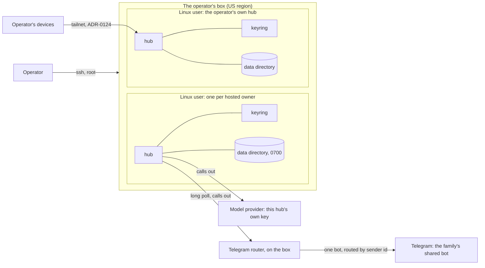

# Hosted family hubs

**The question.** May this system run a hub for someone other than the person who
runs the machine it is on, starting with a pilot of two to five close family members,
and if so, on what terms?

Today the answer is no. Each person runs their own hub on a machine they operate. This
proposal asks for a yes, for the pilot, under terms the project's owner ruled in
conversation on 2026-10-17. It does not decide how a hosted person reaches their hub's
web page. That is the door, and it gets its own proposal.

## Why now

- **The pilot needs it.** The first users are close family. A hub on their own machine
  means about thirteen commands and two open terminals by the 2026-10-17 survey's count,
  plus an always-on machine. [#3112](https://github.com/leonapivato/ai-assistant/issues/3112)
  records the install guide's known errors on top of that. None of them will do that.
  The owner wants to host their hubs instead.
- **A hosted hub can already be reached.** Milestone 12's Telegram line (ADR-0323) has
  the hub call out to Telegram by long polling. It needs no public address and no
  listener anyone else can reach. Once its hub starts, a hosted family member can talk
  to their assistant on Telegram with no web door at all. The line as built takes one
  bot per hub; a bot the family shares is a change of its own (see **The box**).
- **The incumbents host.** Muse and Dots each give a user a cloud computer. A pilot that
  asks family to run a server tests the wrong thing.

## The baseline

These would read differently afterwards.

- **The wiki's [Hub](https://github.com/leonapivato/ai-assistant/wiki/Hub/c0d545777763afff0278b810202b56dc7ed940bc)
  page** (revision `c0d5457`, read 2026-10-17). It says "One running hub owns one data
  directory" and "The assistant's durable records remain in the hub's data directory".
  Both stay true. The page says nothing about whose machine the hub runs on, or who
  operates it.
- **Roadmap stance 6** (`docs/roadmap.md`, tracked by
  [#879](https://github.com/leonapivato/ai-assistant/issues/879)). "A **VPS is ruled
  out**: a host that roots the store is the maximal ADR-0017 §1 decision, and it sits
  against the trust thesis rather than merely costing something." The owner's own hub has run on a rented Hetzner box since
  2026-08-21, as a temporary exception the owner ruled and #879 records.
- **ADR-0004 §2's residency clause**, "All persistent data lives on the user's
  machine", which **ADR-0155 §1:1** reads as governing the assistant's own store: "That
  store lives on the owner's machine, under that one directory, and no component of
  this system places any part of it in a service another party operates". The
  temporary exception passed this clause because the owner operates that box. A family
  member's hub would not pass it, because the operator is someone else.
- **ADR-0323 §12**, the narrow precedent. The owner ruled (2026-10-17,
  [#2819](https://github.com/leonapivato/ai-assistant/issues/2819)) that the Telegram
  line may carry covered content to the owner's one chat, which Telegram keeps on its
  servers. That ruling covers the line's calls to that one chat and nothing wider, so
  it does not reach hosting. What it shows is the form a scoped exception to ADR-0155
  takes: named, bounded, with its privacy cost stated (ADR-0323 §14).
- **The acts ADRs place "at the hub".** Enrolling a device is "an act the owner
  performs at the hub" (ADR-0124 §6). A credential reaches a connection only over the
  hub's loopback socket (ADR-0151 §13's third clause). The Telegram line's approval is
  "two acts, both the owner's" (ADR-0323 §12). Each assumes the owner has a shell on
  the hub's machine. A hosted family member does not.
- **Fresh data directories at cutovers.** The live hub has started on a fresh data
  directory at each large cutover (`data-m38`, `data-m39`, `data-0283`, `data-step3`,
  `data-m41`, `data-m44`), and ADR-0309 §6:1 and §6:4 made that the rule for the M44
  cutover. That is a practice, not a standing ADR. For a hosted person it means their
  assistant forgets them.

## The change

### Two roles where there was one

A hub keeps **one owner**: the person it serves, whose user model it holds and whose
yes authorises what it does. That does not change, and nothing here makes a hub serve
two people. ADR-0124 §10's "Nothing here authorises a second hub" still holds: every
hosted person has their own hub, and each hub has one owner.

What is new is naming a second role the corpus has never needed: the **operator**, who
runs the machine. The operator has root, deploys, takes backups and restarts units. On
a self-run hub the owner is the operator, which is why the corpus could say "the owner"
for both. On a hosted hub they are different people, and the proposal uses the two
words apart from here on.

### The residency clause, for a hosted hub

ADR-0155 §1:1 would be superseded for a **hosted hub**: one whose owner has asked an
operator they chose to run it for them, and has been given the pilot's terms. Its store
lives on the operator's machine, under one data directory, as now. Everything else in
ADR-0155 stands, and so does ADR-0323 §12's line exception. Nothing in this system
places any part of the store anywhere else.

That is a supersession, not a reading. "The owner's machine" does not stretch to cover
someone else's box, and stretching the words would hide the decision. The supersession
is the decision, and stating it in the open is the point.

### Stance 6

The stance becomes: a hub may run on a rented box when its owner chooses that, either
as their own operator or with an operator they trust. That covers the owner's own hub
(the 2026-08-21 exception stops being an exception) and the family's. The owner's own
hub moves to the US box with `data-m44` copied over, as a plain data-directory copy at
the same version. #879 then closes as not planned when the ADR merges: the rented box is
the standing arrangement, and a box at home stays possible later (owner, 2026-10-17).
The trust thesis
moves from "nobody else's machine" to "a machine run by someone you chose, on terms you
were told". That matches the owner's view that what withholding protects against is
other people, not providers.

### The pilot's terms

Ruled by the owner on 2026-10-17:

- **Storage is plain; trust is by relationship; and the operator looks.** The operator
  can read any hosted store, and does. Each hosted hub keeps the diagnostic record on,
  and the operator reads it to see what the assistant did and to improve it. The note
  says so in those words. The owner chose to be honest about that rather than promise
  not to look: debugging the pilot needs it, and a promise broken in the first week is
  worse than none. The cost is candour. Someone who knows the operator can read their
  assistant may tell it less, and the pilot then measures a more guarded user model.
  No encryption at rest is added. Backups are encrypted already: `ai-assistant-backup`
  (ADR-0123) encrypts the whole data directory to a passphrase, which the operator holds
  for each hosted hub. The diagnostic record stays out of backups (ADR-0314 §7:5).
- **Resets happen with notice, whenever the operator cuts over.** A cutover may start a
  hosted hub on a fresh data directory, as the practice is today. Family hubs follow the
  operator's cutovers, with no separate schedule. The owner expects large cutovers to
  come less often now that M44 is live. The six fresh directories between 09-28 and
  10-16 are the pace to compare against. The owner is told beforehand through their
  line. The previous directory is kept for a while, then removed (how long is open,
  below). Each reset restarts that person's learning loop, which is the pilot's cost for
  keeping cutovers cheap. If resets turn out frequent, the fallback is to pin family
  hubs to a release, so that a reset reaches them less often than it reaches the
  operator's own hub. Revisit before any launch.
- **Model spend has no cap; the operator is alerted.** Each hosted hub has its own
  provider key in its own workspace. That shows spend per person and puts the alert in
  the provider's console, with nothing to build.
- **Size and place.** Up to five hosted hubs plus the operator's own, on one box in a US
  region. The family is in the US. About 450 MB of memory per idle hub (measured on the
  live hub, 2026-10-17) puts that at about 8 GB. One box is a single point of failure
  for every hub on it, which the pilot accepts. Backups are copied off the box to the
  operator's own machine.
- **Leaving.** On the owner's request, the operator stops the hub, hands over a backup
  with its passphrase if the owner wants one, and deletes the data directory and every
  backup of it.
- **Telling them.** Before a hosted hub starts, the owner gets a one-page note in plain
  words: that the operator can see their data and reads what the assistant did, what
  Telegram and the model provider keep, that resets happen, and how to leave.

### The box

- **One Linux user per hub.** It has its own lingering systemd user units (the hub and
  a headless keyring, as the live `assistant` user has now), its own data directory,
  `hub.env`, venv and provider key. The hub already creates its data directory
  owner-only (`service/datadir.py`, `_OWNER_ONLY_DIR`), so one hub's process cannot
  read another's store. Root can read them all, which is the plain-storage term above.
- **A hosted hub binds only its loopback socket.** It sets no remote listener, so it is
  on no overlay, and ADR-0124 §2 has nothing to reach. Its owner reaches it through
  lines that call out, Telegram first, and later through the door. The operator's own
  hub keeps its tailnet listener for the operator's devices, unchanged.
- **One shared bot behind a router, with per-person bots first.** The owner wants a
  single bot the whole family talks to (2026-10-17). Telegram lets only one client
  long-poll a bot, so hubs can't share a bot directly. A small router on the box would:
  - hold the bot's one token and poll Telegram;
  - serve each hub the three Bot API methods its client uses (`getUpdates`,
    `sendMessage`, `sendChatAction`), over only the updates whose sender matches that
    hub's `telegram_user_id`;
  - keep a durable queue per hub, so that a hub that is down loses nothing.

  Three things make it more than a relay:
  - **Authentication moves.** ADR-0323 §4:3 establishes the user "by Telegram's own
    authentication of its users: the reader compares the sender id Telegram reports
    against the setting". Behind a router, the sender id is the router's report. So the
    channel between a hub and the router needs its own mutual authentication, per hub,
    and the ADR has to argue why the router's report still establishes the user.
    Otherwise the line's input is only claimed. A claimed input carries no authority,
    so there would be no yes over Telegram.
  - **One token sees every message.** The router holds the only token and sees every
    family member's messages in the clear. Under plain storage that adds no new reader,
    because the operator can already read everything. But it is one process whose
    compromise exposes everyone's line, and the note says so.
  - **What survives.** Suppose the router serves the Bot API faithfully, with its own
    update ids and offsets for each hub. Then milestone 12's reader (T3) and intake
    record (T2) need not change. Only the client (T1) does: its fixed origin, its
    transport and its credential. Keeping it that way is the ADR's main design goal and
    its main test.

  Ruled (owner, 2026-10-17): the pilot starts on **one bot per person**, which works
  today with no code.
  The operator creates each bot in BotFather and connects it at that person's hub. The
  shared bot follows once its ADR and router land. A person then switches by opening a
  chat with the new bot: their hub keeps the transcript, and the old Telegram chat
  stays behind. A shared bot is also the launch's shape. No one can make a bot for
  every stranger, and linking a Telegram account to a person's hub is the same job the
  launch's account system will do.
- **Deploys go through `scripts/deploy_hub.py` once per hub.** It already takes the
  ssh user, unit, venv, uv binary and marker as arguments. Whether it needs anything
  more for several hubs on one box is for the implementation lane to find out.

### Acts at the hub, for a hosted owner

A hosted owner has no shell, so the operator performs, for them, the **setup acts**
the corpus places at the hub:
- connecting the hub's Telegram line and setting `telegram_user_id` (ADR-0323 §3);
- enrolling devices;
- assigning roles;
- listing the owner's devices.

The rule proposed: **the operator performs a setup act only at that owner's request,
and the act is recorded as it is today.**

**An act that carries the owner's authority is never the operator's to perform.** That
covers an approval, a grant, and anything else the owner's yes decides (ADR-0321). It
comes from the owner, through their own line. Otherwise the operator's yes would stand
in for the owner's, which is the one thing a hosted hub must not blur. Connecting an
account that takes a credential (ADR-0151) is out of the pilot.

## Options considered

- **Each person runs their own hub (today).** It needs no ruling, and nobody in the
  pilot would do it.
- **One Telegram bot per person, for good.** Nothing to build, and ADR-0323 stands as
  written, with the operator creating each bot. The cost is that each person messages a
  differently named bot. The owner wants the shared bot (2026-10-17), because the
  launch needs one. Per-person bots are the pilot's first step, not its end state.
- **One multi-user hub.** Rejected. A hub has one owner all the way down: one data
  directory (ADR-0083), one user model, one yes. Making a hub multi-tenant would
  rewrite all of that for a worse isolation story than separate processes.
- **A container per hub instead of a Linux user.** Cleaner isolation and the likely
  shape at launch. For five people it is new build work, an image and a runtime, with
  nothing to show for it yet. A Linux user per hub reuses the live deployment as it
  stands. Recommended for the pilot, revisited at launch.
- **Encryption at rest, or a key the owner holds.** The owner ruled plain storage for
  the pilot. A key the owner holds is weak anyway for a hub that runs all the time: the
  key sits in memory, and real protection needs a confidential VM.
- **Migrations instead of resets.** The owner ruled resets with notice for the pilot.
  Carrying memory across cutovers is the launch's job, and possibly an export and
  re-import that doubles as history import.

## What it leaves open

- **The door.** How a hosted owner signs in to their hub's web page. That is the next
  proposal: Cloudflare Tunnel plus Cloudflare Access (the owner's ruling, 2026-10-17),
  with a gateway listener that checks Access's signed token. It would supersede
  ADR-0168 §2's proxy clause and extend ADR-0174. The domain is an operating detail of
  that proposal.
- **The shared bot's router**, as its own ADR. It would:
  - amend ADR-0323 §4:3, which establishes the user by Telegram's own authentication
    with nothing in between, against a router that reports the sender;
  - amend ADR-0323 §11:5's one origin "fixed in code", and the `TelegramBotClient`
    contract's matching sentence ("One request, to the one origin
    `https://api.telegram.org`, fixed in code"), which makes it a Protocol change under
    golden rule 5;
  - say where the router sits, and how a hub reaches it and authenticates it, per hub,
    under the seam's transport rules;
  - say how ADR-0323 §12's connect act reads when the bot is shared.

  It sequences after the line's live acceptance (#3118), so that the direct line is
  proven before a router sits in front of it.
- **How long a reset keeps the previous directory**, before it is removed.
- **The exact ADR text for the operator's setup acts**, and which existing clauses it
  touches by name (ADR-0124 §6, ADR-0323 §3 and §12).
- **Launch terms.** Encryption, migrations, containers, accounts and payments. These
  pilot terms decide none of them.
