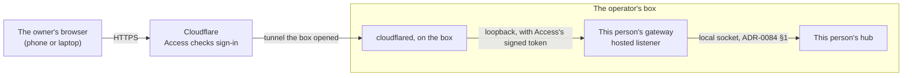

# The web door for hosted hubs

**The question.** How does a hosted family member open their hub's web page from any
browser, signed in, with nothing to install?

This builds on the hosted-hubs proposal
([#3131](https://github.com/leonapivato/ai-assistant/pull/3131)): one hub per person, on
a box the operator runs, reached through Telegram. That gives a hosted person a line but
no page. The page is where they see what their assistant believes and correct it, and
where more features will land. On 2026-10-17 the owner ruled the pilot's page
invite-only, behind **Cloudflare Tunnel and Cloudflare Access**: bought rather than
built, with our own sign-in service left for launch.

## Why now

- **The pilot's evidence needs the page.** The thesis is the user model. The browser's
  belief view is the one place a person sees it and fixes it. A pilot on Telegram alone
  would test a chat bot.
- **Today's door can't be used by family.** A remote browser is admitted only over the
  owner's tailnet: the device's overlay identity, the owner listing that device, and a
  web session bought with a bootstrap value copied from the gateway's terminal. The
  session ends after an hour idle, after twelve hours, or on any gateway restart. Each
  family member would need Tailscale installed and a fresh code from the operator most
  days.
- **The part we build is the part the launch keeps.** The gateway learns to admit a
  browser on a token an edge signed. At launch only the edge changes, from Cloudflare to
  our own.

## The baseline

- **The wiki's [External sensors](https://github.com/leonapivato/ai-assistant/wiki/External-sensors/6e74816b4791535f914f775214a5c3dd9dce82e4#connect)
  page, "Connect"** (revision `6e74816`, read 2026-10-17). "On the hub's own machine it
  connects locally". That stays true: a hosted gateway sits beside its hub. The wiki does
  not describe how a browser is admitted to a gateway, so no page reads differently
  afterwards. A page could gain that section once the ADR merges.
- **ADR-0174 §1:1**, the enumeration of where user data may leave a device. It names
  four boundaries: `models/`, the `tools/` seam, the hub's remote transport, and the
  gateway's remote browser transport over the owner's overlay. "Every other egress is a
  bug". A page served through Cloudflare is none of the four.
- **ADR-0168 §2:2** and **ADR-0174 §2:6**. Reaching a gateway's listener "by an
  operator-configured proxy, a port forward, a tunnel, or any other means" is authorised
  by no clause. A tunnel in front of the loopback listener is not the remote boundary,
  and the prohibition "stands and is reinforced rather than lifted". Cloudflare Tunnel is
  exactly that kind of tunnel.
- **ADR-0168 §5:1–§5:3.** A session is minted only by exchanging a bootstrap value, and
  that value is disclosed only on the gateway's own standard output. "The bootstrap
  exchange is the only request by which a session is minted".
- **ADR-0168 §4** (sessions live only in process memory, with an absolute lifetime and an
  idle timeout) and **§6** (two halves, a cookie and a header, both required).
- **ADR-0296 §1:1 and §1:7.** A browser device is "admitted by a gateway by the overlay
  identity it obtains", and "A device is the machine, not a browser tab or a process".
  Behind Cloudflare there is no machine identity to obtain.
- **ADR-0177 §3**: credentials are entered on a loopback origin only. This proposal
  leaves that unchanged, because the pilot connects no accounts that take a credential.

## The change

### A fifth boundary: the hosted browser transport

ADR-0174 §1:1 would gain a fifth boundary: the gateway's **hosted browser transport**,
between a hosted hub's gateway and its owner's browser. It has two halves, as the
fourth boundary does. One is a **hosted listener** on the gateway, reached only through
Cloudflare Tunnel. The other is the front-end bundle this repository serves. Everything
else in §1:1 stands.

- **The box opens no port.** `cloudflared` dials out to Cloudflare, and Cloudflare
  forwards each request down that connection. The hosted listener binds loopback only,
  as the gateway's loopback listener does. ADR-0124 §2's refusal of a publicly reachable
  hub listener is untouched, because the hub binds no remote listener at all.
- **One hostname per person, one Access application each.** Every application's policy
  allows exactly one email address: that person's. The invite is adding the address;
  removing it ends their access.
- **Sign-in is Google, with an emailed code as the backup** (owner, 2026-10-17). Someone
  signed into Google on their phone signs in with one tap. Someone without Google gets a
  one-time code by email. Either way, the account's own security is what protects the
  door.
- **A sign-in lasts a week** (owner, 2026-10-17). That is the Access application's
  session length, set in Cloudflare. With Google, signing in again is one tap. A lost
  phone stays signed in for at most a week, or until the operator removes the address.
- **The operator is in no family member's policy.** Opening Mom's page would let the
  operator approve or forget as her, an act carrying her authority, which #3131 never
  lets the operator perform. The diagnostics on the box are the operator's view.
- **The operator's own hub has a door too** (owner, 2026-10-17). It is one more
  hostname, whose policy allows only the operator. As user zero, the operator signs in
  the way family do, and meets the door's problems before they do. The operator's CLI
  and devices keep the tailnet as now.
- **Cloudflare decrypts the traffic in transit.** It terminates TLS, so it sees each
  page and each response in the clear. That is the named cost of buying the door. It
  fits the pilot's terms: plain storage, an operator who reads diagnostics, and the
  owner's view that privacy is about people, not providers. The note to family says so.
- **Cloudflare must not change the bundle.** Rocket Loader, email obfuscation and
  injected analytics would rewrite the pages, and the content security policy
  (ADR-0168 §6:16) would block what they inject anyway. They are switched off for the
  domain, and API responses are never cached. ADR-0174 §1:1's "the front-end bundle this
  repository serves" has to stay true through the edge.

### Admission on two facts, with the token in place of the bootstrap

On the hosted listener, a request is admitted only when both facts hold, in the
pattern of ADR-0174 §4:1:

1. **It carries a valid Access token.** Cloudflare adds a signed JWT to every request it
   lets through (`Cf-Access-Jwt-Assertion`). The gateway accepts the token only when all
   of these hold:
   - its signature verifies against the Cloudflare team's published keys;
   - its audience is this hostname's Access application;
   - it has not expired;
   - its email is the one configured for this hub's owner.

   The gateway checks this itself, on every request. It does not take `cloudflared`'s
   word, because any local process can reach a loopback port and set a header. Nobody
   can forge Cloudflare's signature.

   **The token is a bearer credential.** Whoever holds it can mint sessions until it
   expires, so it is Tier 0 like the session halves and the bootstrap value
   (ADR-0168 §6:7). It is never written to a store, a file, a log record, an audit
   record or an error.
2. **It carries a live web session** (ADR-0168 §6), both halves.

The token takes the bootstrap value's place. **On the hosted listener, a request with a
valid token may mint a session**, which supersedes ADR-0168 §5:3 for that listener
alone. The loopback listener keeps the bootstrap value exactly as now.

Sessions stay as ADR-0168 §4 rules them: process memory, the same lifetimes, gone when
the gateway restarts. Behind the token that stops mattering to the person. When a
session ends, the page asks again, the gateway mints a new one from the token, and
nobody types anything. A person signs in when their Access session runs out, not when
the gateway restarts.

That keeps ADR-0172's exemption whole. Its conditions (ADR-0172 §6:1) are ADR-0168 §4's
storage clauses and §6's admission records, and this proposal touches neither of them.

**One clause of §4 does change.** ADR-0168 §4:6 refuses a mint beyond
`gateway_max_sessions` "rather than evicting an existing session". Behind the token,
every new tab and every restart mints a session. A person with a few devices would hit
the cap and be locked out of their own page. On the hosted listener, every session
belongs to the one owner, so a mint at the cap evicts that owner's oldest session
instead. That supersedes §4:6 for the hosted listener alone.

### One browser device per hosted owner

ADR-0296 makes a device a machine, known by its overlay identity. The hosted listener
has no machine identity, only an account. So for a hosted hub, **all of the owner's
browsers are one browser device**. It is registered under the gateway, and the
operator gives it its roles at setup, as a setup act (#3131).

That supersedes ADR-0296 §1:1 and §1:7 for the hosted listener. The cost: the hub can't
tell the person's phone from their laptop, so a conversation's devices name "the web"
rather than a machine. That is acceptable for the pilot. The alternative, one device per
browser profile through a long-lived cookie, would make the operator assign roles every
time someone opens a new browser.

### What stays refused

- **Credential entry**, on the hosted listener as on the remote one (ADR-0177 §3). The
  hosted page is HTTPS, a potentially trustworthy origin, so ADR-0177's own argument
  for refusing it no longer applies. Lifting the refusal stays ADR-0177's decision, for
  when the pilot connects an account.
- **Anything the hub's remote listener would carry.** A hosted gateway reaches its hub
  over the local socket alone.

### Telegram and the web stay separate

The web page shows the hub's own conversations. It does not show the Telegram chat,
because ADR-0323 §2 rules that "The line shares no transcript with the hub chat". The
assistant's memory connects the two: what someone tells it on Telegram shows up in
what it believes on the web. The owner kept that as ratified for the pilot
(2026-10-17). The note to family explains it in a sentence. Revisit if family find it
confusing.

## Options considered

- **Our own sign-in service now.** It builds more of the launch. Passkeys from an auth
  vendor, an account table and invites are a deployable of their own, in a repository of
  their own. The owner chose to buy the door for the pilot.
- **Tailscale for family.** It needs no new boundary. But each person installs an app
  and joins a network, and today's sessions would have them asking for a code most
  days. Rejected on friction.
- **Let `cloudflared` check the token, and have the gateway trust a header.** It is
  simpler in the gateway, and any local user could forge the header to the loopback
  port. Rejected.
- **A device per browser profile.** Closer to ADR-0296 §1:7, but it costs a setup act
  per new browser. Later, if the pilot shows it matters.

## What it leaves open

- **How the gateway gets Cloudflare's keys.** They are published per team and rotate. It
  can fetch them, a call that carries no user data, or they can be configured and
  refreshed by the operator. Either way, a gateway that cannot verify refuses rather
  than admits.
- **Streams through the edge.** The delivery and change streams already send
  keep-alives (`interfaces/gateway/streams.py`, `KEEP_ALIVE_HEADER`). Their cadence has
  to stay under Cloudflare's idle timeout for a proxied response. The implementation
  lane measures that against the live edge.
- **The settings' names.** For example, the hosted listener's port, host name, Access
  team and audience, and the owner's email. They should name "the edge" rather than
  Cloudflare, so that at launch the issuer changes and the gateway's check does not.
- **The domain.** `aetherassistant.com`, on Cloudflare DNS, with a hostname per person.
  It is an operating step, and it needs no trademark answer for a private pilot.
- **Launch.** Our own edge, accounts and payments, a shared Telegram bot linked to an
  account, and credential entry.
