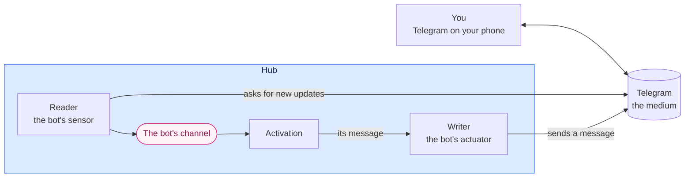

# A Telegram line to the assistant

**The question.** How do you message the assistant from anywhere, and how does it answer,
through a Telegram chat with a bot of your own?

## The baseline

The owner's direction is recorded on
[#2819](https://github.com/leonapivato/ai-assistant/issues/2819): a line *to* the
assistant, not the assistant acting in your chats with other people. Telegram comes
first. A carrier line through an API such as Telnyx, RCS where the phone supports it and
SMS as the fallback, comes later. Hosted iMessage is not pursued for now. Every ruling below
is the owner's, from the walk-through of 2026-10-11, and each is recorded on #2819.

The wiki at
[84f20c8](https://github.com/leonapivato/ai-assistant/wiki) describes the pieces this
proposal uses:
[Channels](https://github.com/leonapivato/ai-assistant/wiki/Channels),
[Sensors](https://github.com/leonapivato/ai-assistant/wiki/Sensors),
[External sensors](https://github.com/leonapivato/ai-assistant/wiki/External-sensors),
[Actuators](https://github.com/leonapivato/ai-assistant/wiki/Actuators),
[Episode window](https://github.com/leonapivato/ai-assistant/wiki/Episode-window) and the
[Place window](https://github.com/leonapivato/ai-assistant/wiki/Place-window). Where
those pages and the ADRs differ, the ADRs govern; the Channels page still describes the
activating and service sorts that ADR-0292 retired.

The decisions it builds on:

| ADR | What it gives this proposal |
| --- | --- |
| ADR-0292 | The model: media, places, spokes and channels; input arriving with an author the hub states; push and pull per input; kinds declaring their rules; channels keeping nothing |
| ADR-0293 | The one kind built so far, the hub's chat. Its reader's bookkeeping, its interim of one activation at a time, its endings and its question messages are the pattern this proposal copies |
| ADR-0295, ADR-0296 | Stopping an activation, and the device roles that may send commands |
| ADR-0149, ADR-0151 | Connected accounts: a credential kept in the keyring under a reference the hub mints, connected with `assistant connect` |
| ADR-0154 | The one way out of the hub. Every call to Telegram passes it |
| ADR-0199 | What may be said for an audience |
| ADR-0303 §7 | The place window, and a kind declaring an episode window |

The phases proposal ([#2723](https://github.com/leonapivato/ai-assistant/pull/2723),
milestone M43) decides how a reply leaves: planning's text is written into the place the
input came from. Writing anywhere else, the assistant writing first included, comes with
the timers and proactivity milestone, with the audience rules it needs
([#2590](https://github.com/leonapivato/ai-assistant/issues/2590)).

**What is built at `5166d5bc`.** The code knows two channel types, `conversation` and
`informational_event`, and has no channel kind object or registry. Connected accounts
exist and are used by web search, forecasts and sending email, each through a setting
that names the account's reference. Nothing reaches Telegram.

## What you get

You create a bot with Telegram's @BotFather and connect it once. From then on you message
the bot as you would a person, and the assistant answers there. Your phone's Telegram
notifications are how you hear the answer. Once the timers milestone lets the assistant
write first, they are also how you hear a reminder.

| You | What happens |
| --- | --- |
| "What's on this weekend?" | Input from you, established. An activation starts, and its answer is written into your chat. |
| "Only Saturday" while it is still working | The message waits in Telegram, and is taken in, with the time you sent it, together with anything else waiting when the first activation ends. |
| "Wrong campsite", replying to one of its messages | Your message, with the message it replies to brought in as quoted context. This is how you correct it, as in the hub chat. |
| A friend's message, forwarded, with "add this to my calendar" | The forward is your friend's words and only informs. Your words instruct. |
| The assistant asks "Saturday or Sunday?" | The options are buttons. Your tap is your answer to that question. |
| A voice note or a photo | A fixed reply, "I can only read text here for now." Nothing starts. Voice notes are the first follow-up. |
| The hub restarts mid-answer | When it is back, the bot says it was interrupted and asks you to send again if you still need it. |
| Someone else finds the bot and messages it | Not input. The bot does not answer and nothing is recorded. |

## 1. The shape

**Telegram is the medium, and your chat with the bot is the place.** The assistant's end of
the chat is the bot: a reader (its sensor) and a writer (its actuator), one spoke running
inside the hub, on the bot's channel. "Reader" and "writer" are the names ADR-0293 gives a
kind's sensor and actuator. The spoke runs in the hub because Telegram's API is reachable
from it; a spoke for another medium could run on a device instead (ADR-0292 §2:1).

| | The hub chat (built) | Telegram |
| --- | --- | --- |
| **Medium** | The hub's chat space, *hosted* by the hub | Telegram, held by Telegram |
| **Place** | A conversation | Your chat with the bot |
| **Spoke** (sensor and actuator) | The chat's reader and writer, in the hub | The bot's reader and writer, in the hub |
| **Channel** | The chat channel | The bot's channel |
| **Your end** | Your devices, chosen per conversation | Telegram on your phone, and Telegram Desktop if you use it |

**Your end is Telegram's business.** Your phone and any other Telegram app signed into your
account are your end of the chat. They are not devices of the hub and not spokes, and the
hub chat's "my devices" does not reach them.

**The hub always calls out.** The reader asks Telegram for new messages by long-polling,
and the writer sends through the same API. Telegram never connects to the hub, so the hub
needs no public address and the line works from a tailnet-only hub as it is today.

**One channel per connected bot, one place per chat.** Your chat is a place, keyed by its
chat id. As the conversation's identity (`conversation`, id) is (the chat, that
conversation) under ADR-0292 §10:8, `(telegram, chat id)` is (the bot's channel, your
chat). If the configured account ever changes, the new account's chat is a new place, and
the old chat's history does not run on as if it were the same conversation.

**It does not share the hub chat's transcript.** A conversation in the browser and your
Telegram chat are two lines. What connects them is the assistant's memory: the episode
window, which spans every channel, recall and stories. A Telegram message sees what you
just did in the browser, and the other way round.

**Telegram is an outside medium, so the hub keeps no mirror of it.** The hub chat is
hosted, and the hub keeps its transcript. Telegram holds its own chat, and the hub's record
of it is the episodes: each records what came in and what the assistant wrote back
(ADR-0292 §3:2, §10:6). That record is not kept in step with Telegram, and differs from
Telegram's copy exactly where the assistant perceived something differently:

| | Telegram's copy | The episodes |
| --- | --- | --- |
| You edit or delete a message in Telegram | Changes | Stays as received |
| You forget something in the assistant | Stays | Removed |
| Voice notes and photos, for now | There | Absent |
| Messages lost in an outage over 24 hours (§4) | There | Absent |

## 2. Setting it up

1. **Create the bot** with @BotFather, which gives you its token.
2. **Connect it** with `assistant connect`, naming the bot and giving the token as the
   credential. The token goes to the keyring like any connected account's (ADR-0149,
   ADR-0151), and is entered only on the command line or a loopback browser, like every
   credential (ADR-0177).
3. **Name the line and yourself in settings.** One setting names that connection as the
   Telegram line, as `web_search_connection` does for search. Another names your Telegram
   user id, which a bot such as @userinfobot shows you. Doing so creates the channel
   (ADR-0292 §2:6), and declares it private (§6).

**Your account comes from the setting, not from a pairing flow.** You already set the
connection at deploy, so naming your account there is the same act. Pairing from a device
with a one-time code is worth building when someone other than the owner needs to set a
line up (What it leaves open).

**Disconnecting** with `assistant disconnect` removes the token (ADR-0151 §8). The channel
stays, unreachable, with its episodes (ADR-0292 §2:8), and planning is told it is
unavailable (§2:9). Forgetting what was said on it is the ordinary forget, over its
episodes.

## 3. A message in

**What counts as input** (ADR-0292 §6:9):

| Event in Telegram | Input? |
| --- | --- |
| A text message from your account, in your private chat with the bot | Yes, a push |
| A tap on a button of the assistant's question | Yes, a push: your answer |
| A message you forward | Yes, with its original sender as its author (below) |
| Anything from any other account or chat | No. Ignored and not recorded |
| You editing or deleting a message | No |
| A voice note, photo, file, sticker or location from you | No. The bot answers with a fixed line, by rule, and nothing starts |

`/start`, which Telegram sends when you first open a bot, is an ordinary message.

The fixed line for non-text messages plays the part of the hub chat's error on a refused
send (ADR-0293 §4), since Telegram gives a bot no way to refuse a message. **Voice notes are
the first follow-up** after the first build: the hub transcribes them, and their author is
still you, established. Live speech, with its audience questions, stays with the voice work
([#2578](https://github.com/leonapivato/ai-assistant/issues/2578)).

**The author is you, established**, because the setting names your account. A message you
send is sent as an instruction, so it can carry your authority (ADR-0292 §5:5), exactly as a
message in the hub chat does (ADR-0293 §4). This is the simple rule for now; the authority
milestone may narrow what a line outside the hub can authorize. It follows that **the line
is as safe as your Telegram account**.

**A forwarded message is its original sender's.** Telegram marks a forward with who wrote
it. Its author is that person, as Telegram reports them, and claimed (ADR-0292 §5:3), so it
informs and authorizes nothing: a forward cannot pass as your instruction (ADR-0292,
Consequences). What you write alongside it is yours. A forward on its own is information,
and the assistant asks what you want done with it.

**A reply names what it replies to.** Telegram includes the replied-to message with a
reply, so the reader brings that text in as quoted context, with its author: the assistant
if it was the bot's, you if it was yours. Like the window, the quoted message informs and
never authorizes (ADR-0292 §10:3).

**Each message keeps the time you sent it.** Telegram gives every message its time, and the
reader carries it with the message, so messages taken in together stay separate and dated
in the episode, and the record can tell that a message was written before the reply it
follows.

**Duplicates.** Each Telegram update has an id. The reader records which updates it took in,
and by which activation, holding no text (as the hub chat's reader does, ADR-0293 §6), so an
update fetched twice starts one activation.

**The reader's contract does not assume polling.** What the reader owes the channel is new
input with its author and its time. Whether a spoke polls, as this one does, or receives
webhooks, as a carrier line would, is the spoke's own business, so later lines fit the same
kind without reshaping it.

## 4. Waiting, and taking in

**One activation at a time in your chat**, the interim ADR-0292 §11:5 sets.

**Messages wait in Telegram.** The reader confirms an update to Telegram only once it has
been taken in, which happens when its activation is admitted. A message you send while an
activation runs is not confirmed: it waits in Telegram, and when the activation ends,
everything waiting is taken in together as one input. Nothing is refused. This is ADR-0292
§11:5's "lands in the medium and waits", with Telegram as the medium.

**After a restart**, updates already taken in are not taken in again, since their activation
may have acted on them, and updates never taken in are taken in as usual (ADR-0293 §6).

**Working.** While an activation runs, the bot shows Telegram's "typing…", renewed until it
ends. That is the current state shown to your end, never written into the chat (ADR-0292
§11:7).

**Endings.**

- An activation that ends having written nothing writes the fixed *couldn't finish*
  message, as in the hub chat (ADR-0293 §9).
- **After a restart, the bot tells you it was interrupted.** For a chat whose last
  activation was cut off by the restart, the writer sends a fixed message by rule: "I was
  interrupted before I could answer. Send it again if you still need it." The hub chat stays
  silent and shows *interrupted* in its current state (ADR-0293 §8, §9). Telegram has no
  such state to show, and without the message you would see "typing…" and then nothing.

**Stopping** is a command from one of your devices with the command role (ADR-0295,
ADR-0296). Typing "stop" in Telegram is a message like any other, never a command (ADR-0292
§12:6), and under the interim it waits until the running work ends. Activations are short,
and anything consequential still asks for your approval first.

**What waiting in Telegram costs.** Telegram keeps an unconfirmed update for 24 hours.
Messages you send while the hub is down for longer than that are lost, and the hub cannot
tell. Every bot has this limit, wherever it runs. While messages wait, the reader asks
Telegram on a short timer rather than long-polling, because Telegram hands back waiting
updates at once.

## 5. A message out

**The writer sends the activation's message to your chat.** In the phases milestone a
message goes only into the place the input came from, so the Telegram line answers what you
send it. The assistant writing to Telegram first, a reminder or "your Friday booking moved",
comes with the timers and proactivity milestone, when planning chooses where output goes
(ADR-0292 §7:2, §7:3).

**Sent** means Telegram accepted the message and returned its id (ADR-0292 §7:4).

**When a send fails**, which writing into the hub chat cannot do:

| What happened | What the writer does |
| --- | --- |
| Telegram said it did not send: a network error before the request, a rate limit | Retries a few times. This is safe |
| No answer: the request timed out after it went | Records the outcome as *unknown*, and does not retry: Telegram cannot recognize a repeated message, so a retry could deliver it twice |

Either way the outcome is recorded with the episode, so the next activation sees in its
window that a reply may not have reached you, and can say so.

**Plain text.** The kind's description tells planning the chat shows plain text, and the
writer sends it as such. Rendering Markdown into Telegram's formatting comes later.

**Long messages.** Telegram caps a message at 4,096 characters. The writer splits a longer
one into consecutive messages at paragraph breaks. That is the spoke's limit (ADR-0292
§8:4), and the episode records one message.

**Questions with options** are sent with buttons. A tap answers that question with that
option, bound to it exactly as in the hub chat (ADR-0293 §6), and the buttons are then
removed. A typed answer works too. This arrives when question messages are built for the
hub chat.

**An activation may write several messages**, such as "looking into it" and then the answer,
and a stopped activation writes none, as in the hub chat (ADR-0293 §6).

## 6. What the kind declares

ADR-0292 §8's declarations, for `telegram`:

| | `telegram` |
| --- | --- |
| **Description**, given to planning | A private Telegram chat with the user, shown as plain text, whose own messages carry their authority, and which expects a reply, a question or a notice. Plus whatever you wrote about it when setting it up |
| **Directions** | In and out |
| **Push and pull** | Pushes: your messages, forwards and taps. Cannot be pulled, because a bot cannot read a chat's history |
| **Input** | Text messages, forwards and button taps from your account, in its private chat |
| **Authors** | Your account is you, established. A forward's author is its original sender, claimed. Nothing else is input |
| **Places** | Each private chat with the bot, keyed by its chat id |
| **Window** | The recent episodes on the channel and place, sized as the hub chat's window is |
| **The channel's rules**, at the writer | Text only; only to your chat |
| **The spoke's limits** | 4,096 characters a message; buttons |
| **Audience** | Private, declared when you set it up: "this is my Telegram" (ADR-0292 §9:6). Whether message text shows on your lock screen is your Telegram setting (§9:7). What may be said is ADR-0199's, as for the hub chat |

**The window needs one sentence of its own in the ADR.** ADR-0292 §10:1 brings the window
from the medium wherever it holds a history, and ADR-0303 §7 lets a kind whose medium has no
stable item ids declare an episode window. Telegram's chat has a history and stable ids, but
a bot cannot read that history, so neither clause covers it as written. The ADR adds that a
kind whose sensor cannot read its medium's history declares an episode window.

## 7. What Telegram sees

**A bot chat is not end-to-end encrypted.** Telegram's servers carry every message both
ways and keep the chat in your account. That is the medium's copy, as a mail server keeps
mail. The owner's line on providers applies: what the assistant withholds, it withholds from
people, not from a service you chose.

**Forgetting reaches what the assistant reads, not Telegram.** The window comes from
episodes, so forgetting a message's episode keeps it out of every later activation.
Telegram's copy stays in your Telegram until you delete it there.

**The bot token is the line.** Whoever holds it can read what is sent to the bot and send
as it. It is kept in the keyring. To change it, revoke it with @BotFather and re-provision
the connection (ADR-0151).

## 8. How it is built

**The reader and writer run inside the hub**, as a long-running task beside the scheduler.
Every call to `api.telegram.org` passes the egress seam (ADR-0154), with the connection's
credential bound there (ADR-0149). How the reader's polling and the writer's sends are
declared at that seam is the ADR's to settle, with the capability declarations the phases
introduce.

**No Telegram library.** The Bot API is a handful of HTTPS calls returning JSON. The hub's
existing HTTP client covers it, and a library would bring its own HTTP stack, which would
have to be kept behind the egress seam.

**Two halves**, as the owner ruled:

| Half | What it builds | When |
| --- | --- | --- |
| **1. The line** | The Telegram client, the two settings, the reader's polling and its record of what it took in, the writer with its failure rules, and the kind's declarations, tested against a fake Telegram. It merges with nothing switched on | Now. It touches no orchestration module |
| **2. The flow** | The reader's pushes starting activations, the writer sending planning's messages, and the restart message | Once the phases replace the turn loop (M43's cutover). It goes live with the phases' deploy |

Voice notes follow the cutover as the first addition. Messages the assistant writes first
follow with the timers and proactivity milestone, which needs nothing more from this line
than permission for the writer to be chosen.

**What is new in `core`** is the ADR's to list: the `telegram` channel type and its
declarations, and the store for the reader's record of what it took in. If that store needs
a new Protocol, it lands as a triad with its implementation (ADR-0137 §2). The phases are
changing `core` at the same time, so the lane for half 1 is sequenced with M43's lanes
rather than run against them.

## Options considered

- **Telegram mirroring the hub chat.** Ruled against. A message would be written into a hub
  conversation and the reply copied back. You would see one conversation everywhere, but
  every message would be held twice and kept in step, edits and deletions would not map
  across, many hub conversations would fold onto one linear chat, and a bridge would have to
  pose as one of your devices.
- **Building it all now, on today's chat path.** Ruled against. It would work sooner, but
  would be reworked at the cutover.
- **No places: the channel is the chat.** Ruled against. It works while there is one chat,
  but a changed account's chat would continue the old one's history, and every later case of
  more than one chat would need a redesign.
- **Pairing with a one-time code.** Deferred. It proves possession of the account at setup,
  but needs a command, a store of expiring codes and `/start` handling; a setting does the
  job while the owner is the only person setting a line up.
- **Silence after a restart, as in the hub chat.** Ruled against: Telegram has no current
  state to show *interrupted*.
- **Voice notes in the first build**, or left to the voice work. Ruled against: the hub's
  speech path is reworked at the cutover, and voice notes are simple enough to follow it at
  once.
- **Webhooks instead of long polling.** Telegram would call the hub, which needs a public
  address the hub does not have.
- **Keeping waiting messages in the hub.** A small inbox holding fetched messages until they
  are taken in. It gains nothing on an outage, since Telegram's 24-hour limit binds the same
  way while the hub is down, and the hub would hold message text outside episodes, which the
  hub chat's reader is ruled not to do.
- **A Telegram library** (python-telegram-bot, aiogram). Not needed, and each brings its own
  HTTP stack.
- **Other providers.** Signal, iMessage (through a Mac relay or a hosted vendor such as
  Inkbox), SMS, RCS and WhatsApp are compared on #2819.

## What it leaves open

- **Groups, topics and other people in the chat**: places that nest
  ([#2826](https://github.com/leonapivato/ai-assistant/issues/2826)), and more than one
  person in a medium (ADR-0292, What stays open).
- **Voice notes**: the first follow-up after the cutover. Live speech stays with
  [#2578](https://github.com/leonapivato/ai-assistant/issues/2578).
- **Pictures and files**, and **Markdown rendered** into Telegram's formatting.
- **Commands inside Telegram**, such as `/stop` or `/new`. A message never becomes a command
  (ADR-0292 §12:6). Whether a Telegram command could count as a structured act belongs to
  the device session and authority.
- **Pairing**, when someone other than the owner sets a line up.
- **Quiet hours and other rules on the assistant writing first**: the timers and
  proactivity milestone.
- **How much a line outside the hub may authorize**: the authority milestone.
- **Noticing a long outage**: telling you that messages from more than a day ago may be lost.
- **The carrier line**: Telnyx or similar, RCS where the phone supports it and SMS as the
  fallback, with how a message arrived deciding how far its author counts. Its reader takes
  webhooks, which brings back the question of a public address.
- **A spoke on a device**, such as iMessage through a Mac relay. The kind's contract is
  written so a spoke running on a device can carry it too.
- **A word for a spoke inside the hub**: ADR-0292's own open item, which this kind cites
  rather than settles.
