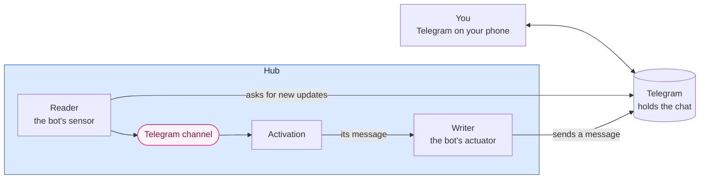

# A Telegram line to the assistant

**The question.** How do you message the assistant from anywhere, and how does it answer,
through a Telegram chat with a bot of your own?

## The baseline

The owner's direction is recorded on
[#2819](https://github.com/leonapivato/ai-assistant/issues/2819): a line *to* the
assistant, not the assistant acting in your chats with other people. Telegram comes
first, and iMessage waits until there is a Mac to dedicate to it. Two rulings of
2026-10-11 shape this proposal. Telegram is **a channel of its own**, not a mirror of
the hub's chat. It is **built in two halves**: the parts that touch no orchestration
now, and the message flow once the phases have replaced the turn loop.

The wiki at
[84f20c8](https://github.com/leonapivato/ai-assistant/wiki) describes the pieces this
proposal uses:
[Channels](https://github.com/leonapivato/ai-assistant/wiki/Channels),
[Sensors](https://github.com/leonapivato/ai-assistant/wiki/Sensors),
[External sensors](https://github.com/leonapivato/ai-assistant/wiki/External-sensors),
[Actuators](https://github.com/leonapivato/ai-assistant/wiki/Actuators) and the
[Place window](https://github.com/leonapivato/ai-assistant/wiki/Place-window). Where
those pages and the ADRs differ, the ADRs govern; the Channels page still describes the
activating and service sorts that ADR-0292 retired.

The decisions it builds on:

| ADR | What it gives this proposal |
| --- | --- |
| ADR-0292 | The model: a channel is the group of spokes facing one thing, input arrives with an author the hub states, push and pull per input, kinds declare their rules, and channels keep nothing |
| ADR-0293 | The one kind built so far, the hub's chat. Its reader's bookkeeping, its interim of one activation at a time, its endings and its question messages are the pattern this proposal copies |
| ADR-0296 | Device roles. Pairing is a command, so it needs a device with the command role |
| ADR-0149, ADR-0151 | Connected accounts: a credential kept in the keyring under a reference the hub mints, connected with `assistant connect` |
| ADR-0154 | The one way out of the hub. Every call to Telegram passes it |
| ADR-0199 | What may be said for an audience |
| ADR-0303 §7 | The place window, and a kind declaring an episode window |

The phases proposal ([#2723](https://github.com/leonapivato/ai-assistant/pull/2723),
milestone M43) decides how a reply leaves: planning's text is written into the place
the input came from. Writing anywhere else, the assistant writing first included, comes
with the timers and proactivity milestone, with the audience rules it needs
([#2590](https://github.com/leonapivato/ai-assistant/issues/2590)).

**What is built at `5166d5bc`.** The code knows two channel types, `conversation` and
`informational_event`, and has no channel kind object or registry. Connected accounts
exist and are used by web search, forecasts and sending email, each through a setting
that names the account's reference. Nothing reaches Telegram.

## What you get

You create a bot with Telegram's @BotFather, connect it once, and pair your Telegram
account with a code. From then on you message the bot as you would a person, and the
assistant answers there. Your phone's Telegram notifications are how you hear the
answer. Once the timers milestone lets the assistant write first, they are also how you
hear a reminder.

| You | What happens |
| --- | --- |
| "What's on this weekend?" | A push on the Telegram channel, from you, established. An activation starts, and its answer is written into the chat. |
| "Only Saturday" while it is still working | The message waits in Telegram, and is taken in together with anything else waiting when the first activation ends. |
| A voice note or a photo | A fixed line, "I can only read text here for now." Nothing starts. |
| "Wrong campsite", replying to one of its messages | Your message, with the message it replies to brought in as quoted context. This is how you correct it, as in the chat. |
| The assistant asks "Saturday or Sunday?" | The options are buttons. Your tap is your answer to that question. |
| Someone else finds the bot and messages it | Not input. The bot does not answer and nothing is recorded. |
| The hub is down for an hour | Your messages wait in Telegram and are taken in when it is back. |

## 1. A channel of its own

**The medium is Telegram's.** Telegram holds the chat. The assistant's end of it is a
bot: a reader (its sensor) and a writer (its actuator) running inside the hub, one spoke
on a channel of kind `telegram` (ADR-0292 §2:1). Your phone running Telegram is your
end of the chat. It is not a device of the hub and not a spoke, any more than the
phone of someone you email is.

**The hub always calls out.** The reader asks Telegram for new messages by
long-polling, and the writer sends through the same API. Telegram never connects to
the hub, so the hub needs no public address, and the line works from a tailnet-only
hub as it is today.

**One channel per connected bot**, identified by the connection's reference. It has
**no places** for now: you have one chat with your bot, so the channel is the chat, as
ADR-0292 §10:8 treats every channel identity except the conversation's. Groups and
topics would make places later.

**It does not share the hub chat's transcript.** A conversation in the browser and the
Telegram chat are two lines. What connects them is the assistant's memory: the episode
window, recall and stories, as the wiki's Channels page has it ("Channels do not share
memory").

**The hub keeps no copy of the chat** (ADR-0292 §3:2). Your messages reach the hub as
input recorded in episodes, and the assistant's messages are recorded in the episodes
that wrote them. The chat itself stays in Telegram.

## 2. Setting it up

1. **Create the bot** with @BotFather, which gives you its token.
2. **Connect it** with `assistant connect`, naming the bot and giving the token as the
   credential. The token goes to the keyring like any connected account's (ADR-0149,
   ADR-0151). A setting names that connection as the Telegram line, as
   `web_search_connection` does for search. Doing so creates the channel (ADR-0292
   §2:6). The token is entered only on the command line or a loopback browser, like
   every credential (ADR-0177).
3. **Pair your account.** A device with the command role (ADR-0296 §2) asks the hub to
   pair. The hub answers with a one-time link, `t.me/<bot>?start=<code>`, shown only
   on that device. Opening it on your phone sends `/start <code>` to the bot. The
   reader matches the code, records your Telegram account and chat, and the bot
   answers "Paired." The code works once and expires after ten minutes.

**Pairing is a command, not a message.** The authority to bind an account comes from
your act on an admitted device (ADR-0292 §12:5). The `/start` message only proves that
the Telegram account opening the link is the one at your phone. Pairing again replaces
the binding, and unpairing clears it. Until you pair, nothing the bot receives is
input.

**Disconnecting** with `assistant disconnect` removes the token (ADR-0151 §8). The
channel stays, unreachable, with its episodes (ADR-0292 §2:8), and planning is told it
is unavailable (§2:9). Forgetting what was said on it is the ordinary forget, over its
episodes.

## 3. A message in

**What counts as input** (ADR-0292 §6:9):

| Event in Telegram | Input? |
| --- | --- |
| A text message from your paired account, in your private chat with the bot | Yes, a push |
| A tap on a button of the assistant's question | Yes, a push: your answer |
| Anything from any other account or chat | No. Ignored and not recorded |
| You editing or deleting a message | No |
| A voice note, photo, file, sticker or location from you | No. The bot answers with a fixed line, by rule, and nothing starts |

The fixed line for non-text messages plays the part of the chat's error on a refused
send (ADR-0293 §4). Telegram gives a bot no way to refuse a message. Voice comes back
with [#2578](https://github.com/leonapivato/ai-assistant/issues/2578).

**The author is you, established**, because pairing bound your account. A message you
send is sent as an instruction, so it can carry your authority (ADR-0292 §5:5), exactly
as a message in the hub chat does (ADR-0293 §4). This is the simple rule for now. The
authority milestone may narrow what a line outside the hub can authorize. It follows
that **the line is as safe as your Telegram account**.

**A reply names what it replies to.** Telegram includes the replied-to message with a
reply, so the reader brings that text in as quoted context, with its author: the
assistant if it was the bot's, you if it was yours. Like the window, the quoted message
informs and never authorizes (ADR-0292 §10:3).

**Duplicates.** Each Telegram update has an id. The reader records which updates it
took in, and by which activation, holding no text (as the chat's reader does, ADR-0293
§6), so an update fetched twice starts one activation.

## 4. Waiting, and taking in

**One activation at a time on the channel**, the interim ADR-0292 §11:5 sets for the
chat.

**Messages wait in Telegram.** The reader confirms an update to Telegram only once the
update has been taken in, which happens when its activation is admitted. A message you
send while an activation runs is not confirmed. It waits in Telegram, and when the
activation ends, everything waiting is taken in together as one input. Nothing is
refused. This is ADR-0292 §11:5's "lands in the medium and waits", with Telegram as
the medium.

**After a restart**, updates already taken in are not taken in again, since their
activation may have acted on them. Updates never taken in are taken in as usual
(ADR-0293 §6).

**Working.** While an activation runs, the bot shows Telegram's "typing…", renewed
until it ends. That is the current state shown to your end and never written into the
chat (ADR-0292 §11:7).

**Endings.** An activation that ends having written nothing writes the fixed *couldn't
finish* message, and a restart writes nothing, as in the chat (ADR-0293 §9).

**Stopping** works through the stop command (ADR-0295) from a device with the command
role. Typing "stop" in Telegram is a message like any other, never a command (ADR-0292
§12:6).

**What waiting in Telegram costs.** Telegram keeps an unconfirmed update for 24 hours.
Messages you send while the hub is down for longer than that are lost, and the hub
cannot tell. Every bot has this limit, wherever it runs. While messages wait, the
reader asks Telegram on a short timer rather than long-polling, because Telegram hands
back waiting updates at once.

## 5. A message out

**The writer sends the activation's message to your paired chat.** In the phases
milestone a message goes only into the place the input came from, so the Telegram line
answers what you send it. The assistant writing to Telegram first, a reminder or "your
Friday booking moved", comes with the timers and proactivity milestone, when planning
chooses where output goes (ADR-0292 §7:2, §7:3).

**Sent** means Telegram accepted it and returned its message id (ADR-0292 §7:4). Each
send is done, not done or unknown. A send that times out is unknown, and is not
retried, since a retry could deliver it twice.

**Plain text.** The kind's description tells planning the chat shows plain text, and
the writer sends it as such. Rendering Markdown into Telegram's formatting can come
later.

**Long messages.** Telegram caps a message at 4,096 characters. The writer splits a
longer one into consecutive messages at paragraph breaks. That is the spoke's limit
(ADR-0292 §8:4), and the episode records one message.

**Questions with options** are sent with buttons. A tap answers that question with that
option, bound to it exactly as in the chat (ADR-0293 §6), and the buttons are then
removed. A typed answer works too. This arrives when question messages are built for the
chat.

**An activation may write several messages**, and a stopped activation writes none,
as in the chat (ADR-0293 §6).

## 6. What the kind declares

ADR-0292 §8's declarations, for `telegram`:

| | `telegram` |
| --- | --- |
| **Description**, given to planning | A private Telegram chat with the user, shown as plain text, whose own messages carry their authority, and which expects a reply, a question or a notice. Plus whatever you wrote about it when setting it up |
| **Directions** | In and out |
| **Push and pull** | Pushes: your messages and taps. Cannot be pulled, because a bot cannot read a chat's history |
| **Input** | Text messages and button taps from the paired account, in its private chat |
| **Authors** | The paired account is you, established. Nothing else is input |
| **Window** | The recent episodes on the channel, sized as the chat's window is |
| **The channel's rules**, at the writer | Text only; only to the paired chat |
| **The spoke's limits** | 4,096 characters a message; buttons |
| **Audience** | Private, declared when you pair: "this is my Telegram" (ADR-0292 §9:6). Whether message text shows on your lock screen is your Telegram setting (§9:7). What may be said is ADR-0199's, as for the chat |

**The window needs one sentence of its own in the ADR.** ADR-0292 §10:1 brings the
window from the medium wherever it holds a history. ADR-0303 §7 lets a kind whose
medium has no stable item ids declare an episode window. Telegram's chat has a history
and stable ids, but a bot cannot read that history, so neither clause covers it as
written. The ADR adds that a kind whose sensor cannot read its medium's history
declares an episode window.

## 7. What Telegram sees

**A bot chat is not end-to-end encrypted.** Telegram's servers carry every message both
ways and keep the chat in your account. That is the medium's copy, as a mail server
keeps mail. The owner's line on providers applies: what the assistant withholds, it
withholds from people, not from a service you chose
([#2819](https://github.com/leonapivato/ai-assistant/issues/2819)).

**Forgetting reaches what the assistant reads, not Telegram.** The window comes from
episodes, so forgetting a message's episode keeps it out of every later activation.
Telegram's copy stays in your Telegram until you delete it there.

**The bot token is the line.** Whoever holds it can read what is sent to the bot and
send as it. It is kept in the keyring. To change it, revoke it with @BotFather and
re-provision the connection (ADR-0151).

## 8. How it is built

**The reader and writer run inside the hub**, as a long-running task beside the
scheduler. Every call to `api.telegram.org` passes the egress seam (ADR-0154), with the
connection's credential bound there (ADR-0149). How the reader's polling and the
writer's sends are declared at that seam is the ADR's to settle, with the capability
declarations the phases introduce.

**No Telegram library.** The Bot API is a handful of HTTPS calls returning JSON. The
hub's existing HTTP client covers it, and a library would bring its own HTTP stack,
which would have to be kept behind the egress seam.

**Two halves**, as the owner ruled:

| Half | What it builds | When |
| --- | --- | --- |
| **1. The line** | The Telegram client, the connection setting, pairing, the reader's polling and bookkeeping, the writer and the kind's declarations, tested against a fake Telegram. It merges with nothing switched on | Now. It touches no orchestration module |
| **2. The flow** | The reader's pushes starting activations, and the writer sending planning's messages | Once the phases replace the turn loop (M43's cutover). It goes live with the phases' deploy |

Messages the assistant writes first follow with the timers and proactivity milestone,
which needs nothing more from this line than permission for the writer to be chosen.

**What is new in `core`** is the ADR's to list: the `telegram` channel type and its
declarations, and the reader's bookkeeping store. If the bookkeeping needs a new
Protocol, it lands as a triad with its implementation (ADR-0137 §2).

## Options considered

- **Telegram mirroring the hub chat.** Ruled against on 2026-10-11. A message would be
  written into a hub conversation and the reply copied back. You would see one
  conversation everywhere, but every message would be held twice, edits and deletions
  would not map across, many hub conversations would fold onto one linear chat, and a
  bridge would have to pose as one of your devices.
- **Building it all now, on today's chat path.** Ruled against on 2026-10-11. It would
  work sooner, but would be reworked at the cutover.
- **Webhooks instead of long polling.** Telegram would call the hub, which needs a
  public HTTPS address the hub does not have.
- **Keeping waiting messages in the hub.** A small inbox holding fetched messages until
  they are taken in. It gains nothing on an outage, since Telegram's 24-hour limit binds
  the same way while the hub is down, and the hub would hold message text outside
  episodes, which the chat's reader is ruled not to do.
- **A Telegram library** (python-telegram-bot, aiogram). Not needed, and each brings
  its own HTTP stack.
- **Other providers.** Signal, iMessage, SMS and WhatsApp are compared on #2819.

## What it leaves open

- **Groups, topics and other people in the chat**: places, and more than one person in
  a medium (ADR-0292, What stays open).
- **Voice notes and pictures**: [#2578](https://github.com/leonapivato/ai-assistant/issues/2578)
  and the voice work.
- **Formatting**: Markdown rendered into Telegram's formatting.
- **Commands inside Telegram**, such as `/stop` or `/new`. A message never becomes a
  command (ADR-0292 §12:6). Whether a Telegram command could count as a structured act
  belongs to the device session and authority.
- **Quiet hours and other rules on the assistant writing first**: the timers and
  proactivity milestone.
- **How much a line outside the hub may authorize**: the authority milestone.
- **Noticing a long outage**: telling you that messages from more than a day ago may be
  lost.
- **A second line on a device**, such as iMessage through a Mac relay (#2819). The kind
  here is written so that a spoke on a device can carry the same contract, with the
  relay connecting out to the hub.
