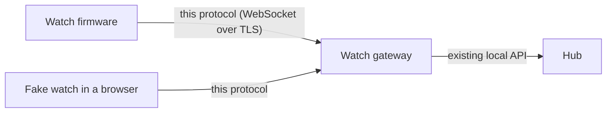

# Proposal: the watch display protocol

**The question:** what do a watch and the hub side say to each other so that the
assistant owns the watch's screen, hears its microphone and speaks through it?

This is a proposal, not a decision. The owner's own rulings are listed first;
everything after that section is the author's recommendation.

## What the owner has ruled

- The assistant owns the watch and draws on its screen (#3672).
- The first watch is a LilyGo T-Watch Ultra (ESP32-S3, 410 x 502 AMOLED). No
  Pebble.
- The watch reaches the hub over Wi-Fi or a phone hotspot. Bluetooth is not
  used for the hub link.
- Battery life does not matter for this proof of concept.
- The watch should be able to show anything, "likely through different
  methods".
- Everyday screens follow one designed style; the assistant draws freely only
  when it has something special to show.
- Video is not important. Some animation is wanted. Where motion costs
  something, sharpness is given up first.
- The screen is off when the assistant has nothing to say.
- The assistant should guess what the owner wants next and put it one tap away.
- This is for the watch only for now, not for other screens.
- Display works in three layers: pictures rendered on the hub side, a few
  helpers the watch runs itself, and animation (built-in effects, then
  flipbooks, with vector animation later).
- Five optimizations are in: an image format of our own, a cache on the watch,
  instant navigation on a press, layers that the watch can move, and a
  black-background style.
- Ruled 2026-11-24, in answer to four questions put with options:
  - **A press.** The watch's link sits at weak: an enrolled device of the
    owner's, held by someone. A press answers a card whose call needs weak.
    For a card that needs more, the watch asks for a PIN, and the PIN counts
    for that one approval only (the owner's words: "weak, but if a approval
    comes for something higher, it only requires the pin for that specific
    approval").
  - **Admission.** The existing device rule, unchanged: the owner enrols the
    watch, and the secret and the hub's identity are written to it over USB
    when it is flashed. It presents the secret on every connect, over TLS.
  - **Route.** Ruled first as a public door (the watch gateway listening on
    the public internet on the hosted box, over TLS). Changed 2026-11-26, see
    below.
  - **Channel.** The watch has a channel of its own for its screen, microphone
    and speaker, as its own place. Its audience is the owner alone.
- Ruled 2026-11-26 ("Lets try to do private"): the watch joins the private
  network itself, as the owner's laptop and phone do, so admission stays
  ADR-0124's as written. The public door is the fallback, not the plan. The
  earlier ruling rested on a statement of mine that the chip has no Tailscale
  client, which was not checked and is wrong: a community client for the
  ESP32-S3 exists (MicroLink).

## Baseline

- #3672, the watch design note. It still says the owner wants two watches; that
  line is out of date.
- ADR-0094 §1 and §2: a spoke reaches the hub across a process boundary, and the
  edge always dials out. §10 defers all `core` surface for spokes until a second
  spoke exists.
- ADR-0292 §2, §4, §7 and §8: spokes, channels and places; one connection per
  device; output goes through an actuator; a spoke reports its hardware limits
  as facts.
- ADR-0205: delivery is a fact the device reports, never assumed.
- ADR-0084 §3: one protocol version, matched exactly, refused at connect.

No wiki page was read for this proposal. To the author's knowledge none
describes a watch.

## Scope

The protocol runs between the watch and a **watch gateway**, a small program
beside the hub. The gateway speaks this protocol on one side and the hub's
existing local API on the other, as the browser and Telegram gateways do. The
hub's own wire does not change.



The gateway also renders screens. A screen is written as HTML or SVG, turned
into an image on the hub side, and sent to the watch as that image. The watch
never sees HTML or SVG.

A fake watch that runs in a browser speaks the same protocol. It is the first
client and stays as the test double.

## 1. Connection

- The watch opens one WebSocket over TLS to the gateway and keeps it open. The
  gateway never dials the watch.
- Text frames carry JSON messages. Every message has a `type`.
- Binary frames carry image and audio data. Each starts with an 8-byte header:
  one byte for the kind (1 image, 2 audio), one byte of flags, two reserved
  bytes, and a four-byte id, little-endian. The data follows.
- Either side may send `ping`; the other answers `pong`. A watch that hears
  nothing for a set time treats the link as down.

## 2. Starting a session

The watch sends `hello` first:

```json
{"type": "hello", "version": 1, "device": "watch-7f3a",
 "screen": {"w": 410, "h": 502, "depth": 16, "byte_order": "big"},
 "images": ["wi1", "jpeg"], "max_image_bytes": 262144,
 "max_layers": 4, "cache_bytes": 2097152, "max_screen_pixels": 960000,
 "max_staged": 4, "max_flipbook_bytes": 2097152,
 "effects": ["fade", "slide-left", "slide-right", "slide-up", "slide-down"],
 "buttons": ["side"], "audio": ["pcm16-16k-mono"],
 "audio_buffer_ms": 2000, "max_listen_s": 30,
 "has": ["mic", "speaker", "buzz", "wrist"]}
```

Everything after `device` is the watch stating what its hardware can do. These
are facts, not permission (ADR-0292 §8).

The gateway answers `welcome` with the current time and the owner's time zone
(`time_ms` and `tz_offset_min`), or `refused` with a reason. The watch needs
the time zone to show local time. A version that does not match exactly is refused.

How the watch proves which device it is, and how it was admitted, is left open
below.

## 3. Screens (layer 1)

A screen is a short stack of layers, each one image, plus what the watch should
do with them.

```json
{"type": "screen", "id": 41,
 "effect": "slide-up", "sleep_after_s": 20,
 "layers": [
   {"id": "back", "image": "3fa9c1d2e07b4a66", "x": 0, "y": 0},
   {"id": "body", "image": "b81e55f0a2c94d13", "x": 0, "y": 60,
    "pan": "vertical"}
 ],
 "regions": [
   {"id": "call", "layer": "body", "x": 20, "y": 340, "w": 370, "h": 80,
    "feedback": "highlight"}
 ],
 "overlays": [
   {"kind": "clock", "x": 20, "y": 16, "glyphs": "0c4d2e9a71b35f88"}
 ]}
```

- Layers are drawn bottom to top. An upper layer may have see-through parts.
  A layer may carry a starting `opacity` from 0 to 1, so it can begin hidden
  and fade in.
- An image is named by a hash of its content. If the watch already holds that
  image, nothing is sent. If not, the watch answers `need` with the hashes it
  lacks and the gateway sends them. While a message waits for an image, the
  watch holds every later message behind it, so order is kept.
- Before each image's binary frame the gateway sends `{"type": "image",
  "id": 9001, "hash": "b81e55f0a2c94d13", "format": "wi1", "w": 410, "h": 900,
  "bytes": 6120, "keep": false}`.
- `keep: true` asks the watch to store the image in flash, so it survives a
  restart. Backgrounds, icons and the fixed parts of everyday screens are kept.
  The watch drops the least recently used images when the cache is full.
- `update` changes one rectangle of one layer. It is how text appears as it
  arrives, and how small changes avoid a full resend.
- `update`, `flipbook` and `move` each name the screen they change. The watch
  may have moved to another screen by itself (section 4), so "the current
  screen" is not a safe target.
- `stage` sends a screen without showing it. `show` shows a staged screen.
  The watch keeps a few staged screens ready, so a screen can appear the moment
  the wrist rises, with no network wait. This is what makes "one tap away"
  quick.
- `stage` with `"wake": true` marks the screen to show when the wrist rises.
  The newest one marked wins.
- `clear` turns the screen off.
- A screen whose layers hold more pixels between them than the watch's
  `max_screen_pixels` is refused with the error `too-large`. Decoded pixels
  are what fill the watch's memory, so the limit is on them and not on bytes
  sent.
- The watch may drop a staged screen that is not on show when it needs the
  room. `show` for a screen it no longer holds answers the error `not-staged`,
  and the gateway sends it again.
- `screen` for the id that is already on show replaces it in place. Each layer
  that keeps its name stays scrolled where the person left it. This is how a
  layer grows, since a layer's size is fixed.

Everyday screens use a black background. On this kind of display black pixels
are switched off, black costs almost nothing to send, and it wears the screen
less.

### The image format

Sharp images use a format of our own, called `wi1` here. Photos use JPEG.

- Pixels are stored in the display's own 16-bit colour format and byte order, so
  decoded pixels go to the display with no conversion.
- The hub side reduces the colours and smooths gradients, since it holds the
  full-colour original.
- The image is cut into horizontal strips. Each strip decodes alone, so the
  watch can decode one strip and push it while the next arrives.
- Inside a strip there are four instructions: these exact pixels; repeat the
  last pixel N times; reuse a recently seen colour; and skip N pixels.
- "Skip" means "see-through" in a layer image and "unchanged" in an `update` or
  a flipbook frame. A frame can therefore carry only what differs from the one
  before.
- A pixel is either solid or skipped; there is no partial see-through. Smooth
  edges of text and shapes therefore have to be drawn against the colour that
  will be behind them. That is free on a black background. A layer laid over a
  photo would show rough edges.

This is close to the published QOI format, changed to fit a 16-bit display and
given the skip instruction. The exact byte layout is left to be settled by
measuring it on the chip.

## 4. Helpers the watch runs itself (layer 2)

- **Regions.** A tap inside a region shows its feedback at once and is reported.
  The watch does not know what the region means.
- **Instant navigation.** A region may carry `"on_press": {"show": 42,
  "effect": "slide-left"}`. The watch then shows staged screen 42 at once and
  reports the press, saying it did so. If screen 42 is not staged, the watch
  only reports the press.
- **Panning.** When a layer's image is larger than the display, the watch
  scrolls it locally. `pan` is `none`, `vertical` or `both`.
- **Overlays.** Things the watch draws on top and keeps current alone: a
  `clock`, a `timer` that counts down to an instant the gateway gives, a
  `presence` mark, and the assistant's `mark`.
- **The mark.** `{"kind": "mark", "x": 35, "y": 6, "size": 340, "colour": ...,
  "listen": ..., "signal": ...}` is the assistant's own sign, which the watch
  draws and moves itself because pictures of it could not be sent fast enough.
  It needs no message: the watch shows the link cut, the microphone open, or
  the assistant working (`presence: thinking`) from what it already knows.
- **Digits.** The watch holds no font. A clock or timer names a `glyphs` image
  the hub drew: eleven equal cells, the digits 0 to 9 and then a colon. The
  watch builds the time from those cells, so the digits match the screen's own
  typeface.
- **Presence.** `{"type": "presence", "state": "listening"}` switches a built-in
  animation: `idle`, `listening`, `thinking` or `speaking`.
- **Fallback.** `fallback` is a screen the watch stores in flash and shows when
  the link is down, with an offline mark.

## 5. Animation (layer 3)

- **Effects.** A `screen` or `show` names one effect from the list the watch
  reported. The watch runs it alone.
- **Moves.** `{"type": "move", "screen": 41, "layer": "body", "to": {"x": 0, "y": -200},
  "opacity": 1.0, "ms": 300, "ease": "out"}` slides or fades a layer. The watch
  runs it alone, so nothing is decoded or sent while it plays. Most animation
  should be a move.
- **Flipbooks.** `flipbook` gives a screen, a layer, a frame rate and whether
  it loops. The frames follow as images, each carrying only what
  changed from the one before. Small flipbooks are kept decoded and play at
  full speed. Full-screen ones stay compressed; how fast they play depends on
  how much changes per frame and is not yet measured.
- **Later:** vector animation files (Lottie), and a live stream of JPEG frames
  for a camera or a moving map. Neither is in version 1.

## 6. Input

The watch reports what happened, never what it means.

```json
{"type": "input", "screen": 41, "kind": "press", "region": "call",
 "at_ms": 1532, "did": {"show": 42}}
```

`did` is present only when the watch acted on the press itself (section 4). It
may also carry `"listen"` or `"listen_end"` with the stream's number when the
press opened or closed the microphone (section 7).

- Kinds: `press`, `long-press`, `tap` (outside any region, with x and y),
  `pan-end` (with the offset), `button` (which one, and short, long or double),
  `wrist-up`, `wrist-down`.
- Every input names the screen it was made on. The gateway can then refuse a
  press that was made on a screen it has already replaced.
- A press made while the link is down is dropped, not queued. A late approval
  is worse than a lost one.

## 7. Audio

- `audio-start` opens a stream with a number and a format. Chunks follow as
  binary audio frames carrying that number. `audio-end` closes it.
- Both directions use the same three messages. The watch numbers its streams
  with odd numbers and the gateway with even ones, so a number names one stream.
- Version 1 has one format: 16 kHz, 16-bit, mono, uncompressed, least
  significant byte first. The watch sends a tenth of a second per frame.
- `audio-stop` from either side cuts a stream short.
- **One direction at a time.** Opening the microphone cuts whatever is playing,
  and a stream from the gateway closes the microphone. The speaker never feeds
  the microphone, and the owner talks over a reply by starting to talk.
- **Opening the microphone.** A region may carry `"on_press": {"listen": true}`.
  The watch then opens the microphone at once and says so in `did`, the same way
  as instant navigation. The gateway may also send `listen`.
- **Closing it.** The gateway decides when the person has finished and sends
  `audio-stop`. The watch answers by sending what it still holds, then
  `audio-end`. A press on a listening region while the microphone is open closes
  it too.
- **The watch closes it alone** after a limit it states in `hello`
  (`max_listen_s`), when the screen goes off, and when the link drops. It does
  not record while the link is down.
- **An open microphone is always shown.** The watch draws its own mark while it
  is open, on top of any screen, and keeps the screen on. No screen the hub
  sends can hide it.
- **Pace.** The watch holds a short stretch of sound for the speaker and states
  how much in `hello` (`audio_buffer_ms`). The gateway sends at the pace of
  speech, a little ahead. Sound that does not fit is lost and reported once.
- Sound does not wait for pictures: an audio message is handled when it arrives
  even if a screen before it is still waiting for an image.

## 8. Reports

- `shown`: this screen is on the display now.
- `played`: this audio stream finished, or was cut short. It says which, and
  how many milliseconds reached the speaker, so the hub knows how much of a
  reply was heard.
- `status`: battery, charging, signal strength, on the wrist or not.

`shown` and `played` exist because the hub treats delivery as something the
device reports (ADR-0205).

## 9. The rest

- `buzz`: vibrate, with a pattern name.
- `text`: plain text with no image. It is the fallback when rendering fails and
  the form a slow link such as LoRa could carry. It is the one message that
  needs a font on the watch, which nothing else does.
- `act`: reserved for the watch acting on other things (typing on a nearby
  machine, infrared, LoRa). Not specified here.
- `error`: either side reports a message it could not use, naming it. An
  unknown `type` is reported and otherwise ignored.

## Tried in a prototype

The protocol was built twice against this text in a separate local project
(`~/projects/assistant-watch`), outside this repo: first as a fake watch
written for a browser, then as the watch's own screen engine and image decoder
in C, which the fake watch now runs. A test gateway plays a fixed demo in place
of the hub.

Screens, the image format, the cache, regions, instant navigation, panning,
updates, flipbooks, moves, effects, overlays, the wake screen and the offline
fallback all ran. TLS, admission, JPEG and the `text` message were not
built.

Eight points in the text above came from those builds: the wake mark, a
layer's starting opacity, naming the screen in `update`, `flipbook` and `move`,
the limit on see-through, digits sent as an image, the time zone in `welcome`,
keeping order while waiting for an image, and the font that `text` needs.

The hub-side renderer was built third. A screen is written as HTML, with inline
SVG where wanted, and a headless browser draws it with scripts off and the
network off. Attributes on the page mark its layers, press regions and
overlays, so their places are measured from the page and never written by hand.
It changed nothing in the protocol. What it showed:

- One render took about 70 ms on a desktop PC, not measured on the hub's
  server. A two-layer screen is ready well inside a second.
- The same page gives the same images each time, so the content-hash cache
  holds across renders.
- Streamed text is the same page rendered with more words shown. Every word is
  laid out from the start, so none moves and each step is one small `update`.
- A flipbook is the same page rendered once per frame, keeping one layer.
- The digit image for a clock or timer is drawn in the font and colour of the
  element that marks its place.

Audio was built fourth, in the engine, the fake watch and the test gateway.
The test gateway first played back what it heard, which checks every sample
both ways. It then gained speech recognition and a voice running on the same
machine, with no change to the protocol or the watch: about 0.8 s to
transcribe a short question and 0.2 s to speak a sentence on a desktop PC.
Which speech service the hub uses is not decided here. Section 7 was rewritten from that
build. Everything in it beyond the first, third and fifth points came from it.
Two choices in it are mine and not yet ruled: that the gateway may open the
microphone with `listen`, and that the hub, not the watch, decides when the
person has finished talking.

Admission and the PIN were built fifth, after the owner's rulings on them.
`hello` carries a `credential`, the secret written to the watch when it was
enrolled; the gateway keeps only a hash, reads nothing but `hello` until it
matches, and otherwise answers `refused` with reason `not-admitted` and
closes. The secret is in the first message, so the link must be TLS. The PIN
needed nothing new on the watch: the keypad is an ordinary screen and the
digits reach the gateway as ordinary presses, which it compares itself. Two
things this showed: a denial needs the PIN as an approval does (ADR-0377 §3),
and the digits are visible to whatever logs presses, so a gateway must keep
presses on a PIN screen out of its logs.

TLS was built sixth, on the test gateway. The gateway makes and signs its own
certificate, and a watch is given it at enrolment and trusts no other, which
is ADR-0124 §4's enrolled hub identity in another form. The first build
admitted on the secret alone, which is the design ADR-0124 refuses; the second
signs a certificate for each watch and admits only on both. The C engine ran
against the gateway over a real TLS socket. The chip's own TLS client is not
written.

The engine was built seventh as real firmware for the ESP32-S3 (ESP-IDF 5.5)
and run in Espressif's emulator with the watch's 8 MB of external memory. It
was admitted by the test gateway, drew the demo's screens and carried an
approval through the PIN, with touches typed on a console. Measured there: the
engine is 23 KB of code and 29 KB of fixed memory; the whole firmware with
Wi-Fi is 927 KB; the demo peaked at 2.2 MB of external memory, 1.7 MB of it
four whole frames the engine always holds. A cache grown to the 4 MB that
`hello` advertises would leave about 1 MB of the 8, which is too tight beside
a private network client, so `cache_bytes` or the frames held must come down.
The emulator has the chip's memory and not its speed: decode time, display
push rate and Wi-Fi throughput are still unmeasured (item 9). The watch's own
board file compiles and has never run; its power chip, touch and buzzer are
not written.

The memory was cut eighth. The engine now holds one whole frame and the
firmware one: a transition draws the new screen in place and uses the engine's
frame for the old screen. Decoded pixels are counted and capped, which is
where `max_screen_pixels` and the dropping of staged screens in section 3 come
from, and `cache_bytes` is 2 MB. At their limits the frames, decoded pixels,
stored images and sound take about 5.2 MB of the 8, leaving about 3 MB for the
network. The same demo now peaks at 1.6 MB in the emulator.

Answers that arrive in pieces were built ninth. The test gateway asks a model
(Claude, through a command on the PC; not the hub, and it knows nothing about
the owner), cuts the answer into sentences as it is written, and shows and
speaks each one. One audio stream carries the whole answer, with silence where
the next sentence is still being made. With a question spoken in 1.5 s, the
first sound of the answer came 3.5 s after the question ended, all of it spent
on the PC. Three things came out of it. A layer's size is fixed, so a growing
answer means sending the screen again, which is the in-place `screen` of
section 3. Nothing lets the watch keep the newest text in view. And the text
reaches the screen a sentence before the voice says it (item 12).

A watch face and a message screen were built tenth, as a first design of the
everyday screens (item 7): the time drawn by the watch, the date, what is next
and what is waiting drawn by the hub side, and "Ask", which opens the
microphone with no wait.

The mark was built eleventh, with a new face and a "one thing" screen around
it. The face is the mark over the time; when one thing matters now (a message,
where to be next, a card to approve) the face gives way to a screen with that
one thing in large type and the mark small in a corner. The mark shows three
things only, by the owner's word: that the assistant is there or cut off, that
the microphone is open, and that it is working. What is waiting belongs to the
"one thing" screen. With the microphone open the watch also lights the edge of
the display, so that people nearby can tell. The type and the colours are a
first choice and not ruled. The mark brings the engine to 35 KB of code and 34 KB
of fixed memory. A moving mark changes most of its square on every frame, twenty
to thirty times a second; whether the real chip and display keep up is not
known without a watch. Which things earn the "one thing" screen, and who
decides, is the hub's to say and is open.

Tools for the model were tried twelfth, as one answer to item 7. The model that
answers is given four tools and never the protocol: `show` (one thing: a label,
a headline, a detail), `ask` (a question with two answers, which returns the one
touched), `timer` and `buzz`. The gateway carries each out on the fixed screens,
with the model's words cut to length and put in as text, so a model cannot
draw. When a tool puts a screen up, the spoken answer is heard and not shown.
A small model used them as meant: it started a countdown when asked for one,
used none for an ordinary question, and said it could not send a message. Not
decided, and the hub's to say: whether these are tools in the hub's registry,
what each needs from permissions (a buzz interrupts a person), and how a work
that did not start at the watch may reach it.

One thing the engine does is not protocol but shapes it: the watch frees a
screen's decoded pixels when it leaves the screen, unless an update or a
flipbook changed them, because those cannot be rebuilt from the stored image.

## Options considered

| Option | Why not, or why |
| --- | --- |
| Pictures rendered on the hub side | Chosen as the base: shows anything, simplest firmware, the fake watch matches exactly |
| Helpers on the watch | Chosen: touch feels instant |
| Flipbooks, moves and built-in effects | Chosen for animation |
| Our own image format | Chosen over PNG: no colour conversion on the chip, cheap to decode, frames can carry only changes |
| PNG | Dropped: slow to decode on this chip, and nothing needs it once the fake watch reads our format |
| A stream of JPEG frames | Later; same decoder, the owner ranked video low |
| H.264 video | The chip decodes it only at about 320 x 192 |
| Remote desktop (VNC) | Built for desktops; no audio, no regions; 6 to 20 frames a second in hobby projects |
| SVG or Lottie drawn on the watch | Slow full-screen, partial SVG support; kept for later small animations |
| A widget list (openHASP, LVGL XML, A2UI) | The watch would own the layout |
| A drawing-command list of our own | Pictures cover it without a new format to teach models |
| Programs sent to the watch (JavaScript, WebAssembly) | A large build and a safety question; not needed yet |
| Existing assistant firmware (xiaozhi) | Fixed text-and-emoji screen |

Figures behind the table, none measured on this watch: JPEG decode of about
13 frames a second at 640 x 480 (Espressif); H.264 at 23 to 27 frames a second
at 320 x 192 (Espressif); about 32 frames a second pushed to a similar
466 x 466 screen (Waveshare).

## What this leaves open

1. **The PIN.** Ruled, shape included ("Yes, as put", 2026-11-24): the hub
   checks the digits, not the watch; it raises that one answer to normal and
   never to strong; the answer records that a PIN raised it; five wrong tries
   lock raising until the owner clears it elsewhere. ADR-0377 §2 reads a
   tap's level from the link it arrived by, so a raise for one tap needs a
   decision of its own before the hub builds it.
2. **Admission.** Ruled. Left to its decision: where the secret sits in the
   watch's flash, and what a lost watch costs (ADR-0124's expelling a device).
3. **The route.** Ruled: the private network first. Not verified: that the
   community Tailscale client (MicroLink) runs on the watch beside the display
   and sound, that it lets the watch check the hub's overlay identity before
   sending anything (ADR-0124 §4), and how it fares when Tailscale changes its
   protocol. If it fails, in order: fix it; a plain WireGuard tunnel from the
   watch to the hosted box (ADR-0124 §2 is not conditioned on Tailscale); the
   public door. A public door cannot leave admission unchanged: ADR-0124 §7
   admits on two facts and its alternatives refuse "a public TLS listener with
   a bearer token" by name, so the prototype's door gives each watch a
   certificate as the second fact. A phone's hotspot does not carry the
   phone's Tailscale to the watch, by users' reports. None of this can be
   tried before there is hardware.
4. **Channels.** Ruled. Not yet checked clause by clause against ADR-0292 §2
   and §9; that is owed when this becomes a decision.
5. **`core` surface.** Whether the watch is the second spoke that fires
   ADR-0094 §10, and what that owes.
6. **Where the gateway and the renderer live** in the tree, and which renderer
   (HTML needs a headless browser; SVG needs only a small library).
7. **Who writes a screen.** The templates for everyday screens, and how the
   assistant asks for a free drawing.
8. **Predicted shortcuts.** What decides the staged screens. This is the
   assistant's work, not the protocol's.
9. **Measurement.** Decode speed, screen push rate and Wi-Fi throughput on the
   real watch. The claim that our image format decodes much faster than PNG is
   an estimate; a bare ESP32-S3 board can time it before the watch arrives.
10. **When the microphone may open.** Section 7 lets a press open it and lets
    the gateway ask. Whether the gateway should be able to, and whether a wake
    word belongs on the watch, is the owner's to rule.
11. **Later parts:** the `act` family, the JPEG stream, vector animation,
    compressed audio, a LoRa text path.
12. **A spoken answer on the screen.** Whether the words should keep time with
    the voice, and whether a layer can be told to follow its end as text is
    added. The prototype shows each sentence whole, ahead of the voice, and
    leaves the scrolling to the person.

## Sources

- Espressif JPEG component:
  <https://docs.espressif.com/projects/esp-techpedia/en/latest/esp-friends/solution-introduction/multimedia/component-description/esp-new-jpeg.html>
- Espressif H.264 component:
  <https://docs.espressif.com/projects/esp-techpedia/en/latest/esp-friends/solution-introduction/multimedia/component-description/esp-h264.html>
- Waveshare AMOLED guide and benchmark:
  <https://docs.waveshare.com/ESP32-Peripheral-Tutorials/Display/AMOLED>,
  <https://files.waveshare.com/wiki/common/Performance.pdf>
- T-Watch Ultra: <https://wiki.lilygo.cc/products/t-watch-series/t-watch-ultra/>
- VNC on ESP32: <https://github.com/moononournation/ArduinoVNC>
- Vector animation on ESP32-S3:
  <https://wiki.seeedstudio.com/round_display_animation_workshop/>
- openHASP: <https://haswitchplate.github.io/openHASP-docs/0.6/design/objects>
- LVGL XML: <https://docs.lvgl.io/9.3/details/auxiliary-modules/xml/intro.html>
- A2UI:
  <https://developers.googleblog.com/a2ui-10-build-delightful-fast-reliable-agentic-experiences/>
- xiaozhi-esp32: <https://github.com/78/xiaozhi-esp32>
- QOI image format (cited from memory, not re-read): <https://qoiformat.org/>
